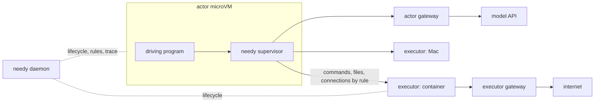

<h1 align="center">Needy</h1>

Needy separates the program that drives work from the environments where that
work takes effect.

- Run the driving program, such as an agent harness or a test suite, in a small
  stateless microVM: the **actor**.
- Route its commands, file access and network traffic by declarative rules to
  **executors**: containers, microVMs, pods or real devices such as a Mac.
- Record every operation, inject faults, and build each machine from a
  **recipe** that fixes its identity: OS, kernel, CPU, firmware and devices.

> [!NOTE]
> Needy is being redesigned around this model. The code in this repository is
> the previous prototype and will be replaced. See the
> [design notes](docs/ai/references/INDEX.md).

## Table of Contents

- [Use cases](#use-cases)
- [Concepts](#concepts)
- [How it works](#how-it-works)
- [Documentation](#documentation)
- [Development](#development)
- [Acknowledgements](#acknowledgements)

## Use cases

- **Agent RL rollouts and evaluations.** Run many cheap, isolated harnesses
  near the inference cluster, while their tools run where the workspace,
  devices and services are. Let an agent replace its own harness, then ask what
  machine it runs on.
- **Integration tests.** A test suite drives services and devices on other
  machines through one routing and recording layer.
- **Acceptance environments.** Build a machine from a recipe, run the
  acceptance script against it, and read the report.

## Concepts

| Term | Meaning |
| --- | --- |
| **actor** | Runs the driving program. Usually one stateless microVM. |
| **executor** | Where routed operations take effect: a container, microVM, pod or device. Several actors may share one executor. |
| **daemon** | The control plane: lifecycle, routing rules, network gateways and the trace. |
| **recipe** | One machine: image, kernel, CPU, memory, firmware, devices and network identity. |
| **profile** | One session: which recipes to use, routing rules, network policies, chaos and file mappings. |
| **session** | One actor and the executors bound to it. |
| **trace** | Every event recorded during a session. |

## How it works



- **Route.** Exec, file and network operations go to the actor or an executor
  by declarative rules. The program sees ordinary PIDs, pipes, terminals and
  exit codes.
- **Observe.** Every operation and decision is recorded. `needy report` writes a
  human-readable summary; the trace exports to JSONL, SQLite and OpenTelemetry.
- **Shape.** Inject faults such as `EIO`, delays or overheating sensors, and
  build machines whose identity comes from a recipe.

The actor and the executors use separate networks. The actor's network sits
near its main dependency, such as inference, and its gateway injects
credentials so the actor never holds them. The executors' network sits near
what the work operates on and carries most audit rules.

## Documentation

- [Actor and executor separation](docs/ai/references/architecture/2026-11-09-actor-executor-separation-design.md):
  model, terms, network and experiments.
- [CLI, exec streams and reports](docs/ai/references/cli/2026-11-09-cli-exec-and-report-design.md)
- [Profiles and rules](docs/ai/references/config/2026-11-09-profile-and-rules-design.md)
- [Recipes](docs/ai/references/config/2026-11-09-recipe-design.md)
- [Where documents go](docs/README.md)

## Development

```sh
make check
make test
make proto
```

Linux kernel tests must run on Linux; macOS cannot exercise ptrace.

## Acknowledgements

Needy borrows from, was compared against, or was tested with these projects.
Thank you to their authors.

**Built on**

- [Firecracker](https://github.com/firecracker-microvm/firecracker): the actor
  microVM; needy carries a patch for CPUID, SMBIOS and PCI identity.
- [sshfs](https://github.com/libfuse/sshfs) and OpenSSH `sftp-server`: file
  routing in passive mode, an idea taken from
  [Lima](https://github.com/lima-vm/lima)'s reverse-sshfs mounts.
- [tonic](https://github.com/hyperium/tonic), [prost](https://github.com/tokio-rs/prost),
  [Buf](https://github.com/bufbuild/buf) with the
  [neoeinstein](https://github.com/neoeinstein/protoc-gen-prost) plugins,
  [tokio-vsock](https://github.com/rust-vsock/tokio-vsock),
  [portable-pty](https://github.com/wezterm/wezterm/tree/main/pty),
  [hyper](https://github.com/hyperium/hyper),
  [rusqlite](https://github.com/rusqlite/rusqlite) and
  [brush](https://github.com/reubeno/brush)'s shell parsing approach.

**Design references**

- [AUV](https://github.com/moeru-ai/auv): repository layout, documentation
  structure, Buf workflow and agent skills.
- [agentsh](https://github.com/canyonroad/agentsh): human and JSON output modes,
  session reports, composite trace storage and its platform comparison.
- [Reverie](https://github.com/facebookexperimental/reverie) and
  [Hermit](https://github.com/facebookexperimental/hermit): syscall
  interception, chaos scheduling and virtual time.
- [kbox](https://github.com/sysprog21/kbox): seccomp user notification, FD
  injection and shadow memfds.
- [mirrord](https://github.com/metalbear-co/mirrord): running a local process
  against remote resources.
- [containerd shim v2](https://github.com/containerd/containerd/blob/main/api/runtime/task/v2/shim.proto):
  the process lifecycle API.
- [rclone](https://rclone.org/filtering/), [Mutagen](https://mutagen.io/) and
  [Lima mounts](https://lima-vm.io/docs/config/mount/): file mapping and
  filters.
- [Codex](https://github.com/openai/codex/pull/7127) and
  [Claude Code](https://code.claude.com/docs/en/permissions) permission rules:
  matching shell commands.
- [macstab chaos-testing-libraries](https://github.com/macstab/macstab-chaos-testing-libraries):
  rule-based syscall fault injection.
- [DeepSeek DSec](https://arxiv.org/html/2609.22978v1): sandbox infrastructure
  for agent RL at scale, and the agent attacks it reports.

**Compared or tried**

- Isolation: [gVisor](https://github.com/google/gvisor),
  [Kata Containers](https://github.com/kata-containers/kata-containers),
  [Cloud Hypervisor](https://github.com/cloud-hypervisor/cloud-hypervisor),
  [libkrun](https://github.com/containers/libkrun),
  [apple/container](https://github.com/apple/container) and
  [Containerization](https://github.com/apple/containerization),
  [agentc](https://github.com/laosb/agentc),
  [microvm.nix](https://github.com/astro/microvm.nix),
  [Incus](https://github.com/lxc/incus) and [lxcfs](https://github.com/lxc/lxcfs).
- OS identity: [Darling](https://github.com/darlinghq/darling) (tested),
  [Wine](https://www.winehq.org/),
  [tart-skills](https://github.com/jonnyzzz/tart-skills),
  [faux-mac](https://github.com/stpettersens/faux-mac),
  [fake-uname](https://github.com/brenkem/fake-uname) and
  [fakehostname](https://github.com/dtcooper/fakehostname).
- Agent sandboxes and policy:
  [Anthropic sandbox-runtime](https://github.com/anthropics/sandbox-runtime),
  [E2B](https://e2b.dev/), [Modal](https://modal.com/),
  [AgentSentinel](https://github.com/abhinandanpandey-in/agentsentinel) and
  [safe-agent](https://github.com/TurboRx/safe-agent).
- Observation and faults: [Tetragon](https://github.com/cilium/tetragon),
  [Falco](https://github.com/falcosecurity/falco),
  [libfiu](https://github.com/albertito/libfiu), `strace --inject` and the
  kernel fault-injection framework.
- From the earlier research: [PRoot](https://github.com/proot-me/proot),
  [LKL](https://github.com/lkl/linux), [LegoOS](https://github.com/Wuklab/LegoOS)
  and [Telepresence](https://github.com/telepresenceio/telepresence).
- Driving program and model used in tests: [opencode](https://github.com/sst/opencode),
  [Ollama](https://github.com/ollama/ollama) with Qwen3.

Thanks to [Makito](https://github.com/sumimakito) for CLI design ideas.

