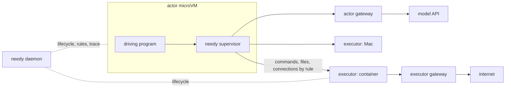

<h1 align="center">Needy</h1>

Needy separates the program that drives work from the environments where that
work takes effect.

- Run the driving program, such as an agent harness or a test suite, in a small
  stateless microVM: the **actor**.
- Route its commands, file access and network traffic by declarative rules to
  **executors**: containers, microVMs, pods or real devices such as a Mac.
- Record every operation, inject faults, and build each machine from a
  **recipe** that fixes its identity: OS, kernel, CPU, firmware and devices.

> [!NOTE]
> Needy is experimental. The first closed loop works: opencode runs in an actor
> while its commands run in Docker or on a Mac. See the
> [results](docs/ai/references/architecture/2026-11-09-closed-loop-results-evidence.md).

## Table of Contents

- [Use cases](#use-cases)
- [Concepts](#concepts)
- [How it works](#how-it-works)
- [Getting started](#getting-started)
- [Documentation](#documentation)
- [Development](#development)
- [Acknowledgements](#acknowledgements)

## Use cases

- **Agent RL rollouts and evaluations.** Run many cheap, isolated harnesses
  near the inference cluster, while their tools run where the workspace,
  devices and services are. Let an agent replace its own harness, then ask what
  machine it runs on.
- **Integration tests.** A test suite drives services and devices on other
  machines through one routing and recording layer.
- **Acceptance environments.** Build a machine from a recipe, run the
  acceptance script against it, and read the report.

## Concepts

| Term | Meaning |
| --- | --- |
| **actor** | Runs the driving program. Usually one stateless microVM. |
| **executor** | Where routed operations take effect: a container, microVM, pod or device. Several actors may share one executor. |
| **daemon** | The control plane: lifecycle, routing rules, network gateways, the trace and the runner registry. |
| **runner** | A machine that joined the control plane and reports what it can host. |
| **recipe** | One machine: image, kernel, CPU, memory, firmware, devices and network identity. |
| **profile** | One run: which recipes to use, routing rules, network policies, chaos and file mappings. |
| **run** | One actor and the executors bound to it. |
| **trace** | Every event recorded during a run. |

## How it works



- **Route.** Exec, file and network operations go to the actor or an executor
  by declarative rules. The program sees ordinary PIDs, pipes, terminals and
  exit codes.
- **Observe.** Routing decisions, routed execs, file transfers, gateway
  requests and faults are recorded as typed events; commands the actor's
  kernel does not route are not. `needy report` writes a summary as plain
  text, markdown or JSON; the trace is stored in SQLite and JSONL, as each profile's
  `trace:` selects. Terminal output is not recorded.
- **Shape.** Inject faults such as `EIO`, delays or overheating sensors, and
  build machines whose identity comes from a recipe.

The actor and the executors use separate networks. The actor's network sits
near its main dependency, such as inference, and its gateway injects
credentials so the actor never holds them. The executors' network sits near
what the work operates on and carries most audit rules.

## Getting started

An actor host needs Linux with KVM and Docker. Executors need only the `needy`
binary: Linux and macOS are fully supported; Windows works without terminals.

```sh
# On the actor host: build the actor image and the executor image.
needy build --executor        # writes $XDG_DATA_HOME/needy/images/default
needy daemon --mode control &

# Run opencode in an actor; its shells run in a Docker executor.
needy run create --profile examples/opencode/profile.yaml
needy run logs -f RUN    # the actor's console, followed
needy report latest
```

For an interactive driving program, use `needy run create -it --profile
PROFILE`. `ctrl-]` detaches; `needy run attach RUN` returns to its terminal.
Automated tests and live probes on a Linux KVM host from a Mac are recorded
in the [interactive actor evidence](docs/ai/references/cli/2026-11-11-interactive-actor-evidence.md).
Rebuild the actor image when updating to this terminal protocol.

Needy keeps the trace and run directories in `$XDG_STATE_HOME/needy`, images in
`$XDG_DATA_HOME/needy`, client tokens in `$XDG_CONFIG_HOME/needy` and the
daemon's socket in `$XDG_RUNTIME_DIR/needy` (the state directory on macOS).
`NEEDY_STATE_DIR`, `NEEDY_DATA_DIR`, `NEEDY_CONFIG_DIR` and
`NEEDY_RUNTIME_DIR` override them; `-v` turns on logs.

On another machine, the CLI pairs once with a code an operator creates with
the control daemon's token (`--token-env`, the bootstrap credential), then
uses its own token, which can be revoked; the trace and `needy report` name it
as `client:NAME`. `run logs` and `report` come from the control plane:

```sh
NEEDY_TOKEN=... needy client pair create --name laptop     # where the control token is
needy --endpoint http://127.0.0.1:7400 client pair CODE    # on the laptop, once
needy --endpoint http://127.0.0.1:7400 report latest
needy client ls; needy client revoke ID
```

`needy exec` runs one command through the same rules, with a terminal when
stdin and stdout are terminals:

```sh
needy run create --profile examples/cli/profile.yaml   # an actor that only waits
needy exec --run RUN -- uname -a
needy exec -t --run RUN -- ssh user@host     # interactive
needy exec -d --run RUN -- pnpm dev          # prints a process ID
needy attach PROCESS                                 # replays recent output
needy exec --output ndjson --run RUN -- make test
needy fs cp ./src build:/home/agent/workspace
```

Another machine, such as a Mac, joins the control plane as a **runner** with a
join token.
A runner dials the control plane and keeps that connection open, so it needs
no listening port, only a way to reach the control plane (such as `ssh -L`).
Transport encryption comes from the tunnel:

```sh
needy runner token create --ttl 1h --roles executor     # on the control host
JOIN=... needy daemon --mode runner --join http://127.0.0.1:7400 --join-token-env JOIN
needy runner ls
needy exec --runner mac -- uname -a                     # on the control host
needy ps --runner mac
```

On Windows, a runner started in an SSH session ends with the session. Start
it outside the session, for example with
`Invoke-CimMethod Win32_Process -MethodName Create -Arguments @{CommandLine='C:\needy\needy.exe daemon --mode runner --join http://127.0.0.1:7400 --join-token-file C:\needy\join.txt'}`
or a scheduled task. Give full paths, and pass the token in a file: the
process does not get the session's environment or working directory.

Profiles place executors and the actor on runners by name or labels, with no
addresses or secrets in the profile:

```yaml
actor: { runner: kvm }                       # the control host's own runner
executors:
  mac: { runner: mac }                       # the Mac's own process space
  build: { runner: { labels: [kvm] }, provider: docker }
```

Actors and Docker executors run on the control host for now: on it directly
(no `runner:`), or on the runner the control daemon names as its own with
`needy daemon --mode control --local-runner kvm`. See
[runners and runs](docs/ai/references/architecture/2026-11-10-runner-and-run-design.md#as-built-slice-5).

Examples:

| Profile | Shows |
| --- | --- |
| [`examples/opencode`](examples/opencode/profile.yaml) | opencode in an actor with a GCE identity, a local model through the gateway, shells in Docker |
| [`examples/macos`](examples/macos/profile.yaml) | A Linux actor running `xcodebuild`, `simctl` and `swift build` on runner `mac` |
| [`examples/smoke`](examples/smoke/profile.yaml) | Routing, the shared workspace and identity probes |
| [`examples/bench`](examples/bench/profile.yaml) | Latency and throughput probes inside an actor, with `cargo xtask bench run` |
| [`examples/local`](examples/local/profile.yaml) | This machine as a native executor for `needy exec --run`: copy-in, mirror-out, chaos and the trace |
| [`examples/chaos`](examples/chaos/profile.yaml) | Copy-in and mirror-out on the actor, a file fault on the workspace, an exec fault and an overheating sensor |
| [`examples/cli`](examples/cli/profile.yaml) | A Docker executor for `needy exec --run`, with an actor that only waits |

`needy profile check PROFILE --cmd "git status"` asks the control plane where
the actor and executors would run, checks the recipe against the CPU of the
actor's host, and shows where commands would run and the chaos faults that
match them; `--local` checks offline against this machine.

## Documentation

- [Actor and executor separation](docs/ai/references/architecture/2026-11-09-actor-executor-separation-design.md):
  model, terms, network and experiments.
- [CLI, exec streams and reports](docs/ai/references/cli/2026-11-09-cli-exec-and-report-design.md)
- [Profiles and rules](docs/ai/references/config/2026-11-09-profile-and-rules-design.md)
- [Recipes](docs/ai/references/config/2026-11-09-recipe-design.md)
- [Closed-loop results](docs/ai/references/architecture/2026-11-09-closed-loop-results-evidence.md):
  what runs, and latency and throughput numbers.
- [Where documents go](docs/README.md)

## Development

```sh
make check
make test
make proto
cargo xtask bench --help      # latency and throughput probes
```


## Acknowledgements

Needy borrows from, was compared against, or was tested with these projects.
Thank you to their authors.

**Built on**

- [Firecracker](https://github.com/firecracker-microvm/firecracker): the actor
  microVM; needy carries a patch for CPUID, SMBIOS and PCI identity.
- [sshfs](https://github.com/libfuse/sshfs) and OpenSSH `sftp-server`: file
  routing in passive mode, an idea taken from
  [Lima](https://github.com/lima-vm/lima)'s reverse-sshfs mounts.
- [tonic](https://github.com/hyperium/tonic), [prost](https://github.com/tokio-rs/prost),
  [Buf](https://github.com/bufbuild/buf) with the
  [neoeinstein](https://github.com/neoeinstein/protoc-gen-prost) plugins,
  [tokio-vsock](https://github.com/rust-vsock/tokio-vsock),
  [portable-pty](https://github.com/wezterm/wezterm/tree/main/pty),
  [hyper](https://github.com/hyperium/hyper),
  [SeaORM](https://github.com/SeaQL/sea-orm) and
  [brush](https://github.com/reubeno/brush)'s shell parsing approach.

**Design references**

- [AUV](https://github.com/moeru-ai/auv): repository layout, documentation
  structure, Buf workflow and agent skills.
- [agentsh](https://github.com/canyonroad/agentsh): human and JSON output modes,
  session reports, composite trace storage and its platform comparison.
- [Reverie](https://github.com/facebookexperimental/reverie) and
  [Hermit](https://github.com/facebookexperimental/hermit): syscall
  interception, chaos scheduling and virtual time.
- [kbox](https://github.com/sysprog21/kbox): seccomp user notification, FD
  injection and shadow memfds.
- [mirrord](https://github.com/metalbear-co/mirrord): running a local process
  against remote resources.
- [containerd shim v2](https://github.com/containerd/containerd/blob/main/api/runtime/task/v2/shim.proto):
  the process lifecycle API.
- [rclone](https://rclone.org/filtering/), [Mutagen](https://mutagen.io/) and
  [Lima mounts](https://lima-vm.io/docs/config/mount/): file mapping and
  filters.
- [Codex](https://github.com/openai/codex/pull/7127) and
  [Claude Code](https://code.claude.com/docs/en/permissions) permission rules:
  matching shell commands.
- [macstab chaos-testing-libraries](https://github.com/macstab/macstab-chaos-testing-libraries):
  rule-based syscall fault injection.
- [DeepSeek DSec](https://arxiv.org/html/2609.22978v1): sandbox infrastructure
  for agent RL at scale, and the agent attacks it reports.

**Compared or tried**

- Isolation: [gVisor](https://github.com/google/gvisor),
  [Kata Containers](https://github.com/kata-containers/kata-containers),
  [Cloud Hypervisor](https://github.com/cloud-hypervisor/cloud-hypervisor),
  [libkrun](https://github.com/containers/libkrun),
  [apple/container](https://github.com/apple/container) and
  [Containerization](https://github.com/apple/containerization),
  [agentc](https://github.com/laosb/agentc),
  [microvm.nix](https://github.com/astro/microvm.nix),
  [Incus](https://github.com/lxc/incus) and [lxcfs](https://github.com/lxc/lxcfs).
- OS identity: [Darling](https://github.com/darlinghq/darling) (tested),
  [Wine](https://www.winehq.org/),
  [tart-skills](https://github.com/jonnyzzz/tart-skills),
  [faux-mac](https://github.com/stpettersens/faux-mac),
  [fake-uname](https://github.com/brenkem/fake-uname) and
  [fakehostname](https://github.com/dtcooper/fakehostname).
- Agent sandboxes and policy:
  [Anthropic sandbox-runtime](https://github.com/anthropics/sandbox-runtime),
  [E2B](https://e2b.dev/), [Modal](https://modal.com/),
  [AgentSentinel](https://github.com/abhinandanpandey-in/agentsentinel) and
  [safe-agent](https://github.com/TurboRx/safe-agent).
- Observation and faults: [Tetragon](https://github.com/cilium/tetragon),
  [Falco](https://github.com/falcosecurity/falco),
  [libfiu](https://github.com/albertito/libfiu), `strace --inject` and the
  kernel fault-injection framework.
- From the earlier research: [PRoot](https://github.com/proot-me/proot),
  [LKL](https://github.com/lkl/linux), [LegoOS](https://github.com/Wuklab/LegoOS)
  and [Telepresence](https://github.com/telepresenceio/telepresence).
- Driving program and model used in tests: [opencode](https://github.com/sst/opencode),
  [Ollama](https://github.com/ollama/ollama) with Qwen3.

Thanks to [Makito](https://github.com/sumimakito) for CLI design ideas.

