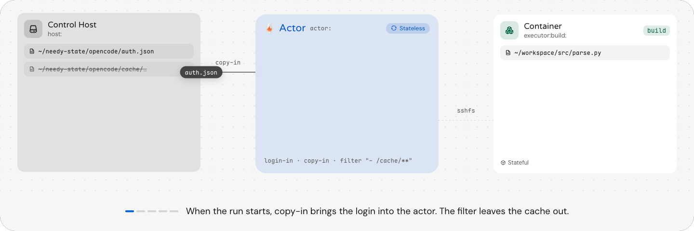
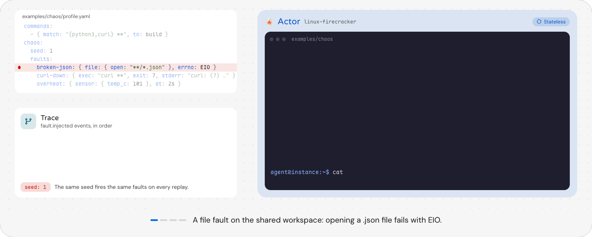
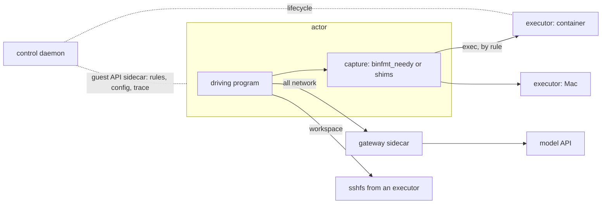

<picture>
  <source width="100%" srcset="./docs/assets/banners/hero-dark.webp" media="(prefers-color-scheme: dark)" />
  <source width="100%" srcset="./docs/assets/banners/hero-light.webp" media="(prefers-color-scheme: light), (prefers-color-scheme: no-preference)" />
  
</picture>

<h1 align="center">Needy</h1>

Needy separates the program that drives work from the environments where that
work takes effect.

- Run the driving program, such as an agent harness or a test suite, in a small
  stateless sandbox: the **actor**.
- Route its commands, file access and network traffic by declarative rules to
  **executors**: containers, microVMs or real machines such as a Mac.
- Record every operation, inject faults, and build each machine from a
  **recipe** that fixes its identity: OS, kernel, CPU, firmware and devices.

> [!NOTE]
> Needy is experimental. Start with a small project directory.

## Table of Contents

- [Getting started](#getting-started)
  - [1. Install](#1-install)
  - [2. Run a coding agent](#2-run-a-coding-agent)
  - [3. Inspect and customize](#3-inspect-and-customize)
  - [Multi-machine setup](#multi-machine-setup)
  - [Other install methods and prerequisites](#other-install-methods-and-prerequisites)
- [Actor drivers](#actor-drivers)
- [Configuration](#configuration)
- [Examples](#examples)
- [How it works](#how-it-works)
- [Architecture](#architecture)
- [Documentation](#documentation)
- [Development](#development)
- [Acknowledgements](#acknowledgements)

## Getting started

### 1. Install

**Linux** (installs `needy` and starts the control daemon user service):

```sh
curl -fsSL https://raw.githubusercontent.com/needy-dev/needy/main/install/install.sh | sh
```

**Apple silicon macOS** (installs `needy`, the guest needy, and `vfkit`, then starts the daemon):

```sh
brew install needy-dev/tap/needy vfkit
needy daemon service install --now
```

(Need `proto`, Windows, source builds, or `NEEDY_NO_DAEMON=1`? See [Other install methods and prerequisites](#other-install-methods-and-prerequisites).)

### 2. Run a coding agent

On **Linux with KVM**, start a built-in coding agent directly — no repo clone
or manual image pull required:

```sh
needy run create -it --profile builtin:opencode
```

Needy also ships `builtin:codex`, `builtin:pi`, and `builtin:herdr`. On the
first local run, needy automatically pulls the release's base VM image, builds
and caches the agent's Dev Container feature layers, and mounts a persistent
sync store for its login and session state (with a SQLite row-merge driver for
OpenCode's database).

The `builtin:*` profiles stay minimal: they declare the agent feature, entry
command, and unrestricted gateway egress (`allow: ["*"]`), without pre-binding
an executor, command routing, or `actor.workspace`. Extend a `builtin:*`
profile to attach an executor (the directory `needy run create` runs in is then
mounted live at `~/workspace`; see [Workspace](#workspace)) or tighten
`actor.network.allow`.

<details>
<summary><b>Apple silicon Mac</b> (<code>macos-vz</code> actor + <code>native</code> executor)</summary>

Save `~/.config/needy/profiles/opencode.yaml`:

```yaml
extends: builtin:opencode
actor:
  driver: macos-vz
executors:
  mac: { driver: native }
commands:
  - { match: "**", to: mac }
unknown: mac
```

```sh
needy run create -it --profile opencode
```

</details>

<details>
<summary><b>Linux without KVM</b> (<code>linux-container</code> actor, requires SSHFS and FUSE 3)</summary>

Install [SSHFS and FUSE 3](#workspace-mount-prerequisites), then save
`~/.config/needy/profiles/opencode.yaml`:

```yaml
extends: builtin:opencode
actor:
  driver: linux-container
  container: { oci_runtime: runc }   # or runsc, if gVisor is installed
```

```sh
needy run create -it --profile opencode
```

</details>

Use `ctrl-]` to detach and leave a run active. Common run commands:

```sh
needy run ls
needy run attach                                # defaults to the only live run
needy run exec latest -- uname -a               # routed through the run's rules
needy run stop                                  # SIGTERM, mirror-out / sync merge, then SIGKILL after --grace
```

### 3. Inspect and customize

Read the trace of the last run (routed commands, denied hosts, injected faults):

```sh
needy run report latest
```

Open an interactive writable shell on an image definition to install tools and
commit the resulting layer to its lockfile (pass `--driver macos-vz` on a Mac):

```sh
needy image edit --profile builtin:opencode
needy image log --profile builtin:opencode
needy image rollback --profile builtin:opencode
needy image export --profile builtin:opencode -o opencode.tar
```

Check where a profile's actor, executors, and commands will run before starting:

```sh
needy config profile check builtin:opencode --mode control --cmd "bash -c pwd"
```

### Multi-machine setup

To run the actor on a Linux host and route child commands to a Mac (or another
Linux/Windows machine) over an SSH tunnel or Cloudflare Access TCP tunnel,
follow the [Linux actor → Mac executor walkthrough](docs/ai/explanations/linux-actor-mac-executor.md).

Quick reference for pairing a remote control client or enrolling a runner:

```sh
# On the control host: enable a loopback TCP listener and replace the service
needy config set daemon.listen '[tcp://127.0.0.1:7400]'
needy daemon service install --replace --now

# Enroll an executor runner (paste the code from `needy runner invite --roles executor`)
needy --address tcp://127.0.0.1:7400 runner join mac --roles executor
needy runner serve

# Or pair a remote control client (paste the code from `needy client invite --name mac-cli`)
needy --address tcp://127.0.0.1:7400 config context pair control
needy config use control
```

Connector argv can carry connections through an authenticated tunnel directly
during pairing or enrollment (for example
`-- ssh -W 127.0.0.1:7400 user@example.com` or
`-- cloudflared access tcp --hostname needy.example.com`). Use a TCP route;
proxied HTTPS hostnames do not carry gRPC through Cloudflare Tunnel.

### Other install methods and prerequisites

Released binaries and images are published on [GitHub Releases](https://github.com/needy-dev/needy/releases)
with `.sha256` checksums and build provenance attestations
(`gh attestation verify <asset> -R needy-dev/needy`). Container images are on
GHCR (`ghcr.io/needy-dev/needy-actor` and `ghcr.io/needy-dev/needy-executor`).

- **Install script options**: `install.sh` verifies `.sha256`, installs to
  `~/.local/bin` (`NEEDY_INSTALL_DIR`, `NEEDY_VERSION`), and installs/replaces
  the user daemon service (`NEEDY_NO_DAEMON=1` skips the daemon on runner-only
  machines). Works on Linux and macOS.
- **proto**:
  ```sh
  proto plugin add needy "https://raw.githubusercontent.com/needy-dev/needy/main/toolchain/proto/needy.toml" --to global
  proto install needy latest --config-mode global --pin global
  ```
- **Windows (executor only)**: download
  [needy-x86_64-pc-windows-msvc.zip](https://github.com/needy-dev/needy/releases/latest/download/needy-x86_64-pc-windows-msvc.zip),
  extract `needy.exe`, and add it to `PATH`.
- **Manual / offline image pulls**: local `run create` and `image build` pull
  missing release base images automatically. For offline or pre-warmed hosts,
  use `needy image pull` (`--driver`, `--file ARCHIVE`), `needy image ls`, and
  `needy image rm`.

<details>
<summary><b>Build from source</b></summary>

```sh
git clone https://github.com/needy-dev/needy && cd needy
cargo install --path crates/cli          # installs `needy`
make guest                               # bin/needy-linux-<arch>, with Docker
cp bin/needy-linux-* "$(dirname "$(command -v needy)")/"
```

Actor images hold no needy binary: the daemon injects its own static Linux
**guest needy** (`needy-linux-<arch>` next to `needy`, or `--guest-needy PATH`).
A dev build has no GitHub release to pull base images from; build them from the
checkout:

```sh
needy image build                                  # host VM base image (needs checkout)
needy image build --linux-container --executor     # or --macos-apple-container on Mac
needy config set daemon.executor_image needy-executor:latest
needy daemon service install --now
```

</details>

<details>
<summary><b>Daemon service management &amp; uninstall</b></summary>

`needy daemon service status` checks the user service (`~/.config/systemd/user/needy.service`
on Linux, launchd on macOS). System services use `--scope system --run-as USER`
(root required). After `brew upgrade needy`, run `needy daemon service install --replace --now`.
For foreground serving during development, run `needy daemon serve`.

To uninstall (keeping state and data directories):

```sh
needy daemon service uninstall                            # if installed
brew uninstall needy                                      # Homebrew
rm -f ~/.local/bin/needy ~/.local/bin/needy-linux-*       # install script
proto uninstall needy && proto plugin remove needy --from global   # proto
cargo uninstall needy-cli                                 # from source
```

</details>

#### Workspace mount prerequisites

For a `linux-container` actor, install SSHFS and FUSE 3 on the **Linux actor
host** (VM actors bundle their own helpers):

<!-- Package sources: docs/ai/references/cli/2026-11-15-workspace-mount-package-sources-note.md -->

```sh
# Debian / Ubuntu
sudo apt-get update && sudo apt-get install -y sshfs fuse3

# Fedora
sudo dnf install -y fuse-sshfs fuse3

# Arch Linux
sudo pacman -S --noconfirm sshfs fuse3
```

Enable `user_allow_other` for the non-root daemon, then verify as the daemon
account without `sudo`:

```sh
sudo sh -c 'grep -qxF user_allow_other /etc/fuse.conf || echo user_allow_other >> /etc/fuse.conf'
command -v sshfs && command -v fusermount3
test -r /dev/fuse && test -w /dev/fuse
docker info --format '{{.ServerVersion}}'
```

## Actor drivers

`actor.driver` picks where the actor runs. The prefix is the operating system
whose isolation the driver relies on.

| | `linux-firecracker` | `linux-container` | `macos-vz` | `macos-apple-container` |
| --- | --- | --- | --- | --- |
| Host | Linux x86_64 with KVM | Linux with a Docker-compatible engine | Apple silicon macOS | Apple silicon macOS |
| Isolation | Firecracker microVM, needy's kernel | `runc` (shared kernel) or `runsc` (gVisor) | Virtualization.framework VM through vfkit, needy's arm64 kernel | Apple `container`: one VM per container, Apple's kernel |
| How execs are caught | kernel module `binfmt_needy` | shims on every `PATH` program of the image | kernel module `binfmt_needy` | shims |
| Ready in | ~0.17 s | | ~0.27 s | ~0.86 s |
| **Routing** | | | | |
| Route a command by name | ✅ | ✅ | ✅ | ✅ |
| Route by absolute path (`/usr/bin/git`) | ✅ | ✅ | ✅ | ✅ |
| Route programs added at run time (`pip`, `npm`, built in the workspace) | ✅ | ❌ | ✅ | ❌ |
| HTTP(S) hostname policy through the gateway | ✅ | ✅ | ✅ | ✅ |
| Workspace mount from an executor | ✅ | ✅ | ✅ | ✅ |
| Copy-in, mirror-out | ✅ | ✅ | ✅ | ✅ |
| Exec and file faults | ✅ | ✅ | ✅ | ✅ |
| Interactive (`-it`, attach, detach) | ✅ | ➖ | ✅ | ✅ |
| **Identity from the recipe** | | | | |
| Hostname | ✅ | ✅ | ✅ | ✅ |
| `/proc/cpuinfo` | ✅ | ✅ | ❌ (arm64) | ❌ |
| `CPUID` | ✅ | ❌ | ❌ | ❌ |
| DMI / SMBIOS | ✅ | ✅ (where the host has DMI; any host under `runsc`) | ❌ | ❌ |
| PCI IDs | ✅ | ❌ | ❌ | ❌ |
| hwmon sensors and the overheat fault | ✅ | ✅ (where the host has hwmon; any host under `runsc`) | ✅ | ❌ |
| Kernel version | ✅ | ❌ (host or gVisor) | ➖ | ❌ |
| Uptime offset | ✅ | ❌ | ➖ | ❌ |

✅ available, ❌ unavailable, ➖ experimental.
`needy config profile check` lists gaps for your recipe and host.
A recipe's `required:` turns a gap into an error.

Executor drivers: `native` (the machine itself: Linux, macOS, Windows) and
`linux-container` (a container through the same engine). A `macos-native`
actor (Seatbelt and shims, no VM) exists as a proof of concept on the
`poc/macos-native-actor` branch.

## Configuration

A profile is YAML; unknown keys are errors, and `extends:` builds on another
profile (including `builtin:opencode`, `builtin:codex`, `builtin:pi`, and
`builtin:herdr`). See the [example profiles](#examples) for complete
configurations.

### Commands

Rules apply in order. A single-valued action takes its first assigned value.
Collections accumulate until `final: true` stops evaluation. A command with
no placement uses `default_executor`, or stays in the actor when none is set.

```yaml
commands:
  - { match: "{bash,sh,zsh} **", to: build }            # glob over the command line
  - { match: "git push **", deny: "no pushes from the agent" }
  - match: "pytest **"
    when: { cwd: "~/workspace/**", tty: false }
    to: build
    timeout: 10m
    env: { set: { CI: "1" } }
```

### Workspace

The directory the work operates on is one setting. The driving program
starts in it.

```yaml
actor:
  workspace:
    path: ~/project                      # in the actor
    from: executor:build:~/project       # live from an executor; or host:PATH (copied in), or omit it
    writable: true
```

`from: executor:NAME:PATH` mounts the executor's directory at `path` and maps
`path` to `PATH` for the commands routed there. `~` is the profile user's home
in the actor, the control host's home on `host:`, and the executor's own home
on an executor side.

Without `actor.workspace`, the workspace is the folder `needy run create`
runs in, mounted live at `~/workspace`, when the executor that runs the
commands (`default_executor`, else the only one) can reach it: a native
executor of the creating client (`runner: { client: true }`), or a native or
`linux-container` executor on the control host when the CLI runs there too
(it reaches the daemon over a Unix socket). Any other executor fails the
create and asks for `workspace.from`. A profile without executors keeps the
actor's home. `run create` prints where the workspace is.

### Files

Named mappings move other files between the control host (`host:`), the actor
(`actor:`) and an executor (`executor:NAME:`). `run_files` lists the ones every
run uses; a rule's `files:` adds some for the commands it matches.

<picture>
  <source width="100%" srcset="./docs/assets/banners/files-dark.webp" media="(prefers-color-scheme: dark)" />
  <source width="100%" srcset="./docs/assets/banners/files-light.webp" media="(prefers-color-scheme: light), (prefers-color-scheme: no-preference)" />
  
</picture>

```yaml
files:
  login-in:                        # copied in when the run starts
    mode: copy-in
    from: "host:~/needy-state/opencode/"
    to: "actor:~/.local/share/opencode/"
    filter: ["- /cache/**", "+ **"]
  login-out:                       # copied back when the run ends (not on `run stop --now`)
    mode: mirror-out
    from: "actor:~/.local/share/opencode/"
    to: "host:~/needy-state/opencode/"
run_files: [login-in, login-out]
```

A `mode: sync` mapping (`from: "host:STORE"`, `to: "actor:PATH"`) shares state
across concurrent runs and survives `run stop --now`: each run works on its
own copy of the store and merges back three-way when it ends, with an
`on-conflict` map (`store`, `run`, `lines`) and pluggable merge drivers (such
as OpenCode's SQLite row-merge driver). Dev Container features can declare sync
mappings under `customizations.needy.files` so agent profiles sync state
automatically. See [Sync mapping](docs/TERMS_AND_CONCEPTS.md#sync-mapping).

### Network

The actor has no network of its own: everything goes through the gateway on
the control host. HTTPS is tunnelled as is (no MITM, no injected CA, and so no
injected headers).

<picture>
  <source width="100%" srcset="./docs/assets/banners/network-dark.webp" media="(prefers-color-scheme: dark)" />
  <source width="100%" srcset="./docs/assets/banners/network-light.webp" media="(prefers-color-scheme: light), (prefers-color-scheme: no-preference)" />
  
</picture>

```yaml
actor:
  network:
    allow: [opencode.ai, "*.opencode.ai"]   # `*.x` also matches `x`
    services:
      ollama:                               # in the actor: http://ollama.needy
        url: http://127.0.0.1:11434         # resolved on the control host
```

A service is a plain-HTTP name the actor uses; the gateway forwards it to
`url`, so the actor never learns the real address. `needy config profile check`
lists the services and warns when a URL does not answer from the control
host.

### Chaos

Named faults, each in one domain, with real effects. They fire from a seed,
so a replayed run injects the same ones; a fault without `probability`,
`nth`, `times`, `after` or `until` fires on every match.

<picture>
  <source width="100%" srcset="./docs/assets/banners/chaos-dark.webp" media="(prefers-color-scheme: dark)" />
  <source width="100%" srcset="./docs/assets/banners/chaos-light.webp" media="(prefers-color-scheme: light), (prefers-color-scheme: no-preference)" />
  
</picture>

```yaml
chaos:
  seed: 1
  faults:
    curl-down:
      exec: "curl **"                   # the command exits 7 without running
      exit: 7                           # or signal: SIGSEGV, hang: true, delay: 2s
      stderr: "curl: (7) Failed to connect\n"
      times: 3
    flaky-json:
      file: { open: "**/*.json" }
      errno: EIO                        # ENOENT, EACCES, EPERM, EOPNOTSUPP or EIO
      probability: 0.1
    slow-example:
      net: { connect: "*.example.com" }
      delay: 2s                         # or refuse, reset, hang; status: 503 with net: { request: ... }
    overheat:
      sensor: { temp_c: 101 }
      at: 30s
```

Change a live run's faults; the trace records each change:

```sh
needy run chaos add api-down --request ollama.needy --status 503 --after 1m
needy run chaos ls
needy run chaos rm api-down
```

### Executors

```yaml
executors:
  build:
    driver: linux-container        # or native
    runner: { labels: [kvm] }      # where; the control host when absent
    key: "{run}"                   # commands with the same key share an instance
    max_procs: 8
    container:                     # typed engine options
      image: needy-executor:latest
      cpus: 2
      memory: 4GiB
      env: { LANG: C.UTF-8 }
  mac: { runner: mac, path_map: { ~/tools: ~/needy-tools } }   # values: the runner's home
```

Privileged options (`privileged`, `cap_add`, `devices`, `gpus`, host mounts
outside the workspace) need the operator. Containers needy creates carry the
labels `needy.run` and `needy.role` (`actor` or `executor`):
`docker ps --filter label=needy.run=RUN` lists a run's containers.

### Customize the actor & image definitions

```yaml
actor:
  driver: linux-firecracker
  recipe: builtin:gce-ubuntu-22.04   # or a path to your own recipe
  image:
    root: ubuntu:24.04               # optional; defaults to ubuntu:24.04
    layers:
      - feature: builtin:opencode    # Dev Container feature (builtin, OCI, https, or local path)
      - run: apt-get update && apt-get install -y jq
    env: { OPENCODE_DISABLE_AUTOUPDATE: "1" }
    hooks:
      start: ["echo ready"]
      stop: ["echo bye"]
  command: [opencode]
user: { name: bob, uid: 1001, gid: 1001 }   # whoami, id, HOME and getent agree in the actor
```

- **Image definitions** (inline under `actor.image` or in a separate `.yaml`
  file) layer Dev Container `feature:` entries and `run:` commands over a
  `root:` OCI image, with optional `env:` and `hooks:` (`start` / `stop`).
  Layers build and cache automatically on `needy run create` or `needy image
  build` (no repo checkout needed), and a sibling `.lock` file pins OCI feature
  digests and interactive commits from `needy image edit` (inspect with `image
  log`, revert with `image rollback`, export with `image export`).
- **Prebuilt OCI references**: `actor.image: REF` runs an image `FROM` needy's
  base on every driver (`needy image build --from REF` for VM drivers; see
  [`examples/custom-image`](examples/custom-image/Dockerfile)).
- **Recipes**: set CPU model and count, memory, kernel, firmware strings,
  devices, hostname (`instance-{time}`), and `required:` identity fields.
  `needy image build --recipe RECIPE` builds a kernel with a recipe's kernel
  options (needs a repo checkout).

### Environment and data

| Variable | Meaning |
| --- | --- |
| `NEEDY_STATE_DIR` | traces, `state.db`, run directories, the socket on macOS (`$XDG_STATE_HOME/needy`) |
| `NEEDY_DATA_DIR` | VM images in `images/<driver>/`, layer store, locks, and guest disks (`$XDG_DATA_HOME/needy`) |
| `NEEDY_CONFIG_DIR` | the global configuration, saved connections, and `profiles/` (`$XDG_CONFIG_HOME/needy`) |
| `NEEDY_RUNTIME_DIR` | the daemon's socket (`$XDG_RUNTIME_DIR/needy`) |
| `NEEDY_REPO` | the checkout `needy image build` builds base images from, when not run inside it |
| `DOCKER_HOST` | the Docker-compatible engine (Docker Engine, OrbStack, Podman) |

`--config FILE` selects the client configuration file, `--context NAME` selects
a saved connection for one invocation, and `-v` turns on logs.

## Examples

| Profile | Shows |
| --- | --- |
| [`examples/agents`](examples/agents/README.md) | Coding agents (`builtin:opencode`, `builtin:codex`, `builtin:pi`, `builtin:herdr`) packaged as Dev Container features with automatic state sync |
| [`examples/linux-mac`](examples/linux-mac) | Linux bash or OpenCode with a shared project and child processes on a Mac |
| [`examples/opencode`](examples/opencode/profile.yaml) | opencode in an actor with a GCE identity, a local model as the service `http://model.needy`, shells in a container |
| [`examples/macos`](examples/macos/profile.yaml) | A Linux actor running `xcodebuild`, `simctl` and `swift build` on runner `mac` |
| [`examples/smoke`](examples/smoke/profile.yaml) | Routing, the shared workspace and identity probes |
| [`examples/chaos`](examples/chaos/profile.yaml) | Copy-in and mirror-out, an `EIO` file fault on the workspace, a `curl` that exits 7 and an overheating sensor |
| [`examples/linux-container`](examples/linux-container/profile.yaml) | The smoke test in a container actor, for hosts without KVM |
| [`examples/macos-vz`](examples/macos-vz/profile.yaml) | The smoke test in a `macos-vz` actor, routing by absolute path |
| [`examples/macos-apple-container`](examples/macos-apple-container/profile.yaml) | The smoke and chaos tests in Apple's `container` |
| [`examples/custom-image`](examples/custom-image/profile.yaml) | An actor image `FROM` needy's base with jq added, on every driver |
| [`examples/local`](examples/local/profile.yaml) | This machine as a native executor: copy-in, mirror-out, chaos and the trace |
| [`examples/cli`](examples/cli/profile.yaml) | A container executor for `needy proc exec`, with an actor that only waits |
| [`examples/bench`](examples/bench/profile.yaml) | Latency and throughput probes inside an actor, with `cargo xtask bench run` |

## How it works



<picture>
  <source width="100%" srcset="./docs/assets/banners/routing-dark.webp" media="(prefers-color-scheme: dark)" />
  <source width="100%" srcset="./docs/assets/banners/routing-light.webp" media="(prefers-color-scheme: light), (prefers-color-scheme: no-preference)" />
  
</picture>

- **Capture, decide, apply.** A driver's capture catches each exec, the
  gateway sidecar every connection, the workspace mount every file open. The
  daemon runs the domain's interceptors (rules, then chaos; the allowlist and
  chaos for the network) and the program sees ordinary PIDs, pipes, terminals
  and exit codes.
- **Observe.** Routing decisions, routed execs, file transfers, gateway
  requests and faults are typed events in the trace (SQLite or JSONL, as the
  profile's `trace:` says). `needy run report` summarizes a run as text, markdown
  or JSON. Commands that stay in the actor and terminal output are not
  recorded.
- **Shape.** Faults (`EIO`, delays, an overheating sensor) and a machine
  identity built from a recipe.

The actor can sit near its model API. The gateway applies its network policy.
Agent credentials live in the actor's mapped state directory. Executors hold
the project files and toolchains.

## Architecture

| Crate | Role |
| --- | --- |
| `cli` | the `needy` binary; inside an actor, injected as the guest needy, also its init and exec proxy |
| `daemon` | the control plane: runs, pool, scheduling, routing, relay, files, runners, `state.db` |
| `core-actor` | actor drivers, the guest (init, capture, proxy), the gateway sidecar, identity |
| `core-executor` | executor drivers, the container engine client, the process host |
| `core` | interceptor domains (exec, net, file) and their chains, rules, chaos, network policy, recipes, events, reports; no IO |
| `trace` | the event pipeline and its sinks |
| `config` | profile, image definition, and recipe schemas, loading and validation |
| `api-proto`, `api-client`, `api-server` | the gRPC API and its two sides |

Extension points are directories with one implementation each: actor drivers
(`core-actor/src/driver/`), executor drivers (`core-executor/src/driver/`),
interceptor domains (`core/src/intercept/`), sidecars
(`core-actor/src/sidecar/`) and trace sinks (`trace/src/sink/`).

## Documentation

- [Linux actor and Mac executor walkthrough](docs/ai/explanations/linux-actor-mac-executor.md)
- [Example profiles](examples)
- [Terms and concepts](docs/TERMS_AND_CONCEPTS.md)
- [Reference docs index](docs/ai/references/INDEX.md)

## Development

```sh
make check
make test
make proto
cargo xtask bench --help      # latency and throughput probes
cargo xtask e2e               # the end-to-end matrix on this host
```

`cargo xtask e2e` runs every cell of the end-to-end matrix this host can
run: each actor driver it has, with each terminal mode, way a run ends, file
mapping, fault domain, network rule and user, each cell against its own
non-root control daemon, checked for invariants (ownership and modes,
mirror-out after every ending, placement in the trace, private sockets,
nothing left behind). It builds the guest needy and the images from the tree
first. A cell it cannot run here is reported as not covered, with the reason,
and the exit code says so. `--list` shows the cells, `--only` and `--skip`
pick some, `--remote HOST` runs on another machine from `git archive HEAD`,
and `--hosts FILE` runs on several at once, each building natively.

GitHub Actions runs the checks and tests on Linux, macOS and Windows, the e2e
cells without an actor on Linux and macOS, and builds the release assets.

The figures in this README are animated scenes in [`apps/docs`](apps/docs), a
page you can also open to step through them and route your own commands:

```sh
cd apps/docs && pnpm install
pnpm dev                      # the page
pnpm banners                  # re-render docs/assets/banners (needs Chrome and img2webp)
```

## Acknowledgements

Needy borrows from, was compared against, or was tested with these projects.
Thank you to their authors.

**Built on**

- [Firecracker](https://github.com/firecracker-microvm/firecracker): the actor
  microVM; needy carries a patch for CPUID, SMBIOS and PCI identity.
- [vfkit](https://github.com/crc-org/vfkit) and Apple's
  [`container`](https://github.com/apple/container): the macOS actors.
- [sshfs](https://github.com/libfuse/sshfs) and OpenSSH `sftp-server`: file
  routing in passive mode, an idea taken from
  [Lima](https://github.com/lima-vm/lima)'s reverse-sshfs mounts.
- [tonic](https://github.com/hyperium/tonic), [prost](https://github.com/tokio-rs/prost),
  [Buf](https://github.com/bufbuild/buf) with the
  [neoeinstein](https://github.com/neoeinstein/protoc-gen-prost) plugins,
  [tokio-vsock](https://github.com/rust-vsock/tokio-vsock),
  [portable-pty](https://github.com/wezterm/wezterm/tree/main/pty),
  [hyper](https://github.com/hyperium/hyper),
  [bollard](https://github.com/fussybeaver/bollard),
  [SeaORM](https://github.com/SeaQL/sea-orm) and
  [brush](https://github.com/reubeno/brush)'s shell parsing approach.

**Design references**

- [AUV](https://github.com/moeru-ai/auv): repository layout, documentation
  structure, Buf workflow and agent skills.
- [agentsh](https://github.com/canyonroad/agentsh): human and JSON output modes,
  session reports, composite trace storage and its platform comparison.
- [Reverie](https://github.com/facebookexperimental/reverie) and
  [Hermit](https://github.com/facebookexperimental/hermit): syscall
  interception, chaos scheduling and virtual time.
- [kbox](https://github.com/sysprog21/kbox): seccomp user notification, FD
  injection and shadow memfds.
- [mirrord](https://github.com/metalbear-co/mirrord): running a local process
  against remote resources.
- [containerd shim v2](https://github.com/containerd/containerd/blob/main/api/runtime/task/v2/shim.proto):
  the process lifecycle API.
- [herdr](https://github.com/ogulcancelik/herdr): terminal viewers and redraw.
- [rclone](https://rclone.org/filtering/), [Mutagen](https://mutagen.io/) and
  [Lima mounts](https://lima-vm.io/docs/config/mount/): file mapping and
  filters.
- [Codex](https://github.com/openai/codex/pull/7127) permission rules:
  matching shell commands.
- [macstab chaos-testing-libraries](https://github.com/macstab/macstab-chaos-testing-libraries):
  rule-based syscall fault injection.
- [DeepSeek DSec](https://arxiv.org/html/2609.22978v1): sandbox infrastructure
  for agent RL at scale, and the agent attacks it reports.

**Compared or tried**

- Isolation: [gVisor](https://github.com/google/gvisor),
  [Kata Containers](https://github.com/kata-containers/kata-containers),
  [Cloud Hypervisor](https://github.com/cloud-hypervisor/cloud-hypervisor),
  [libkrun](https://github.com/containers/libkrun),
  [Containerization](https://github.com/apple/containerization),
  [agentc](https://github.com/laosb/agentc),
  [microvm.nix](https://github.com/astro/microvm.nix),
  [Incus](https://github.com/lxc/incus) and [lxcfs](https://github.com/lxc/lxcfs).
- OS identity: [Darling](https://github.com/darlinghq/darling) (tested),
  [Wine](https://www.winehq.org/),
  [tart-skills](https://github.com/jonnyzzz/tart-skills),
  [faux-mac](https://github.com/stpettersens/faux-mac),
  [fake-uname](https://github.com/brenkem/fake-uname) and
  [fakehostname](https://github.com/dtcooper/fakehostname).
- Agent sandboxes and policy:
  [E2B](https://e2b.dev/), [Modal](https://modal.com/),
  [AgentSentinel](https://github.com/abhinandanpandey-in/agentsentinel) and
  [safe-agent](https://github.com/TurboRx/safe-agent).
- Observation and faults: [Tetragon](https://github.com/cilium/tetragon),
  [Falco](https://github.com/falcosecurity/falco),
  [libfiu](https://github.com/albertito/libfiu), `strace --inject` and the
  kernel fault-injection framework.
- From the earlier research: [PRoot](https://github.com/proot-me/proot),
  [LKL](https://github.com/lkl/linux), [LegoOS](https://github.com/Wuklab/LegoOS)
  and [Telepresence](https://github.com/telepresenceio/telepresence).
- Driving program and model used in tests: [opencode](https://github.com/sst/opencode),
  [Ollama](https://github.com/ollama/ollama) with Qwen3.

Thanks to [Makito](https://github.com/sumimakito) for CLI design ideas.
