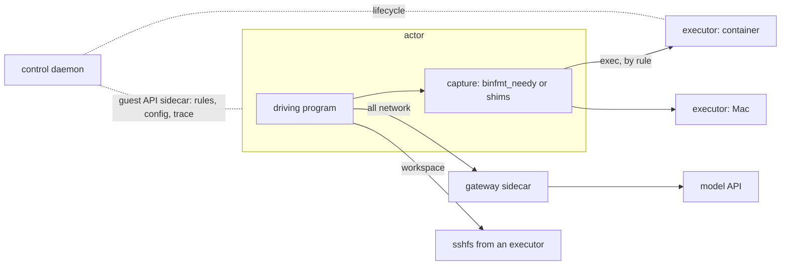

<picture>
  <source width="100%" srcset="./docs/assets/banners/hero-dark.webp" media="(prefers-color-scheme: dark)" />
  <source width="100%" srcset="./docs/assets/banners/hero-light.webp" media="(prefers-color-scheme: light), (prefers-color-scheme: no-preference)" />
  
</picture>

<h1 align="center">Needy</h1>

Needy separates the program that drives work from the environments where that
work takes effect.

- Run the driving program, such as an agent harness or a test suite, in a small
  stateless sandbox: the **actor**.
- Route its commands, file access and network traffic by declarative rules to
  **executors**: containers, microVMs or real machines such as a Mac.
- Record every operation, inject faults, and build each machine from a
  **recipe** that fixes its identity: OS, kernel, CPU, firmware and devices.

> [!NOTE]
> Needy is experimental. Start with a small project directory.

## Table of Contents

- [Getting started](#getting-started)
  - [Install](#install)
  - [Start the control daemon](#start-the-control-daemon)
  - [Pick a profile](#pick-a-profile)
  - [Run it](#run-it)
  - [One command from your laptop](#one-command-from-your-laptop)
  - [Add machines](#add-machines)
- [Actor drivers](#actor-drivers)
- [Configuration](#configuration)
- [Examples](#examples)
- [How it works](#how-it-works)
- [Architecture](#architecture)
- [Documentation](#documentation)
- [Development](#development)
- [Acknowledgements](#acknowledgements)

## Getting started

Choose what you want to run. Each walkthrough identifies the machine,
terminal, project directory, and expected result at every step.

| Your task | Start here |
| --- | --- |
| Explore Linux bash with Mac child processes | [bash → Mac walkthrough](docs/ai/explanations/linux-actor-mac-executor.md#bash) |
| Run Claude Code in Linux with Mac tools | [Claude Code → Mac walkthrough](docs/ai/explanations/linux-actor-mac-executor.md#claude-code) |
| Run OpenCode in Linux with Mac tools | [OpenCode → Mac walkthrough](docs/ai/explanations/linux-actor-mac-executor.md#opencode) |

These three examples use a Linux Docker host and a Mac native runner:

| Linux server | Mac |
| --- | --- |
| Control daemon and your program in an actor | Runner, toolchain, and project files |
| Starts runs from its setup terminal | Keeps one SSH tunnel and one runner process open |
| Mounts the shared project into the actor | Keeps the project in `~/needy-demo` |

Start with the [common setup](docs/ai/explanations/linux-actor-mac-executor.md#where-things-run).
Then save one complete [example profile](examples/linux-mac).
The website and Profile Studio read these same examples.

1. Install needy on both machines. Only the actor host needs actor images.
2. Start the control daemon on Linux and verify local management discovery.
3. Start one SSH tunnel and enroll the runner on the Mac.
4. Mount the Mac project directory and save the selected profile.
5. Start bash, Claude, or OpenCode. Check a real command and the shared files.

The entrypoint stays in Linux. These profiles send captured child processes
to the Mac. Shell builtins stay in their shell; built-in file editors use the
shared mount. Container capture has [limits](#actor-drivers).

### Install

Released binaries and images are available from [GitHub Releases](https://github.com/needy-dev/needy/releases).
Use a release for the walkthroughs. Build from source when developing needy.
`needy image build` needs a checkout of the image sources.

#### From source

```sh
git clone https://github.com/needy-dev/needy && cd needy
cargo install --path crates/cli          # installs `needy`
make guest                               # bin/needy-linux-<arch>, with Docker
cp bin/needy-linux-* "$(dirname "$(command -v needy)")/"
```

Actor images hold no needy: the control daemon brings its own **guest
needy** into every actor it starts, a static Linux build of its own version.
It looks for `needy-linux-<arch>` next to its executable (or takes
`--guest-needy PATH`); a static Linux release `needy` is its own guest.

#### macOS

```sh
brew install needy-dev/tap/needy
needy --version
```

Alternatively, without [Homebrew](https://brew.sh/):

```sh
curl -fsSL https://raw.githubusercontent.com/needy-dev/needy/main/install/install.sh | sh
```

Both install the guest needy next to `needy` on Apple silicon.

#### Linux

```sh
curl -fsSL https://raw.githubusercontent.com/needy-dev/needy/main/install/install.sh | sh
needy --version
```

> [!NOTE]
> The script checks the archive's `.sha256` before it installs anything. Set
> `NEEDY_VERSION` to a release tag or `NEEDY_INSTALL_DIR` to change the
> release or the install directory (default: `~/.local/bin`). `latest` is the
> newest release that is not a prerelease. The Linux build is static, so it
> runs on any distribution.

#### Windows

Download
[needy-x86_64-pc-windows-msvc.zip](https://github.com/needy-dev/needy/releases/latest/download/needy-x86_64-pc-windows-msvc.zip),
extract `needy.exe` to a permanent directory and add that directory to your
user `PATH`. A Windows machine is an executor only.

#### Install with proto

Install and configure [proto](https://moonrepo.dev/docs/proto) first. Then add
the needy plugin and install the latest release:

```sh
proto plugin add needy "https://raw.githubusercontent.com/needy-dev/needy/main/toolchain/proto/needy.toml" --to global
proto install needy latest --config-mode global --pin global
needy --version
```

After installing, pull the base images of your needy's release for the
drivers this machine has (see the table below):

```sh
needy image pull                 # or one driver: needy image pull --driver macos-vz
needy image ls
```

For a VM driver (`linux-firecracker`, `macos-vz`) it downloads the release's
VM image, checks it against its `.sha256` and unpacks it into needy's data
directory; for a container driver it pulls the base image (and the executor
image) through the engine or Apple's `container`. A machine whose engine can
run `linux-container` executors but not actors (a Mac) gets the executor
image alone. needy never downloads a VM
image by itself: a run without one fails and names `needy image pull`. The
container drivers pull a missing container image themselves.

Each
[GitHub release](https://github.com/needy-dev/needy/releases) carries these
assets, each with a `.sha256` file:

| Asset | What it is |
| --- | --- |
| `needy-x86_64-unknown-linux-musl.tar.gz`, `needy-aarch64-unknown-linux-musl.tar.gz` | `needy` for Linux, statically linked |
| `needy-aarch64-apple-darwin.tar.gz`, `needy-x86_64-apple-darwin.tar.gz` | `needy` for macOS, signed with a Developer ID and notarized; the arm64 one also holds `needy-linux-aarch64`, the guest needy (not signed: a Linux binary) |
| `needy-x86_64-pc-windows-msvc.zip` | `needy.exe` for Windows (executor only), not Authenticode-signed |
| `needy-actor-linux-firecracker-x86_64.tar.gz` | the `linux-firecracker` base image: `vmlinux`, `rootfs.ext4`, `firecracker`, `manifest.json` |
| `needy-actor-macos-vz-aarch64.tar.gz` | the `macos-vz` base image: `Image`, `initrd`, `rootfs.ext4`, `manifest.json` |

Each archive has a build provenance attestation:
`gh attestation verify needy-actor-macos-vz-aarch64.tar.gz -R needy-dev/needy`
checks that this repository's release workflow built it. The container images
are on GHCR for amd64 and arm64, tagged with the release (`v<version>`) and
`latest`: `ghcr.io/needy-dev/needy-actor` and
`ghcr.io/needy-dev/needy-executor`. A profile without `actor.image`, and a
daemon without `--executor-image`, use those of its own version.

A needy built from a checkout has no release to pull from, and `needy image
pull` says so. Build the images instead, and name the container images it
builds, `needy-actor:latest` and `needy-executor:latest`:

```sh
needy image build                                  # the base VM image of this host's VM driver
needy image build --linux-container --executor     # or --macos-apple-container on a Mac
needy config set daemon.executor_image needy-executor:latest
needy daemon service install --now
# and in a container actor's profile: actor: { image: needy-actor:latest, ... }
```

`needy image pull --file ARCHIVE` imports a VM image archive on a machine
without a network, and `needy image rm IMAGE` removes a VM image
(`--guest-disks` also the guest disks of older needy versions). The prebuilt
kernels have no recipe's identity; `needy image build --recipe` builds one
that does. An image works with every needy that speaks its base ABI; needy
names the command when it does not.

What each machine needs besides `needy`:

| Machine | Needs | Then |
| --- | --- | --- |
| Linux with KVM (actor host) | Docker or another Docker-compatible engine | `needy image pull` (the `linux-firecracker` base, and the container images) |
| Linux without KVM (actor host) | a Docker-compatible engine; `sshfs` and `user_allow_other` in `/etc/fuse.conf` for workspace mounts; `lxcfs` for resource views | `needy image pull` (the container images) |
| Apple silicon Mac (actor host) | `brew install vfkit`, or Apple's [`container`](https://github.com/apple/container) | `needy image pull` (the `macos-vz` base, or the base in Apple's `container`) |
| Any Linux, macOS or Windows machine (executor only) | nothing | join as a runner, see [Add machines](#add-machines) |

#### Uninstall

Use the commands that match how you installed needy. They keep needy's
state and data directories.

```sh
brew uninstall needy                                      # Homebrew
rm -f ~/.local/bin/needy ~/.local/bin/needy-linux-*       # install script
proto uninstall needy && proto plugin remove needy --from global   # proto
cargo uninstall needy-cli                                 # from source; also remove the copied needy-linux-*
```

On Windows, delete the directory you extracted `needy.exe` to and remove it
from `PATH`.

### Start the control daemon

Install a user service on a Linux systemd host or a Mac with launchd:

```sh
needy daemon service install --now
needy daemon service status
needy runner ls
```

Local commands discover the private management socket. No client pairing or
bearer is required on the control host. A saved remote context does not change
service operations.

For remote runners or clients, configure an additional listener before installation:

```sh
needy config set daemon.listen '[tcp://127.0.0.1:7400]'
needy daemon service install --now
```

If the service is already installed, use `install --replace --now` to update
its configuration snapshot. Remote machines use registered credentials through
an SSH tunnel. The network listener keeps the local management socket.

For development or an external supervisor, use foreground serving:

```sh
needy daemon serve --listen tcp://127.0.0.1:7400
```

TCP carries no encryption itself. If the daemon finds no guest needy, it warns
and cannot start actors.

### Pick a profile

Which actor do you want? Each block is a complete profile: the driving program
is `bash`, and `python3` is routed to an executor while everything else runs
in the actor. Save it as `~/.config/needy/profiles/demo.yaml`.

<details>
<summary><b>Linux with KVM</b>: a Firecracker microVM (<code>linux-firecracker</code>)</summary>

```yaml
user: { name: agent, uid: 1000, gid: 1000 }
actor:
  driver: linux-firecracker
  recipe: builtin:gce-ubuntu-22.04
  command: [bash]
executors:
  build: { driver: linux-container, key: "{run}" }
commands:
  - { match: "python3 **", to: build }
```

</details>

<details>
<summary><b>Linux without KVM</b>: a container with runc or gVisor (<code>linux-container</code>)</summary>

```yaml
user: { name: agent, uid: 1000, gid: 1000 }
actor:
  driver: linux-container
  container: { oci_runtime: runc }      # or runsc, if gVisor is installed
  recipe: builtin:gce-ubuntu-22.04
  command: [bash]
executors:
  build: { driver: linux-container, key: "{run}" }
commands:
  - { match: "python3 **", to: build }
```

</details>

<details>
<summary><b>Apple silicon Mac</b>: a Virtualization.framework VM (<code>macos-vz</code>)</summary>

```yaml
# mkdir -p /tmp/needy-demo first: the Mac itself is the executor.
user: { name: agent, uid: 1000, gid: 1000 }
actor:
  driver: macos-vz
  command: [bash]
executors:
  mac: { driver: native, workspace: /tmp/needy-demo }
commands:
  - { match: "python3 **", to: mac }
```

</details>

<details>
<summary><b>Apple silicon Mac</b>: Apple's <code>container</code> (<code>macos-apple-container</code>)</summary>

```yaml
# mkdir -p /tmp/needy-demo first: the Mac itself is the executor.
user: { name: agent, uid: 1000, gid: 1000 }
actor:
  driver: macos-apple-container
  command: [bash]
executors:
  mac: { driver: native, workspace: /tmp/needy-demo }
commands:
  - { match: "python3 **", to: mac }
```

</details>

`needy config profile check demo --mode control` says where the actor and each executor would run,
what of the recipe the driver cannot present, and where a command would go:
`needy config profile check demo --mode control --cmd "python3 -V"`.

### Run it

```sh
needy run create -it --profile demo
#   agent@instance:~$ uname -a                                  # the actor
#   agent@instance:~$ python3 -c 'import platform; print(platform.node())'   # the executor
#   agent@instance:~$ exit
needy run report latest                       # what was routed, faults, the actor's identity
```

`ctrl-]` detaches and leaves the run active. Run commands accept an ID,
unique prefix, name, or `latest`. With no selector, attach/logs/stop select the
only live run. Reports default to `latest`.

```sh
needy run ls
needy run attach
needy run exec latest -- uname -a
needy proc exec --host -d -- python3 -m http.server
needy proc ls
needy proc attach PROCESS
needy fs cp --run latest ./src build:/home/agent/workspace
needy run stop
```

`run stop` gives the driving program SIGTERM, then SIGKILL after `--grace`
(default 10s). The actor mirrors out before the stop completes.
`--now` kills the actor immediately and skips mirror-out. The report records
which stop occurred. Controlled daemon shutdown uses the same cleanup within
its finite shutdown budget.

`proc exec` runs one process outside a run. Select `--host`, `--runner NAME`,
or `--executor ID` explicitly. `run exec` routes through a run's rules.
Arguments after `--` in `run create` are appended to the profile's
`actor.command`.

### One command from your laptop

Client pairing lets a Mac control runs. Runner enrollment lets it execute
commands. A Mac can hold both roles, but each role needs its own credential.
The [Linux-to-Mac walkthrough](docs/ai/explanations/linux-actor-mac-executor.md)
starts runs from Linux and does not require client pairing.

If you also want a Mac control client, reuse the walkthrough's SSH tunnel.
In the **Linux setup terminal**, create a pairing code:

```sh
needy client invite --name mac-cli --admin
```

In a **new Mac terminal**, pair at the hidden code prompt, then select the saved connection:

```sh
needy --address tcp://127.0.0.1:7400 config context pair control
needy config use control
needy runner ls
```

Pairing saves the transport and client credential without changing the default.
`config use control` selects that connection. The Mac can attach to
runs without a local profile. To create runs from the Mac, also save the
complete profile there. `host:` paths still refer to the Linux control host.
Use the [interactive OpenCode example](examples/linux-mac/opencode.yaml) for
an interactive session. The [local-model experiment](examples/opencode/profile.yaml)
requires a separate model service.

### Add machines

For the Linux-to-Mac scenario, use the
[runner enrollment steps](docs/ai/explanations/linux-actor-mac-executor.md#5-register-the-mac-runner).
Run enrollment on the executor machine, then check both its name and OS.
A native runner needs needy and its toolchain, not actor images.

Profiles select it by name:

```yaml
executors:
  mac: { runner: mac, driver: native }
```

`needy runner ls` lists enrolled machines. `needy proc exec --runner mac -- uname -s`
runs directly on that machine, outside any run. On Windows, start the runner
outside the SSH session, with its normal tool PATH. `runner join` reads the code at a hidden prompt;
`runner serve` reuses the saved runner credential.

#### Over a tunnel

needy serves plain gRPC on a loopback port. Connector argv can carry each
connection through an authenticated tunnel. Save the transport during pairing
or runner enrollment:

```sh
# cloudflared reads its own Access credentials from its configured environment.
needy runner join mac --roles executor -- cloudflared access tcp --hostname needy.example.com
needy runner serve

# Pair a control client separately, then select its saved connection.
needy config context pair control -- ssh -W 127.0.0.1:7400 user@example.com
needy config use control
needy runner ls
```

The invitation codes come from `runner invite` and `client invite` on the
control host. Each consumer reads its code through a hidden prompt.

Use a TCP route of the tunnel (`tcp://`, `cloudflared access tcp`): proxied
HTTPS hostnames do not carry gRPC through Cloudflare Tunnel. A dropped
connection costs little: runners connect again with backoff, and a workspace
mount starts its SFTP stream again for up to 2 minutes.

## Actor drivers

`actor.driver` picks where the actor runs. The prefix is the operating system
whose isolation the driver relies on.

| | `linux-firecracker` | `linux-container` | `macos-vz` | `macos-apple-container` |
| --- | --- | --- | --- | --- |
| Host | Linux x86_64 with KVM | Linux with a Docker-compatible engine | Apple silicon macOS | Apple silicon macOS |
| Isolation | Firecracker microVM, needy's kernel | `runc` (shared kernel) or `runsc` (gVisor) | Virtualization.framework VM through vfkit, needy's arm64 kernel | Apple `container`: one VM per container, Apple's kernel |
| How execs are caught | kernel module `binfmt_needy` | shims on every `PATH` program of the image | kernel module `binfmt_needy` | shims |
| Ready in | ~0.17 s | | ~0.27 s | ~0.86 s |
| **Routing** | | | | |
| Route a command by name | ✅ | ✅ | ✅ | ✅ |
| Route by absolute path (`/usr/bin/git`) | ✅ | ✅ | ✅ | ✅ |
| Route programs added at run time (`pip`, `npm`, built in the workspace) | ✅ | ❌ | ✅ | ❌ |
| HTTP(S) hostname policy through the gateway | ✅ | ✅ | ✅ | ✅ |
| Workspace mount from an executor | ✅ | ✅ | ✅ | ✅ |
| Copy-in, mirror-out | ✅ | ✅ | ✅ | ✅ |
| Exec and file faults | ✅ | ✅ | ✅ | ✅ |
| Interactive (`-it`, attach, detach) | ✅ | ➖ | ✅ | ✅ |
| **Identity from the recipe** | | | | |
| Hostname | ✅ | ✅ | ✅ | ✅ |
| `/proc/cpuinfo` | ✅ | ✅ | ❌ (arm64) | ❌ |
| `CPUID` | ✅ | ❌ | ❌ | ❌ |
| DMI / SMBIOS | ✅ | ✅ (where the host has DMI; any host under `runsc`) | ❌ | ❌ |
| PCI IDs | ✅ | ❌ | ❌ | ❌ |
| hwmon sensors and the overheat fault | ✅ | ✅ (where the host has hwmon; any host under `runsc`) | ✅ | ❌ |
| Kernel version | ✅ | ❌ (host or gVisor) | ➖ | ❌ |
| Uptime offset | ✅ | ❌ | ➖ | ❌ |

✅ available, ❌ unavailable, ➖ experimental.
`needy config profile check` lists gaps for your recipe and host.
A recipe's `required:` turns a gap into an error.

Executor drivers: `native` (the machine itself: Linux, macOS, Windows) and
`linux-container` (a container through the same engine). A `macos-native`
actor (Seatbelt and shims, no VM) exists as a proof of concept on the
`poc/macos-native-actor` branch.

## Configuration

A profile is YAML; unknown keys are errors, and `extends:` builds on another
profile. See the [example profiles](#examples) for complete configurations.

### Commands

Rules apply in order. A single-valued action takes its first assigned value.
Collections accumulate until `final: true` stops evaluation. A command with
no placement uses `default_executor`, or stays in the actor when none is set.

```yaml
commands:
  - { match: "{bash,sh,zsh} **", to: build }            # glob over the command line
  - { match: "git push **", deny: "no pushes from the agent" }
  - match: "pytest **"
    when: { cwd: "~/workspace/**", tty: false }
    to: build
    timeout: 10m
    env: { set: { CI: "1" } }
```

### Workspace

The directory the work operates on is one setting. The driving program
starts in it.

```yaml
actor:
  workspace:
    path: ~/project                      # in the actor
    from: executor:build:~/project       # live from an executor; or host:PATH (copied in), or omit it
    writable: true
```

`from: executor:NAME:PATH` mounts the executor's directory at `path` and maps
`path` to `PATH` for the commands routed there. `~` is the profile user's home
in the actor, the control host's home on `host:`, and the executor's own home
on an executor side.

### Files

Named mappings move other files between the control host (`host:`), the actor
(`actor:`) and an executor (`executor:NAME:`). `run_files` lists the ones every
run uses; a rule's `files:` adds some for the commands it matches.

<picture>
  <source width="100%" srcset="./docs/assets/banners/files-dark.webp" media="(prefers-color-scheme: dark)" />
  <source width="100%" srcset="./docs/assets/banners/files-light.webp" media="(prefers-color-scheme: light), (prefers-color-scheme: no-preference)" />
  
</picture>

```yaml
files:
  login-in:                        # copied in when the run starts
    mode: copy-in
    from: "host:~/needy-state/opencode/"
    to: "actor:~/.local/share/opencode/"
    filter: ["- /cache/**", "+ **"]
  login-out:                       # copied back when the run ends (not on `run stop --now`)
    mode: mirror-out
    from: "actor:~/.local/share/opencode/"
    to: "host:~/needy-state/opencode/"
run_files: [login-in, login-out]
```

A copy-in / mirror-out pair is how state such as a login survives stateless
actors. A `filter` (rclone-style rules, first match wins) applies on the
control host, where it packs a copy-in and where it unpacks a mirror-out.

### Network

The actor has no network of its own: everything goes through the gateway on
the control host. HTTPS is tunnelled as is (no MITM, no injected CA, and so no
injected headers).

<picture>
  <source width="100%" srcset="./docs/assets/banners/network-dark.webp" media="(prefers-color-scheme: dark)" />
  <source width="100%" srcset="./docs/assets/banners/network-light.webp" media="(prefers-color-scheme: light), (prefers-color-scheme: no-preference)" />
  
</picture>

```yaml
actor:
  network:
    allow: [opencode.ai, "*.opencode.ai"]   # `*.x` also matches `x`
    services:
      ollama:                               # in the actor: http://ollama.needy
        url: http://127.0.0.1:11434         # resolved on the control host
```

A service is a plain-HTTP name the actor uses; the gateway forwards it to
`url`, so the actor never learns the real address. `needy config profile check`
lists the services and warns when a URL does not answer from the control
host.

### Chaos

Named faults, each in one domain, with real effects. They fire from a seed,
so a replayed run injects the same ones; a fault without `probability`,
`nth`, `times`, `after` or `until` fires on every match.

<picture>
  <source width="100%" srcset="./docs/assets/banners/chaos-dark.webp" media="(prefers-color-scheme: dark)" />
  <source width="100%" srcset="./docs/assets/banners/chaos-light.webp" media="(prefers-color-scheme: light), (prefers-color-scheme: no-preference)" />
  
</picture>

```yaml
chaos:
  seed: 1
  faults:
    curl-down:
      exec: "curl **"                   # the command exits 7 without running
      exit: 7                           # or signal: SIGSEGV, hang: true, delay: 2s
      stderr: "curl: (7) Failed to connect\n"
      times: 3
    flaky-json:
      file: { open: "**/*.json" }
      errno: EIO                        # ENOENT, EACCES, EPERM, EOPNOTSUPP or EIO
      probability: 0.1
    slow-example:
      net: { connect: "*.example.com" }
      delay: 2s                         # or refuse, reset, hang; status: 503 with net: { request: ... }
    overheat:
      sensor: { temp_c: 101 }
      at: 30s
```

Change a live run's faults; the trace records each change:

```sh
needy run chaos add api-down --request ollama.needy --status 503 --after 1m
needy run chaos ls
needy run chaos rm api-down
```

### Executors

```yaml
executors:
  build:
    driver: linux-container        # or native
    runner: { labels: [kvm] }      # where; the control host when absent
    key: "{run}"                   # commands with the same key share an instance
    max_procs: 8
    container:                     # typed engine options
      image: needy-executor:latest
      cpus: 2
      memory: 4GiB
      env: { LANG: C.UTF-8 }
  mac: { runner: mac, path_map: { ~/tools: ~/needy-tools } }   # values: the runner's home
```

Privileged options (`privileged`, `cap_add`, `devices`, `gpus`, host mounts
outside the workspace) need the operator. Containers needy creates carry the
labels `needy.run` and `needy.role` (`actor` or `executor`):
`docker ps --filter label=needy.run=RUN` lists a run's containers.

### Customize the actor

```yaml
actor:
  driver: linux-firecracker
  runner: kvm
  recipe: builtin:gce-ubuntu-22.04   # or a path to your own recipe
  command: [opencode]
  env: { OPENCODE_DISABLE_AUTOUPDATE: "1" }
user: { name: bob, uid: 1001, gid: 1001 }   # whoami, id, HOME and getent agree in the actor
```

A recipe sets the machine: CPU model and count, memory, kernel, firmware
strings, devices, hostname (`instance-{time}`), and which identity fields are `required:`.
`needy image build --recipe RECIPE` builds the actor kernel with a recipe's
kernel options. `linux-container` takes `actor.container.oci_runtime`.
`actor.image: REF` runs your own image `FROM` needy's base on every driver
(`needy image build --from REF` for the VM drivers); see
[`examples/custom-image`](examples/custom-image/Dockerfile).

### Environment and data

| Variable | Meaning |
| --- | --- |
| `NEEDY_STATE_DIR` | traces, `state.db`, run directories, the socket on macOS (`$XDG_STATE_HOME/needy`) |
| `NEEDY_DATA_DIR` | VM images in `images/<driver>/` and guest disks (`$XDG_DATA_HOME/needy`) |
| `NEEDY_CONFIG_DIR` | the global configuration, saved connections, and `profiles/` (`$XDG_CONFIG_HOME/needy`) |
| `NEEDY_RUNTIME_DIR` | the daemon's socket (`$XDG_RUNTIME_DIR/needy`) |
| `NEEDY_REPO` | the checkout `needy image build` builds from, when not run inside it |
| `DOCKER_HOST` | the Docker-compatible engine (Docker Engine, OrbStack, Podman) |

`--config FILE` selects the client configuration file. `--context NAME` selects
a saved connection for one invocation. For direct transport, combine
`--address URI` with an optional private `--credential-file FILE`.
`-v` turns on logs. Old endpoint/token selectors are unsupported; old run variables
and endpoint-keyed credential files are not read or imported. Create named
connections explicitly with `needy config context pair`.

## Examples

| Profile | Shows |
| --- | --- |
| [`examples/linux-mac`](examples/linux-mac) | Linux bash, Claude Code, or OpenCode with a shared project and child processes on a Mac |
| [`examples/opencode`](examples/opencode/profile.yaml) | opencode in an actor with a GCE identity, a local model as the service `http://model.needy`, shells in a container |
| [`examples/macos`](examples/macos/profile.yaml) | A Linux actor running `xcodebuild`, `simctl` and `swift build` on runner `mac` |
| [`examples/smoke`](examples/smoke/profile.yaml) | Routing, the shared workspace and identity probes |
| [`examples/chaos`](examples/chaos/profile.yaml) | Copy-in and mirror-out, an `EIO` file fault on the workspace, a `curl` that exits 7 and an overheating sensor |
| [`examples/linux-container`](examples/linux-container/profile.yaml) | The smoke test in a container actor, for hosts without KVM |
| [`examples/macos-vz`](examples/macos-vz/profile.yaml) | The smoke test in a `macos-vz` actor, routing by absolute path |
| [`examples/macos-apple-container`](examples/macos-apple-container/profile.yaml) | The smoke and chaos tests in Apple's `container` |
| [`examples/custom-image`](examples/custom-image/profile.yaml) | An actor image `FROM` needy's base with jq added, on every driver |
| [`examples/agents`](examples/agents/README.md) | pi, Claude Code, Codex, opencode and herdr in an actor: one image, a profile each, their logins kept across runs |
| [`examples/local`](examples/local/profile.yaml) | This machine as a native executor: copy-in, mirror-out, chaos and the trace |
| [`examples/cli`](examples/cli/profile.yaml) | A container executor for `needy proc exec`, with an actor that only waits |
| [`examples/bench`](examples/bench/profile.yaml) | Latency and throughput probes inside an actor, with `cargo xtask bench run` |

## How it works



<picture>
  <source width="100%" srcset="./docs/assets/banners/routing-dark.webp" media="(prefers-color-scheme: dark)" />
  <source width="100%" srcset="./docs/assets/banners/routing-light.webp" media="(prefers-color-scheme: light), (prefers-color-scheme: no-preference)" />
  
</picture>

- **Capture, decide, apply.** A driver's capture catches each exec, the
  gateway sidecar every connection, the workspace mount every file open. The
  daemon runs the domain's interceptors (rules, then chaos; the allowlist,
  chaos and header injection for the network) and the program sees ordinary
  PIDs, pipes, terminals and exit codes.
- **Observe.** Routing decisions, routed execs, file transfers, gateway
  requests and faults are typed events in the trace (SQLite or JSONL, as the
  profile's `trace:` says). `needy run report` summarizes a run as text, markdown
  or JSON. Commands that stay in the actor and terminal output are not
  recorded.
- **Shape.** Faults (`EIO`, delays, an overheating sensor) and a machine
  identity built from a recipe.

The actor can sit near its model API. The gateway applies its network policy.
Agent credentials live in the actor's mapped state directory. Executors hold
the project files and toolchains.

## Architecture

| Crate | Role |
| --- | --- |
| `cli` | the `needy` binary; inside an actor, injected as the guest needy, also its init and exec proxy |
| `daemon` | the control plane: runs, pool, scheduling, routing, relay, files, runners, `state.db` |
| `core-actor` | actor drivers, the guest (init, capture, proxy), the gateway sidecar, identity |
| `core-executor` | executor drivers, the container engine client, the process host |
| `core` | interceptor domains (exec, net, file) and their chains, rules, chaos, network policy, recipes, events, reports; no IO |
| `trace` | the event pipeline and its sinks |
| `config` | profile and recipe schemas, loading and validation |
| `api-proto`, `api-client`, `api-server` | the gRPC API and its two sides |

Extension points are directories with one implementation each: actor drivers
(`core-actor/src/driver/`), executor drivers (`core-executor/src/driver/`),
interceptor domains (`core/src/intercept/`), sidecars
(`core-actor/src/sidecar/`) and trace sinks (`trace/src/sink/`).

## Documentation

- [Linux actor and Mac executor walkthrough](docs/ai/explanations/linux-actor-mac-executor.md)
- [Example profiles](examples)
- [Terms and concepts](docs/TERMS_AND_CONCEPTS.md)

## Development

```sh
make check
make test
make proto
cargo xtask bench --help      # latency and throughput probes
cargo xtask e2e               # the end-to-end matrix on this host
```

`cargo xtask e2e` runs every cell of the end-to-end matrix this host can
run: each actor driver it has, with each terminal mode, way a run ends, file
mapping, fault domain, network rule and user, each cell against its own
non-root control daemon, checked for invariants (ownership and modes,
mirror-out after every ending, placement in the trace, private sockets,
nothing left behind). It builds the guest needy and the images from the tree
first. A cell it cannot run here is reported as not covered, with the reason,
and the exit code says so. `--list` shows the cells, `--only` and `--skip`
pick some, `--remote HOST` runs on another machine from `git archive HEAD`,
and `--hosts FILE` runs on several at once, each building natively.

GitHub Actions runs the checks and tests on Linux, macOS and Windows, the e2e
cells without an actor on Linux and macOS, and builds the release assets.

The figures in this README are animated scenes in [`apps/docs`](apps/docs), a
page you can also open to step through them and route your own commands:

```sh
cd apps/docs && pnpm install
pnpm dev                      # the page
pnpm banners                  # re-render docs/assets/banners (needs Chrome and img2webp)
```

## Acknowledgements

Needy borrows from, was compared against, or was tested with these projects.
Thank you to their authors.

**Built on**

- [Firecracker](https://github.com/firecracker-microvm/firecracker): the actor
  microVM; needy carries a patch for CPUID, SMBIOS and PCI identity.
- [vfkit](https://github.com/crc-org/vfkit) and Apple's
  [`container`](https://github.com/apple/container): the macOS actors.
- [sshfs](https://github.com/libfuse/sshfs) and OpenSSH `sftp-server`: file
  routing in passive mode, an idea taken from
  [Lima](https://github.com/lima-vm/lima)'s reverse-sshfs mounts.
- [tonic](https://github.com/hyperium/tonic), [prost](https://github.com/tokio-rs/prost),
  [Buf](https://github.com/bufbuild/buf) with the
  [neoeinstein](https://github.com/neoeinstein/protoc-gen-prost) plugins,
  [tokio-vsock](https://github.com/rust-vsock/tokio-vsock),
  [portable-pty](https://github.com/wezterm/wezterm/tree/main/pty),
  [hyper](https://github.com/hyperium/hyper),
  [bollard](https://github.com/fussybeaver/bollard),
  [SeaORM](https://github.com/SeaQL/sea-orm) and
  [brush](https://github.com/reubeno/brush)'s shell parsing approach.

**Design references**

- [AUV](https://github.com/moeru-ai/auv): repository layout, documentation
  structure, Buf workflow and agent skills.
- [agentsh](https://github.com/canyonroad/agentsh): human and JSON output modes,
  session reports, composite trace storage and its platform comparison.
- [Reverie](https://github.com/facebookexperimental/reverie) and
  [Hermit](https://github.com/facebookexperimental/hermit): syscall
  interception, chaos scheduling and virtual time.
- [kbox](https://github.com/sysprog21/kbox): seccomp user notification, FD
  injection and shadow memfds.
- [mirrord](https://github.com/metalbear-co/mirrord): running a local process
  against remote resources.
- [containerd shim v2](https://github.com/containerd/containerd/blob/main/api/runtime/task/v2/shim.proto):
  the process lifecycle API.
- [herdr](https://github.com/ogulcancelik/herdr): terminal viewers and redraw.
- [rclone](https://rclone.org/filtering/), [Mutagen](https://mutagen.io/) and
  [Lima mounts](https://lima-vm.io/docs/config/mount/): file mapping and
  filters.
- [Codex](https://github.com/openai/codex/pull/7127) and
  [Claude Code](https://code.claude.com/docs/en/permissions) permission rules:
  matching shell commands.
- [macstab chaos-testing-libraries](https://github.com/macstab/macstab-chaos-testing-libraries):
  rule-based syscall fault injection.
- [DeepSeek DSec](https://arxiv.org/html/2609.22978v1): sandbox infrastructure
  for agent RL at scale, and the agent attacks it reports.

**Compared or tried**

- Isolation: [gVisor](https://github.com/google/gvisor),
  [Kata Containers](https://github.com/kata-containers/kata-containers),
  [Cloud Hypervisor](https://github.com/cloud-hypervisor/cloud-hypervisor),
  [libkrun](https://github.com/containers/libkrun),
  [Containerization](https://github.com/apple/containerization),
  [agentc](https://github.com/laosb/agentc),
  [microvm.nix](https://github.com/astro/microvm.nix),
  [Incus](https://github.com/lxc/incus) and [lxcfs](https://github.com/lxc/lxcfs).
- OS identity: [Darling](https://github.com/darlinghq/darling) (tested),
  [Wine](https://www.winehq.org/),
  [tart-skills](https://github.com/jonnyzzz/tart-skills),
  [faux-mac](https://github.com/stpettersens/faux-mac),
  [fake-uname](https://github.com/brenkem/fake-uname) and
  [fakehostname](https://github.com/dtcooper/fakehostname).
- Agent sandboxes and policy:
  [Anthropic sandbox-runtime](https://github.com/anthropics/sandbox-runtime),
  [E2B](https://e2b.dev/), [Modal](https://modal.com/),
  [AgentSentinel](https://github.com/abhinandanpandey-in/agentsentinel) and
  [safe-agent](https://github.com/TurboRx/safe-agent).
- Observation and faults: [Tetragon](https://github.com/cilium/tetragon),
  [Falco](https://github.com/falcosecurity/falco),
  [libfiu](https://github.com/albertito/libfiu), `strace --inject` and the
  kernel fault-injection framework.
- From the earlier research: [PRoot](https://github.com/proot-me/proot),
  [LKL](https://github.com/lkl/linux), [LegoOS](https://github.com/Wuklab/LegoOS)
  and [Telepresence](https://github.com/telepresenceio/telepresence).
- Driving program and model used in tests: [opencode](https://github.com/sst/opencode),
  [Ollama](https://github.com/ollama/ollama) with Qwen3.

Thanks to [Makito](https://github.com/sumimakito) for CLI design ideas.
