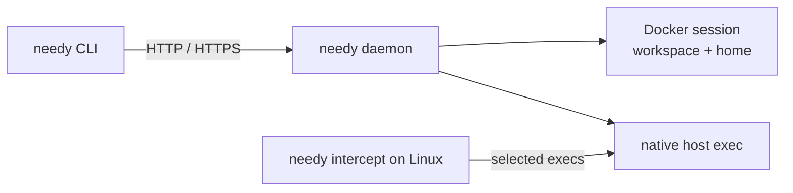

<h1 align="center">Needy</h1>

Needy is a headless runtime for running commands on another machine.

- Run batch jobs in Docker containers with persistent workspaces.
- Keep a process tree on Linux, and run selected commands on macOS.
- Submit jobs, follow events and download files from a paired CLI.

> Needy has no agent-specific concepts. A workload is any command, so any agent
> or tool can run on top of it.

## Table of Contents

- [Getting Started](#getting-started)
- [Linux to Mac execution](#linux-to-mac-execution)
- [Understand Needy](#understand-needy)
- [Development](#development)

## Getting Started

### Requirements

- Rust 1.97 or later.
- Docker Engine (or a Docker-compatible backend on macOS) for container
  workloads.

### Install

```sh
./scripts/install.sh --prefix "$HOME/.local"
export PATH="$HOME/.local/bin:$PATH"
```

### Start the host

```sh
needy daemon \
  --data-dir "$HOME/.local/share/needy" \
  --listen 127.0.0.1:7331 \
  --image needy-runtime:rust \
  --max-concurrent 2
```

For a remote host, use an SSH tunnel (`ssh -N -L 7331:127.0.0.1:7331 user@host`)
or configure HTTPS with `--tls-cert` and `--tls-key`.

### Pair a client

On the host, create a single-use code:

```sh
needy pairing-code --data-dir "$HOME/.local/share/needy" --out /tmp/needy-pairing-code
```

Copy the file to the client through a private channel, then pair:

```sh
needy pair --url http://127.0.0.1:7331 --code-file /tmp/needy-pairing-code --name laptop
needy info
```

### Run a job

```sh
needy sessions create --name demo
needy workspace push SESSION_ID ./project
needy run SESSION_ID -- sh -c 'ls -la; echo hello > result.txt'
needy events RUN_ID --follow
needy workspace pull SESSION_ID ./downloaded-project
```

Clean up:

```sh
needy stop RUN_ID
needy sessions delete SESSION_ID
```

## Linux to Mac execution

On the Mac, allow the commands that may run there:

```sh
needy daemon --no-docker --data-dir .needy/mac-host \
  --listen 127.0.0.1:7331 --host-root /Users/you/project \
  --allow-host-exec uname,xcodebuild
```

Pair the Linux machine with it, then run:

```sh
needy intercept --remote-cwd /Users/you/project --select uname,xcodebuild \
  -- /bin/sh -c 'cat /proc/sys/kernel/ostype; uname -s'
```

The shell prints `Linux`, and the selected `uname` prints `Darwin`. To run one
command on the Mac directly, use `needy exec --cwd /Users/you/project -- uname -s`.

> [!WARNING]
> Host execution is trusted operator access. `--host-root` is not a filesystem
> jail.

## Understand Needy



- One `needy` binary is the daemon, the client, the container runner and the
  Linux proxy.
- [`needy-exec-intercept`](crates/exec-intercept) is the Linux seccomp/ptrace
  library behind `needy intercept`.
- Needy does not install Docker, configure model providers, inject credentials
  or provide a public relay.

> [!IMPORTANT]
> Pair only trusted users. A paired client can run any command on the host.

More documentation:

- [Usage details](docs/usage.md): state, workspace rules, trust and limits.
- [API](docs/api.md): the HTTP wire contract.
- [Verification](docs/verification.md): test evidence and reproduction.

## Development

```sh
make build
make image
make check
make test
make host-test
make test-image
make docker-test
```

Linux kernel tests must run on Linux; macOS cannot exercise ptrace.

See [docs/README.md](docs/README.md) for where new documents go.
