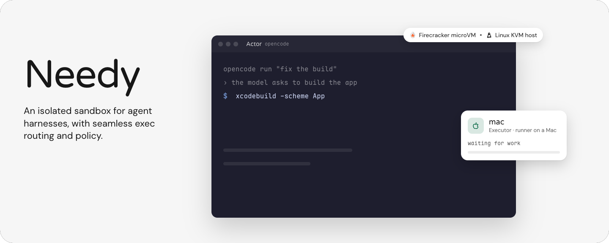
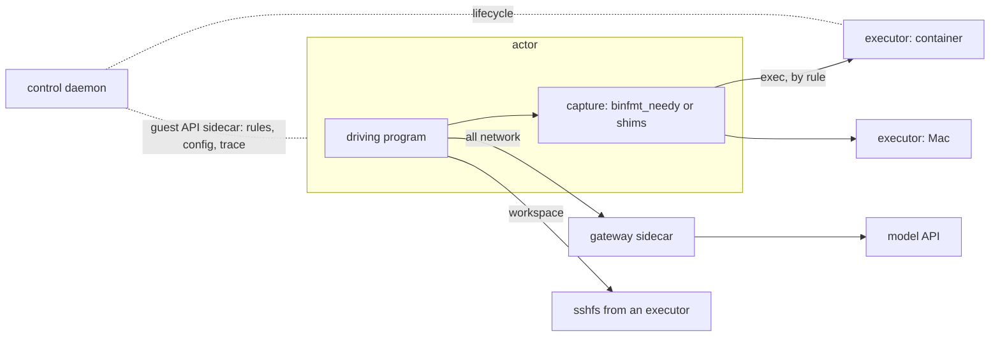
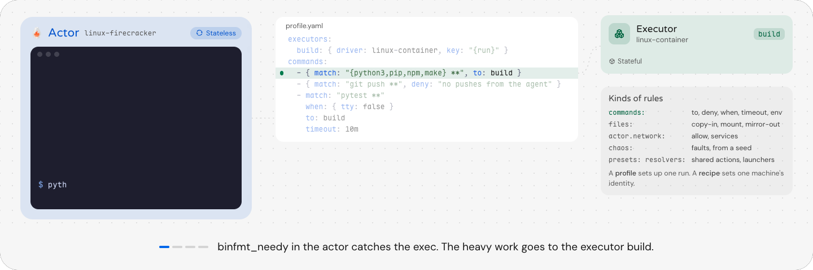
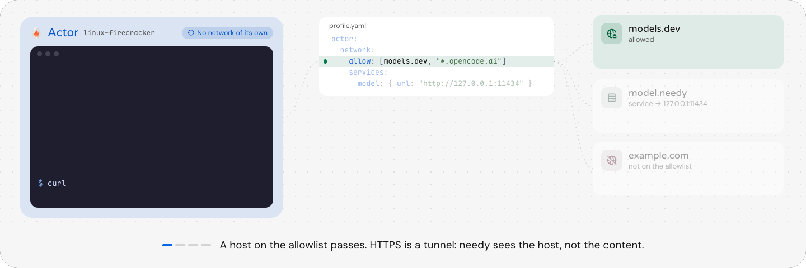

<picture>
  <source width="100%" srcset="./docs/assets/banners/hero-dark.webp" media="(prefers-color-scheme: dark)" />
  <source width="100%" srcset="./docs/assets/banners/hero-light.webp" media="(prefers-color-scheme: light), (prefers-color-scheme: no-preference)" />
  
</picture>

<h1 align="center">Needy</h1>

Needy separates the program that drives work from the environments where that
work takes effect.

- Run the driving program, such as an agent harness or a test suite, in a small
  stateless sandbox: the **actor**.
- Route its commands, file access, and network traffic by declarative rules to
  **executors**: containers, microVMs, or real machines such as a Mac.
- Record every operation, inject faults, and build each machine from a
  **recipe** that fixes its identity: OS, kernel, CPU, firmware, and devices.

> [!NOTE]
> Needy is experimental. Start with a small project directory.

## Table of Contents

- [Getting started](#getting-started)
- [How it works](#how-it-works)
- [Actor drivers](#actor-drivers)
- [Configuration at a glance](#configuration-at-a-glance)
- [Examples](#examples)
- [Documentation](#documentation)
- [Development](#development)
- [Acknowledgements](#acknowledgements)

## Getting started

### 1. Install

**Linux** (installs `needy` and starts the control daemon):

```sh
curl -fsSL https://raw.githubusercontent.com/needy-dev/needy/main/install/install.sh | sh
```

**Apple silicon macOS** (installs `needy`, the guest binary, and `vfkit`):

```sh
brew install needy-dev/tap/needy vfkit
needy daemon service install --now
```

For `proto`, Windows, source builds, daemon service management, and
`linux-container` FUSE/SSHFS prerequisites, see
[Installation and prerequisites](docs/guides/installation.md).

### 2. Run a coding agent

On **Linux with KVM**, start an agent directly — no repo clone or manual image
pull required:

```sh
needy run create -it --profile builtin:opencode
```

Needy ships minimal built-in profiles (`builtin:opencode`, `builtin:codex`,
`builtin:pi`, `builtin:herdr`) backed by OCI Dev Container features on
`ghcr.io/needy-dev/features/*`. On the first run, needy pulls the base VM image,
caches the feature layers, and mounts a persistent sync store for login and
session state. Extend a profile (or reference the OCI feature directly) to
attach an executor, mount your workspace, or tighten network egress.

<details>
<summary><b>Apple silicon Mac</b> (<code>macos-vz</code> actor + <code>native</code> executor)</summary>

Save `~/.config/needy/profiles/opencode.yaml`:

```yaml
extends: builtin:opencode
actor:
  driver: macos-vz
executors:
  mac: { driver: native }
commands:
  - { match: "**", to: mac }
unknown: mac
```

```sh
needy run create -it --profile opencode
```

</details>

<details>
<summary><b>Linux without KVM</b> (<code>linux-container</code> actor, requires SSHFS and FUSE 3)</summary>

Install [SSHFS and FUSE 3](docs/guides/installation.md#workspace-mount-prerequisites-linux-container-actor),
then save `~/.config/needy/profiles/opencode.yaml`:

```yaml
extends: builtin:opencode
actor:
  driver: linux-container
  container: { oci_runtime: runc }   # or runsc, if gVisor is installed
```

```sh
needy run create -it --profile opencode
```

</details>

Use `ctrl-]` to detach and leave a run active:

```sh
needy run ls
needy run attach                    # defaults to the only live run
needy run exec latest -- uname -a   # routed through the run's rules
needy run report latest             # trace summary: routed commands, denied hosts, faults
needy run stop                      # graceful stop + mirror-out / sync merge
```

Want to route from a Linux actor to a Mac executor or run remote Firecracker
actor runners? See [Multi-machine setup](docs/guides/multi-machine.md) and the
[Linux actor → Mac executor walkthrough](docs/ai/explanations/linux-actor-mac-executor.md).

## How it works



- **Exec routing.** A driver's capture (`binfmt_needy` in VMs, shims in
  containers) intercepts every exec; the daemon evaluates command rules and
  executes matches on the chosen executor while preserving PIDs, pipes,
  terminals, and exit codes.

<picture>
  <source width="100%" srcset="./docs/assets/banners/routing-dark.webp" media="(prefers-color-scheme: dark)" />
  <source width="100%" srcset="./docs/assets/banners/routing-light.webp" media="(prefers-color-scheme: light), (prefers-color-scheme: no-preference)" />
  
</picture>

- **Workspace & files.** Mount an executor workspace live over SSHFS, copy files
  in/out per run, or share agent state across concurrent runs with three-way
  `sync` mappings.

<picture>
  <source width="100%" srcset="./docs/assets/banners/files-dark.webp" media="(prefers-color-scheme: dark)" />
  <source width="100%" srcset="./docs/assets/banners/files-light.webp" media="(prefers-color-scheme: light), (prefers-color-scheme: no-preference)" />
  
</picture>

- **Network gateway.** The actor has no network of its own: all traffic goes
  through the control-host gateway with hostname allowlists, SSRF protection,
  and named plain-HTTP services (such as `http://ollama.needy`) — without TLS
  MITM.

<picture>
  <source width="100%" srcset="./docs/assets/banners/network-dark.webp" media="(prefers-color-scheme: dark)" />
  <source width="100%" srcset="./docs/assets/banners/network-light.webp" media="(prefers-color-scheme: light), (prefers-color-scheme: no-preference)" />
  
</picture>

- **Chaos, tracing & identity.** Inject seeded exec, file, network, and sensor
  faults (even live via `needy run chaos`), record every decision in SQLite or
  JSONL traces, and shape hardware/OS identity from recipes and `actor.seed`.

<picture>
  <source width="100%" srcset="./docs/assets/banners/chaos-dark.webp" media="(prefers-color-scheme: dark)" />
  <source width="100%" srcset="./docs/assets/banners/chaos-light.webp" media="(prefers-color-scheme: light), (prefers-color-scheme: no-preference)" />
  
</picture>

## Actor drivers

`actor.driver` picks where the actor runs. The prefix is the operating system
whose isolation the driver relies on.

| | `linux-firecracker` | `linux-container` | `macos-vz` | `macos-apple-container` |
| --- | --- | --- | --- | --- |
| Host | Linux x86_64 with KVM | Linux with a Docker-compatible engine | Apple silicon macOS | Apple silicon macOS |
| Isolation | Firecracker microVM, needy's kernel | `runc` (shared kernel) or `runsc` (gVisor) | Virtualization.framework VM through vfkit, needy's arm64 kernel | Apple `container`: one VM per container, Apple's kernel |
| How execs are caught | kernel module `binfmt_needy` | shims on every `PATH` program of the image | kernel module `binfmt_needy` | shims |
| Ready in | ~0.17 s | | ~0.27 s | ~0.86 s |
| **Routing** | | | | |
| Route a command by name | ✅ | ✅ | ✅ | ✅ |
| Route by absolute path (`/usr/bin/git`) | ✅ | ✅ | ✅ | ✅ |
| Route programs added at run time (`pip`, `npm`, built in the workspace) | ✅ | ❌ | ✅ | ❌ |
| HTTP(S) hostname policy through the gateway | ✅ | ✅ | ✅ | ✅ |
| Workspace mount from an executor | ✅ | ✅ | ✅ | ✅ |
| Copy-in, mirror-out | ✅ | ✅ | ✅ | ✅ |
| Exec and file faults | ✅ | ✅ | ✅ | ✅ |
| Interactive (`-it`, attach, detach) | ✅ | ➖ | ✅ | ✅ |
| **Identity from the recipe** | | | | |
| Hostname | ✅ | ✅ | ✅ | ✅ |
| `/proc/cpuinfo` | ✅ | ✅ | ❌ (arm64) | ❌ |
| `CPUID` | ✅ | ❌ | ❌ | ❌ |
| DMI / SMBIOS | ✅ | ✅ (where the host has DMI; any host under `runsc`) | ❌ | ❌ |
| PCI IDs | ✅ | ❌ | ❌ | ❌ |
| hwmon sensors and the overheat fault | ✅ | ✅ (where the host has hwmon; any host under `runsc`) | ✅ | ❌ |
| Kernel version | ✅ | ❌ (host or gVisor) | ➖ | ❌ |
| Uptime offset | ✅ | ❌ | ➖ | ❌ |

✅ available, ❌ unavailable, ➖ experimental.
`needy config profile check` lists gaps for your recipe and host.
A recipe's `required:` turns a gap into an error.

Executor drivers: `native` (the machine itself: Linux, macOS, Windows) and
`linux-container` (a container through the same engine). A `macos-native`
actor (Seatbelt and shims, no VM) exists as a proof of concept on the
`poc/macos-native-actor` branch.

## Configuration at a glance

Profiles are declarative YAML (`unknown` keys are errors) and support `extends:`
inheritance:

```yaml
user: { name: bob, uid: 1001, gid: 1001 }

actor:
  driver: linux-firecracker
  recipe: builtin:gce-ubuntu-22.04
  seed: worker-1
  image:
    layers:
      - feature: ghcr.io/needy-dev/features/opencode:1
      - run: apt-get update && apt-get install -y jq
  command: [opencode]
  network:
    allow: [opencode.ai, "*.opencode.ai"]
    services:
      ollama: { url: http://127.0.0.1:11434 }   # in the actor: http://ollama.needy

executors:
  build: { driver: linux-container, container: { image: needy-executor:latest } }
  mac:   { runner: mac }

commands:
  - { match: "git push **", deny: "no pushes from the agent" }
  - { match: "{xcodebuild,swift} **", to: mac }
  - { match: "{bash,sh,pytest} **", to: build }

chaos:
  seed: 1
  faults:
    flaky-json: { file: { open: "**/*.json" }, errno: EIO, probability: 0.1 }
```

See the [Configuration reference](docs/guides/configuration.md) for workspace
resolution, `copy-in`/`mirror-out`/`sync` mappings, interactive image editing
(`image edit`/`log`/`rollback`/`export`/`prune`), recipes, the `builtin:`
catalog, and environment variables.

## Examples

| Profile | Shows |
| --- | --- |
| [`examples/agents`](examples/agents/README.md) | Coding agents backed by `ghcr.io/needy-dev/features/*` (and their minimal `builtin:*` profiles) with automatic state sync |
| [`examples/linux-mac`](examples/linux-mac) | Linux bash or OpenCode with a shared project and child processes on a Mac |
| [`examples/opencode`](examples/opencode/profile.yaml) | opencode in an actor with a GCE identity, a local model service `http://model.needy`, and shells in a container |
| [`examples/macos`](examples/macos/profile.yaml) | A Linux actor running `xcodebuild`, `simctl`, and `swift build` on runner `mac` |
| [`examples/smoke`](examples/smoke/profile.yaml) | Routing, the shared workspace, and identity probes |
| [`examples/chaos`](examples/chaos/profile.yaml) | Copy-in/mirror-out, an `EIO` file fault, a failing `curl`, and an overheating sensor |
| [`examples/linux-container`](examples/linux-container/profile.yaml) | Container actor for hosts without KVM |
| [`examples/macos-vz`](examples/macos-vz/profile.yaml) | `macos-vz` actor routing by absolute path |
| [`examples/macos-apple-container`](examples/macos-apple-container/profile.yaml) | Smoke and chaos tests in Apple's `container` |
| [`examples/custom-image`](examples/custom-image/profile.yaml) | Custom actor image `FROM` needy's base on every driver |
| [`examples/local`](examples/local/profile.yaml) | Local machine as a native executor |
| [`examples/cli`](examples/cli/profile.yaml) | Container executor for `needy proc exec` |
| [`examples/bench`](examples/bench/profile.yaml) | Latency and throughput probes with `cargo xtask bench run` |

## Documentation

- [Installation and prerequisites](docs/guides/installation.md)
- [Configuration reference](docs/guides/configuration.md)
- [Multi-machine and remote runner setup](docs/guides/multi-machine.md)
- [Linux actor and Mac executor walkthrough](docs/ai/explanations/linux-actor-mac-executor.md)
- [Development and architecture](docs/guides/development.md)
- [Terms and concepts](docs/TERMS_AND_CONCEPTS.md)
- [Reference docs index](docs/ai/references/INDEX.md)

## Development

```sh
make check
make test               # on macOS, run `ulimit -n 4096` first
make proto
cargo xtask e2e         # end-to-end matrix on this host
```

See [Development and architecture](docs/guides/development.md) for the crate
map, extension points, `cargo xtask e2e` options, and `apps/docs` banner
rendering, and [CONTRIBUTING.md](CONTRIBUTING.md) for contributor guidelines and
the release process (all releases are published as pre-releases first until
release artifacts finish building, then promoted to stable).

## Acknowledgements

Needy borrows from, was compared against, or was tested with these projects.
Thank you to their authors.

**Built on**

- [Firecracker](https://github.com/firecracker-microvm/firecracker): the actor
  microVM; needy carries a patch for CPUID, SMBIOS and PCI identity.
- [vfkit](https://github.com/crc-org/vfkit) and Apple's
  [`container`](https://github.com/apple/container): the macOS actors.
- [sshfs](https://github.com/libfuse/sshfs) and OpenSSH `sftp-server`: file
  routing in passive mode, an idea taken from
  [Lima](https://github.com/lima-vm/lima)'s reverse-sshfs mounts.
- [tonic](https://github.com/hyperium/tonic), [prost](https://github.com/tokio-rs/prost),
  [Buf](https://github.com/bufbuild/buf) with the
  [neoeinstein](https://github.com/neoeinstein/protoc-gen-prost) plugins,
  [tokio-vsock](https://github.com/rust-vsock/tokio-vsock),
  [portable-pty](https://github.com/wezterm/wezterm/tree/main/pty),
  [hyper](https://github.com/hyperium/hyper),
  [bollard](https://github.com/fussybeaver/bollard),
  [SeaORM](https://github.com/SeaQL/sea-orm) and
  [brush](https://github.com/reubeno/brush)'s shell parsing approach.

**Design references**

- [AUV](https://github.com/moeru-ai/auv): repository layout, documentation
  structure, Buf workflow and agent skills.
- [agentsh](https://github.com/canyonroad/agentsh): human and JSON output modes,
  session reports, composite trace storage and its platform comparison.
- [Reverie](https://github.com/facebookexperimental/reverie) and
  [Hermit](https://github.com/facebookexperimental/hermit): syscall
  interception, chaos scheduling and virtual time.
- [kbox](https://github.com/sysprog21/kbox): seccomp user notification, FD
  injection and shadow memfds.
- [mirrord](https://github.com/metalbear-co/mirrord): running a local process
  against remote resources.
- [containerd shim v2](https://github.com/containerd/containerd/blob/main/api/runtime/task/v2/shim.proto):
  the process lifecycle API.
- [herdr](https://github.com/ogulcancelik/herdr): terminal viewers and redraw.
- [rclone](https://rclone.org/filtering/), [Mutagen](https://mutagen.io/) and
  [Lima mounts](https://lima-vm.io/docs/config/mount/): file mapping and
  filters.
- [Codex](https://github.com/openai/codex/pull/7127) permission rules:
  matching shell commands.
- [macstab chaos-testing-libraries](https://github.com/macstab/macstab-chaos-testing-libraries):
  rule-based syscall fault injection.
- [DeepSeek DSec](https://arxiv.org/html/2609.22978v1): sandbox infrastructure
  for agent RL at scale, and the agent attacks it reports.

**Compared or tried**

- Isolation: [gVisor](https://github.com/google/gvisor),
  [Kata Containers](https://github.com/kata-containers/kata-containers),
  [Cloud Hypervisor](https://github.com/cloud-hypervisor/cloud-hypervisor),
  [libkrun](https://github.com/containers/libkrun),
  [Containerization](https://github.com/apple/containerization),
  [agentc](https://github.com/laosb/agentc),
  [microvm.nix](https://github.com/astro/microvm.nix),
  [Incus](https://github.com/lxc/incus) and [lxcfs](https://github.com/lxc/lxcfs).
- OS identity: [Darling](https://github.com/darlinghq/darling) (tested),
  [Wine](https://www.winehq.org/),
  [tart-skills](https://github.com/jonnyzzz/tart-skills),
  [faux-mac](https://github.com/stpettersens/faux-mac),
  [fake-uname](https://github.com/brenkem/fake-uname) and
  [fakehostname](https://github.com/dtcooper/fakehostname).
- Agent sandboxes and policy:
  [E2B](https://e2b.dev/), [Modal](https://modal.com/),
  [AgentSentinel](https://github.com/abhinandanpandey-in/agentsentinel) and
  [safe-agent](https://github.com/TurboRx/safe-agent).
- Observation and faults: [Tetragon](https://github.com/cilium/tetragon),
  [Falco](https://github.com/falcosecurity/falco),
  [libfiu](https://github.com/albertito/libfiu), `strace --inject` and the
  kernel fault-injection framework.
- From the earlier research: [PRoot](https://github.com/proot-me/proot),
  [LKL](https://github.com/lkl/linux), [LegoOS](https://github.com/Wuklab/LegoOS)
  and [Telepresence](https://github.com/telepresenceio/telepresence).
- Driving program and model used in tests: [opencode](https://github.com/sst/opencode),
  [Ollama](https://github.com/ollama/ollama) with Qwen3.

Thanks to [Makito](https://github.com/sumimakito) for CLI design ideas.
