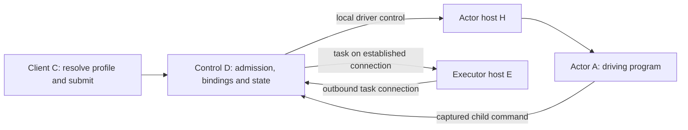
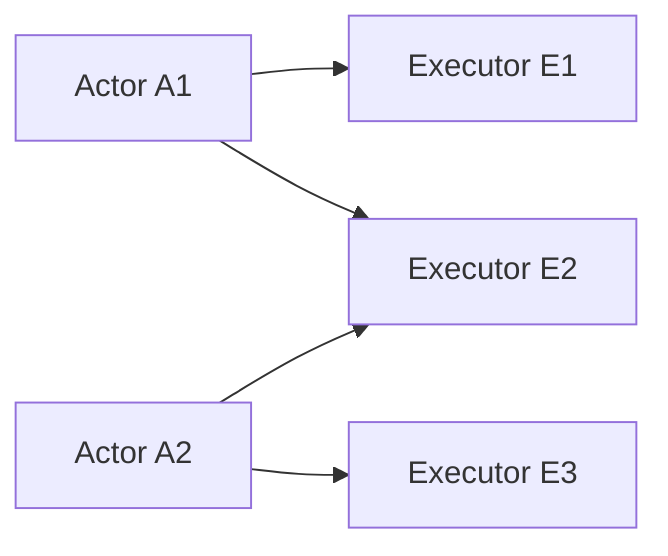

# Deployment topology and daemon responsibilities

Status: rationale for the approved [client execution and actor lifecycle
contract](2026-11-15-client-execution-and-actor-lifecycle-spec.md), 2026-11-15.
The contract defines the required behavior; implementation and acceptance
remain pending. The topology matrix describes connection requirements, not
verified support for every combination.

## Roles and locations

Actor, executor and client describe different responsibilities. The control
entrypoint and actor host also matter when explaining where an operation runs.
An actor host with a public address does not require the actor itself to expose
a public management API.

The following letters are diagram notation, not new product or config names.

| Role | Responsibility | Location question |
| --- | --- | --- |
| C: client | Submit profiles; create, inspect, attach to and stop runs. | Where does the person invoke the CLI? |
| D: control | Admission, scheduling, bindings, run state, routing and coordinated cleanup. | Which daemon accepts the request? |
| H: actor host | Create and stop isolated actors through a local driver. | Which machine owns the VM or container? |
| A: actor | Run the driving program and issue child commands. | Where does the driving program execute? |
| E: executor host | Execute commands and file operations under an explicit local account. | Which machine owns the project and processes? |

Current source places H with D. Remote actor creation is rejected; remote
runners provide native execution, while remote `linux-container` executor
creation remains deferred. See [scheduling](../../../../crates/daemon/src/schedule.rs),
[actor creation](../../../../crates/daemon/src/actor.rs) and
[runner connections](../../../../crates/daemon/src/runner.rs).
These are source observations, not cross-machine acceptance results.

NOTICE: independent remote actor placement and remote container creation are
outside this contract. Their existing limits stay until the owner approves
those slices; the role separation below does not enable them.

## Responsibility contract

One daemon manages multiple independent actor invocations. One run records one
actor invocation and its executor bindings. A driving program can issue many
execs without creating another run. Attach and exec into an existing actor do
not create another actor.

| Operation | Control responsibility | Local responsibility |
| --- | --- | --- |
| Create a run | Validate admission and submitted configuration; establish bindings before work starts; coordinate rollback on failure. | Actor and executor drivers create the accepted local resources. |
| Register or remove a persistent runner | Maintain registration, reported capabilities and connection state. | The runner establishes or closes its task connection. |
| Choose execution placement | Resolve explicit selectors and capabilities without changing execution authority. | The selected execution host supplies the accepted account and resources. |
| Create or stop an actor | Coordinate the run's lifecycle. | The actor driver manages isolation, guest channels and local resources. |
| Acquire or release an executor instance | Apply existing instance keys, pool policy, references and slots. | The executor driver manages its local environment. |
| Execute, transfer files or control a process | Route through the established binding and preserve its identity. | The executor owns the process, PTY, signals and file access. |
| Recover after control restart | Verify identity, reconnect to holders and reconcile actual resources. | Protected holders keep surviving work and its required channels alive. |
| Explicitly stop a run | End that invocation and coordinate cleanup. | End owned processes and mounts; preserve other users of shared resources. |

Creating a run, registering a resource, acquiring an instance and starting a
process are distinct operations. A shared verb such as “create” does not grant
them the same authority. Logical separation also does not require separately
installed management and scheduling services.

Arrows show logical operations as well as connections. They are not a complete
TCP connection diagram. Driver-specific local channels connect the actor to
its host. Executor tasks can travel back along an outbound connection.

## Network topology matrix

This matrix keeps D and H together. “Private network” means an actually
routable network; two unrelated private networks do not become connected by
sharing that description. A public endpoint needs protocol-compatible secure
transport and authentication.

`X → D` means X initiates the connection. Bidirectional tasks on it do not
require D to open a new inbound connection to X.

| Scenario | D/H | E | C | Required paths | Authority consideration |
| --- | --- | --- | --- | --- | --- |
| All roles on one machine | Same machine | Same machine | Same machine | Local management and execution channels. | The management caller and native execution account remain distinct. |
| Three machines on one LAN | LAN | LAN | LAN | C → D and E → D. | Network membership does not establish account identity. |
| Public actor host; private executor | Publicly reachable | Private network with outbound access | Third machine | C → D and outbound E → D. | E supplies an explicit execution account and resources. |
| Public actor host; client is executor | Publicly reachable | Private network | C = E | Client and execution connections reach D. | Creation supplies the invoking account's execution capability. |
| All roles on one private network | Private network X | X | X | Direct private routes to D. | Reachability does not replace authentication. |
| Actor host and client/executor on different private networks | X | Y | Another machine on Y | Each of C and E needs its own route or external tunnel to D. | A client-local port forward does not automatically serve E. |
| Client is executor across private networks | X | Y | C = E | A usable endpoint on the client machine may serve both roles. | Tunnel identity, Needy identity and OS execution account remain distinct. |
| Each role on a different network | X | Y | Z | Independent C → D and E → D paths. | Direct C ↔ E connectivity is unnecessary for the existing relay path. |
| Virtual network supplies common routing | Any | Any | Any | Permitted virtual-network paths to D. | Network ACLs govern reachability; Needy retains its protocol roles and bindings. |

Moving a machine without changing these paths or authority relationships does
not create new execution semantics. A physically separate H would require an
additional actor-host control path and remains outside the approved slice.

## External connection tools

Needy keeps the existing outbound runner task transport. It does not provision
a VPN, NAT traversal or external tunnels.

| Connection method | Required external condition | Needy boundary |
| --- | --- | --- |
| Direct public endpoint | Each initiating role reaches a compatible secure endpoint. | Authenticate callers and retain accepted bindings. |
| SSH forwarding or connector | Each initiating machine has a permitted SSH path to the correct service. | An SSH account does not become the executor UID or Needy administrator. |
| Kubernetes port-forward | The machine running the forward has the required API access and forwarding permission. | Other machines still need a usable route; the forward does not coordinate runs. |
| Cloudflare Tunnel | Choose a connector or routing mode compatible with the protocol. | A working web tunnel does not establish bidirectional gRPC compatibility. |
| Tailscale, ZeroTier or another virtual network | Membership, routes and network ACLs permit the connection. | Network identity does not select a local execution account. |

The [Cloudflare transport evidence](2026-11-13-cloudflare-transport-evidence.md)
records a historical Needy TCP-connector probe. It does not establish support
for every Tunnel or Access configuration.

## Execution authority and daemon visibility

Authenticated clients retain their existing grants and daemon-wide visibility.
This slice introduces no human-account model, creator ACL or fine-grained RBAC.
A record of who created a run is an audit fact, not a new isolation guarantee.

Execution authority still has a concrete boundary. Client-selected execution
uses the capability supplied at creation, under the invoking OS account. It
cannot silently use a privileged runner, the control host or the most recent
viewer. Another client's attach does not replace that binding. A context
selects the control endpoint and credential; changing it does not move an
existing workspace or change an execution account.

Persistent named runners remain explicit execution resources under their
hosting accounts. The current grants remain authoritative. This contract does
not add a per-client delegation system or claim protection against a malicious
admitted control administrator.

NOTICE: stronger resource delegation, per-creator isolation and RBAC are
intentionally deferred at the owner's request. They require a separate owner
approved contract and must not block this slice or be advertised as delivered.

## Mesh is the application graph

Mesh means the actors, executors and accepted execution bindings that Needy
coordinates. It does not mean a new virtual network or direct sockets between
all participants.

Edges represent bindings used by routing. A shared execution machine does not
by itself mean the same instance, account or project directory. Existing
instance keys and pool references continue to decide sharing. The contract
adds neither a multi-actor run nor a new grouping object.

Control maintains the graph because an actor knows its own requests and an
executor knows its local resources. Neither alone knows all bindings and
references. Current [runs](../../../../crates/daemon/src/run/mod.rs),
[pool](../../../../crates/daemon/src/pool.rs),
[routing](../../../../crates/daemon/src/routing.rs) and
[task links](../../../../crates/daemon/src/link.rs) already provide parts of
this coordination. Client execution and restart adoption are approved changes
that still require implementation and behavioral evidence.

NOTICE: pool keys, sharing semantics, direct data paths and additional
orchestrator services are not redesigned here. Reopen them only for a named
owner-approved slice.

## Evidence and references

Current source inspection covers [daemon responsibilities](../../../../crates/daemon/src/lib.rs),
[scheduling limits](../../../../crates/daemon/src/schedule.rs),
[runner task streams](../../../../crates/daemon/src/link.rs) and
[client transport](../../../../crates/api-client/src/lib.rs). The
[setup coverage note](../cli/2026-11-15-setup-locations-and-coverage-evidence.md)
records existing acceptance gaps. These observations do not prove the approved
new behavior.

The following official pages were consulted on 2026-11-15 as explanatory
references. They have no stable version permalink recorded here; no external
constants or source tables are copied from them.

- [Kubernetes architecture](https://kubernetes.io/docs/concepts/architecture/): global coordination and node-local execution are separate responsibilities.
- [Kubelet authentication and authorization](https://kubernetes.io/docs/reference/access-authn-authz/kubelet-authn-authz/) and [Node Authorization](https://kubernetes.io/docs/reference/access-authn-authz/node/): internal components still have identities and bounded roles.
- [Kubernetes port-forward](https://kubernetes.io/docs/tasks/access-application-cluster/port-forward-access-application-cluster/): forwarding provides a connection path, not Needy lifecycle management.
- [Cloudflare gRPC connections](https://developers.cloudflare.com/network/grpc-connections/) and [Tunnel protocols](https://developers.cloudflare.com/cloudflare-one/networks/connectors/cloudflare-tunnel/routing-to-tunnel/protocols/): assess gRPC, TCP connectors, public hostnames and private routing separately.
