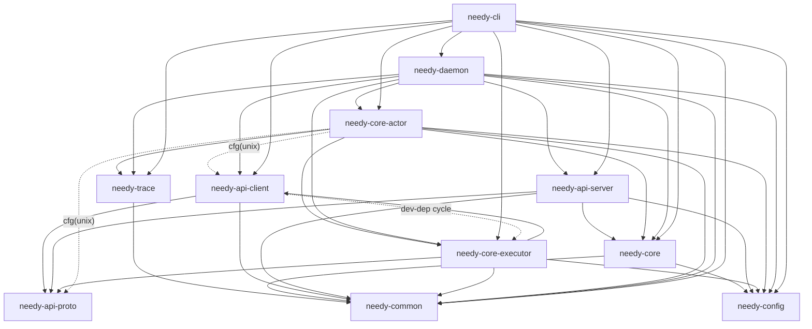

# Codebase Architecture, Rust Idioms, CLI, and Ecosystem Review

Status: architecture review recorded on 2026-11-22 covering all 12 workspace
crates (~105.5k LOC Rust), `images/Dockerfile`, and `docs/TERMS_AND_CONCEPTS.md`,
cross-referenced against `devcontainers/spec` & `devcontainers/cli`, Firecracker,
containerd, BuildKit, and Nix ecosystem practices.

This document records findings and prioritization only; approved scope and
contracts live in
[Architecture cleanup, CLI unification, and standalone image crates (spec)](2026-11-22-architecture-cleanup-and-crate-extraction-spec.md).

---

## 0. Executive Summary

### What Is Working Well (Keep)
1. **Strict actor/executor separation and acyclic runtime DAG**: All 12 workspace
   crates form an acyclic runtime dependency graph. `needy-core` remains pure
   domain logic with no processes, sockets, VMs, or storage. Extension points
   (`core-actor/driver`, `core-executor/driver`, `sidecar`, `capture`,
   `core/intercept`) follow the directory + `mod.rs` registry layout cleanly.
2. **Explicit deferral discipline**: Zero `unimplemented!()` or `todo!()` panics
   exist in `crates/`; deferred work is tracked with explicit errors or
   `TODO(...)` markers.
3. **Strong local engineering pockets**: `cli`'s `BrokenPipe -> 141` discipline,
   secret redaction and control-byte escaping in `diagnostics.rs`, in-memory
   SquashFS/OCI unit tests in `core-actor/src/image/store/mod_test.rs`, and pure
   no-IO report rendering in `core/src/report/`.

### Where Technical Debt and Overengineering Concentrate
1. **God files and God structs**:
   [crates/daemon/src/image.rs](../../../../crates/daemon/src/image.rs) (2,494L),
   [crates/daemon/src/run/mod.rs](../../../../crates/daemon/src/run/mod.rs) (1,332L),
   [crates/api-server/src/control.rs](../../../../crates/api-server/src/control.rs) (1,119L),
   [crates/core-actor/src/image/feature.rs](../../../../crates/core-actor/src/image/feature.rs) (1,100L), and
   [crates/api-server/src/protocol/domain.rs](../../../../crates/api-server/src/protocol/domain.rs) (976L)
   bundle unrelated responsibilities. `Daemon` (21 fields) and `Run` (31 fields)
   act as catch-all receivers with no enforced internal service boundaries.
2. **Domain and host mechanisms leaking into `crates/cli`**: `crates/cli` holds
   1,075L of OS service management (`launchd`/`systemd`), 1,800+L of image
   pull/build/BuildKit/sparse-tar mechanics (pulling `bollard`, `reqwest`, `tar`,
   `flate2`, `sha2`, `ignore` directly into `cli`), hardcoded config mutation
   rules, and direct imports from `needy-api-server`.
3. **Duplicated mechanisms and colliding names**: 3 `SingleFlight`
   implementations, 4 `impl Engine for Fake` mocks, 4 `User::home()`
   implementations, 3 account-remapping paths, 14+ atomic file-write blocks, 54
   poisoned-mutex unwraps; overloaded terms (`holder`, `Placement`, `Event`,
   `image`, `client`, `runner`/`runners`).
4. **Missing idiomatic Rust traits**: Across ~28k LOC of core/protocol crates,
   only 11 `From`/`TryFrom` impls exist (0 in `core`, `common`, `trace`, and
   `api-server/src/protocol/domain.rs`), causing boilerplate conversions and 12
   redundant `.map_err(ControlError::from)?` sites.
5. **Concrete bugs and unclosed loops**: 8 actionable defects were identified
   (Section 5.4).

---

## 1. Monolithic / Tangled Code (Q1)

### 1.1 Largest Monolith Hotspots

| File | Non-test LOC | Mixed Responsibilities | Oversized Functions |
| --- | ---: | --- | --- |
| [crates/daemon/src/image.rs](../../../../crates/daemon/src/image.rs) | **2,494** | 8 concerns: generic `SingleFlight`, cache-key index, VM/container disposable sessions, OCI feature resolution + shell generation, snapshot planning/materialization, `impl Images for Daemon`, container tar export/import, `SessionGuest`/`EditSessionRuns` stubs | `start_edit` ([L1188-L1539](../../../../crates/daemon/src/image.rs#L1188-L1539), 352L), `run_session_in` (129L), `run_container_session_in` (125L), `build_step` (120L, 10 args) |
| [crates/daemon/src/run/mod.rs](../../../../crates/daemon/src/run/mod.rs) | **1,332** | 6 concerns: 31-field `Run`, console polling, trace loading, `Registry` + prefix matching, `Boot`, full lifecycle orchestration + `impl Runs for Daemon` | `provision` ([L703-L790](../../../../crates/daemon/src/run/mod.rs#L703-L790), 88L); 31-field `Run` literal duplicated in `mod.rs:658` and `recovery.rs:196` |
| [crates/api-server/src/control.rs](../../../../crates/api-server/src/control.rs) | **1,119** | All 6 unrelated service traits (`Runs`, `Processes`, `Guest`, `Runners`, `Clients`, `Images`), ~50 DTOs, `Caller`, `Diagnostic`, `ControlError` separated only by comment banners | Single flat contract file |
| [crates/core-actor/src/image/feature.rs](../../../../crates/core-actor/src/image/feature.rs) | **1,100** | 6 concerns: OCI ref parser, hardcoded agent builtins (`codex`, `pi`, `opencode`, `herdr` — violating `AGENTS.md`'s no-agent-concepts rule), `FeatureFlightMap` + 67L `SharedError`, RFC 6750 Bearer parser + OCI v2 HTTP client, atomic cache, tar/gzip metadata extraction | `parse_bearer_challenge` (87L), `fetch_uncached` (64L) |
| [crates/api-server/src/protocol/domain.rs](../../../../crates/api-server/src/protocol/domain.rs) | **976** | All 6 services' proto ↔ domain free functions; `#[cfg(test)] mod tests;` sits mid-file at [L755](../../../../crates/api-server/src/protocol/domain.rs#L755) with 220L of production code below it | 54 hand-written conversion functions |
| [crates/daemon/src/runner.rs](../../../../crates/daemon/src/runner.rs) | **943** | Remote runner enroll/heartbeat/bidirectional streams + `serve_client_execution` (re-implements a second heartbeat loop inline at [L897-L927](../../../../crates/daemon/src/runner.rs#L897-L927)) | `exec` ([L695-L817](../../../../crates/daemon/src/runner.rs#L695-L817), 123L) mixes stream plumbing with `bound_run` authorization |
| [crates/core/src/report/mod.rs](../../../../crates/core/src/report/mod.rs) | **934** | `Tally`, `Summary`, `summarize()`, and the full Markdown renderer `write_report()` (which bypasses `Summary` and duplicates finding generation & slowest-command sorting from `summarize()` at [L651-L678](../../../../crates/core/src/report/mod.rs#L651-L678) vs [L832-L872](../../../../crates/core/src/report/mod.rs#L832-L872)) | `write_report` (170L) |
| [crates/daemon/src/relay/mod.rs](../../../../crates/daemon/src/relay/mod.rs) | **905** | Exec validation, `sync::mount_instance` hook, routing + chaos short-circuit, stream filter installation, upstream capacity policy, diagnostic rewriting, relay tasks | `Processes::exec` ([L320-L534](../../../../crates/daemon/src/relay/mod.rs#L320-L534), 215L) |
| [crates/core-actor/src/image/store/oci.rs](../../../../crates/core-actor/src/image/store/oci.rs) | **856** | Generic OCI Image Layout / Docker `tarexport` I/O mixed with needy shim-layer synthesis; `materialize` and `export_snapshot` copy-paste ~80L of manifest/index/tar assembly | `materialize` (85L), `export_snapshot` (74L), `synthesize_shim_layer` (98L) |
| [crates/daemon/src/sync.rs](../../../../crates/daemon/src/sync.rs) | **803** | Persistent store seeding, per-run copy mounts, 3-way merge, and merge-driver execution (duplicating `image.rs` snapshot/materialize dispatch) | `run_merge_driver` ([L592-L791](../../../../crates/daemon/src/sync.rs#L592-L791), 200L) |

Secondary hotspots:
- [crates/cli/src/commands/daemon/service/mod.rs](../../../../crates/cli/src/commands/daemon/service/mod.rs) (791L + `launchd.rs` 141L + `systemd.rs` 143L = 1,075L).
- [crates/core-actor/src/driver/linux_container/mod.rs](../../../../crates/core-actor/src/driver/linux_container/mod.rs) (715L): `Started` and `SessionContainer` duplicate lifecycle handling; `SessionContainer` bypasses `Driver`/`Running`.
- [crates/core-executor/src/process/proc.rs](../../../../crates/core-executor/src/process/proc.rs) (652L): `Proc`, `Seats`, and `Fanout`/`Live` under 3 locks; clean submodule candidates.
- [crates/common/src/merge.rs](../../../../crates/common/src/merge.rs) (633L): mixes 3-way merge, external driver staging, low-level tree scanning, and line append; uses `anyhow::Result` in a library crate (violating `AGENTS.md`).

### 1.2 God Structs
- **`Daemon`** ([crates/daemon/src/lib.rs:213-264](../../../../crates/daemon/src/lib.rs#L213-L264), 21 fields): sole receiver for all 6 control traits and 9 separate `impl Daemon` blocks.
- **`Run`** ([crates/daemon/src/run/mod.rs:66-125](../../../../crates/daemon/src/run/mod.rs#L66-L125), 31 fields): mixes immutable config, 6 `std::sync::Mutex` fields, 1 `tokio::sync::Mutex`, 2 state machines, `OnceCell`, `watch`, `TaskTracker`, and `CancellationToken`.
- **`Start<'a>`** ([crates/core-actor/src/driver/mod.rs:353-378](../../../../crates/core-actor/src/driver/mod.rs#L353-L378)): option-bag mixing VM-only `layer_disks`, container-only `snapshot_image`, and `linux-container`-only `mounts`.

---

## 2. Rust Idioms and Missing Standard Traits (Q2)

Across the 6 non-generated core/protocol crates (~28k LOC), only 11 `From`/`TryFrom` impls exist (0 in `core`, `common`, `trace`, and `api-server/src/protocol/domain.rs`).

### 2.1 Orphan-Rule Classification in `api-server/src/protocol/domain.rs`
1. **Orphan-rule SAFE (local `control::*` ↔ foreign `v1::*`) — convert to `From`/`TryFrom`**:
   - `WindowSize` ([control.rs:479](../../../../crates/api-server/src/control.rs#L479)): reverse conversion missing, duplicating `WindowSize { rows: w.rows, cols: w.cols }` 4 times (`domain.rs:356, 516, 563, 874`).
   - All ~30 local `control::*` request/response/info structs (`NewRun`, `RunInfo`, `ProfileToCheck`, `ProfileCheck`, `RunFaults`, `Route`, `ExecSpec`, `ExecInput`, `ExecOutput`, `Started`, `ProcessInfo`, `GuestConfig`, `StoredEvent`, `NewJoinToken`, `JoinTokenInfo`, `Joining`, `RunnerReport`, `RunnerHost`, `RunnerInfo`, `ClientInfo`, `ClientAccess`, `Image*`) plus sub-structs `v1::GuestCopy` and `v1::RecordedCommand`.
   - Fix `proto_client_access` ([domain.rs:772](../../../../crates/api-server/src/protocol/domain.rs#L772)) returning `i32` while sibling helpers return typed `v1::*` enums.
2. **Orphan-rule BLOCKED (foreign `v1::*` ↔ foreign `core`/`common`/`config`) — free functions are legitimate**:
   - `v1::Origin <-> core::types::Origin`, `v1::RunState <-> core::types::RunState`, `v1::ExecExited <-> common::process::Exit`, `v1::ImageCommit <-> core::image::Commit`, etc.
3. **Lossy/partial conversions — correctly NOT `From`**:
   - `diagnostic`/`proto_diagnostic` (`Option`), `exec_input` (`Option` dropping duplicate `Start`/`Attach`).

### 2.2 Missing `From<domain::Error> for tonic::Status`
[crates/api-server/src/protocol/status.rs:50-61](../../../../crates/api-server/src/protocol/status.rs#L50-L61) implements `From<ControlError> for Status` and `From<domain::Error> for ControlError`, but omits `From<domain::Error> for Status`. Twelve gRPC handler sites must therefore write `.map_err(ControlError::from)?`, and 7 additional sites manually call `status::status(e)` despite `From<ControlError> for Status` existing.

### 2.3 Other High-Value Missing Standard Traits
- `api-client`: `From<tonic::Code> for Kind` (`error.rs:179`), `From<Channel> for Client` (`lib.rs:148`).
- `api-server`: `From<&str>`/`From<String>`/`FromStr` for `Listen` (`server.rs:40`); missing `#[source]` on `ControlError::Diagnostic { error, .. }` (`control.rs:71`).
- `common`: `Display` + `Default` for `Exit` (`process.rs:5`; also `signal: Option<String>` instead of empty `String`).
- `config`: `From`/`Display`/`AsRef`/`IntoIterator` for `Duration`, `ByteSize`, `Words`, `Glob`, `Template` (`value.rs`); `FromStr` + `Display` for `Side` (`profile/files.rs:197`), `OciRuntime`, `ActorDriver`, `ExecutorDriver`, `IdentityField`.
- `core`: `FromStr`/`AsRef<str>`/`Display` for `RunState`, `ActorState`, `Origin`, `Network` (`types.rs`; `Network` missing `Display` forced ad-hoc `network_name()` in `report/mod.rs:365`), `FaultSource`, `Transfer`; `From<Payload> for Event` generated by `events!` macro (`event.rs`); `From<[u8; 32]>`/`AsRef<[u8]>` for `Digest` (`image/mod.rs:99`); `FromStr` for `FeatureMetadata` (`image/feature.rs:216`).

---

## 3. CLI and Output Layering & Best Practices (Q3)

### 3.1 Output Layering Leaks
- **Direct `eprintln!` / `writeln!(stderr)` bypassing `output`**:
  [commands/run/mod.rs:416](../../../../crates/cli/src/commands/run/mod.rs#L416),
  [commands/config.rs:497-499,663](../../../../crates/cli/src/commands/config.rs#L497-L499),
  [commands/runner.rs:416](../../../../crates/cli/src/commands/runner.rs#L416),
  [commands/daemon/service/mod.rs:256](../../../../crates/cli/src/commands/daemon/service/mod.rs#L256),
  [diagnostics.rs:245-260](../../../../crates/cli/src/diagnostics.rs#L245-L260).
- **Duplicated TTY/`NO_COLOR`/progress logic**: copy-pasted 5 times across `output/mod.rs`, `commands/run/report.rs`, and `commands/image/progress.rs`; `commands/image/progress.rs` wraps `indicatif` outside `output/` with different `TERM != "dumb"` rules.
- **Inconsistent stdout vs stderr for human prose**: most mutations write stderr via `output::acknowledge`, but `daemon service install`, `runner join`, and `run chaos add/rm` write human prose to stdout; `image/progress.rs:39-46` switches stdout/stderr depending on TTY.
- **Spinner leaks into `-o json`**: [commands/image/log.rs:67](../../../../crates/cli/src/commands/image/log.rs#L67) animates on stderr even under `-o json`.
- **Ad-hoc tables & inverted dependency**: [cli/src/runs.rs:101-114](../../../../crates/cli/src/runs.rs#L101-L114) hand-pads columns and imports `crate::commands::runner::ago`.
- **Inconsistent JSON shapes**: `config context check` and `daemon service status` emit 1-element arrays `[{...}]`, `client/runner invite` emit `{"version": 1, ...}`, and `profile check` emits an unversioned object.

### 3.2 CLI Best Practices Gaps
- **`-o` / `--output` flag collision**: 4 different format enums share `-o`/`--output`, while [commands/image/export.rs:30-31](../../../../crates/cli/src/commands/image/export.rs#L30-L31) uses `-o`/`--output <PATH>` as a file path (whereas `run report` uses `--file`).
- **`proc exec -e` silent drop**: [commands/proc/exec.rs:132](../../../../crates/cli/src/commands/proc/exec.rs#L132) uses `.filter_map(|kv| kv.split_once('='))`, silently dropping malformed `--env` entries.
- **`--diagnostic-format json` bypassed**: [image/pull.rs:110,115](../../../../crates/cli/src/commands/image/pull.rs#L110-L115), [image/rm.rs:51,56](../../../../crates/cli/src/commands/image/rm.rs#L51-L56), and [run/mod.rs:292-293](../../../../crates/cli/src/commands/run/mod.rs#L292-L293) print directly and return `Ok(1/2)`.
- **Global flag leakage**: `--context`/`--address`/`--credential-file` (`global = true`) appear in `--help` for every local-only subcommand, fail via `anyhow::bail!` (losing structured reason codes), and force `#[arg(skip)] address` hacks in `config context pair/set`.
- **Missing standard affordances**: no `-q/--quiet`, no `RUST_LOG` support in `logging.rs:54-66`, no `Termination` guard around `config context pair`'s one-time credential save, and `config paths` omits `cache`.

### 3.3 Business Logic Leaking into `crates/cli`
- `commands/daemon/service/` (1,075L): OS service lifecycle (`launchd`/`systemd`, `getpwnam_r`, `chown`, polling) belongs in `needy-daemon`.
- `commands/image/{pull,build,ls,rm}` (1,800+L): HTTP download, SHA-256 verification, `write_sparse` tar unpack, BuildKit streaming, local store discovery/deletion belong in `needy-core-actor::image`. `image build` also conflates 3 unrelated workflows (definition build, `--from` OCI-to-VM, checkout base build).
- `commands/config.rs:227-292`: hardcoded `WRITABLE` list & YAML mutation belong in `needy-config::global`.
- `commands/fs.rs:173-219`: tar pack/unpack belongs in `needy-api-client::files`.
- `commands/run/execution.rs:10-12`: imports `needy-api-server` internals and spawns `setsid()` subprocesses; belongs in `needy-daemon::runner`.
- [crates/cli/tests/cli.rs](../../../../crates/cli/tests/cli.rs) (4,441L, 169 tests): should be split into domain submodules under `tests/cli/`.

---

## 4. Devcontainer, Docker Tests, Firecracker/containerd, Standalone Crates & Nix (Q4)

### 4.1 Lessons from `devcontainers/spec` & `devcontainers/cli`
1. **`dependsOn` vs `installsAfter`**: `core/src/image/mod.rs:535-572` validates `installsAfter` order and errors instead of topologically sorting per spec.
2. **UID/GID remapping**: `needy` currently maintains 3 separate account-remapping paths (`core-executor/account.rs` scratch container, `guest/init/account.rs` guest bind, `daemon/image.rs:2425-2446` build-time `useradd`/`adduser`).
3. **Auth & metadata**: feature fetcher supports anonymous registries only (`~/.docker/config.json` is `TODO`); `onCreateCommand` and `postAttachCommand` are parsed but unexecuted.

### 4.2 Firecracker & containerd Alignment
- **Firecracker custom patch cost**: [linux_firecracker/config.rs:162-205](../../../../crates/core-actor/src/driver/linux_firecracker/config.rs#L162-L205) passes identity via `NEEDY_*` env vars to a 382-line patch (`images/firecracker/needy.patch`) built against hand-compiled musl `libseccomp`.
- **VM driver drift**: `linux_firecracker::Vm` and `macos_vz::Vm` duplicate `Child` wrappers with divergent spawn error types (`Error::driver` vs `Error::Unsupported`) and layer caps (16/28 in `config.rs:54-62` vs hardcoded `MAX_UNFLATTENED_LAYERS = 8` in `store/mod.rs:52`).
- **OCI/containerd friction**: `linux_container/mod.rs:435-441` relies on Docker-specific `/info` `runtimes[runsc].runtimeArgs`; `account.rs:25-56` launches a scratch container + 3 archive downloads on every start; `oci.rs:197-222` must emit hybrid OCI+Docker tarballs.

### 4.3 Docker-Side Testing & `images/Dockerfile` Anti-Patterns
1. **4 duplicated `impl Engine for Fake` mocks** (~300L total across `core-actor`, `core-executor`, and `daemon`): consolidate into a single `engine::testing::Fake`.
2. **Brittle 11–12 step call-sequence assertions** in both `linux_container/mod_test.rs` files assert internal `account::binds` scratch-container calls already covered by `account_test.rs`.
3. **Silently-skipping live Docker unit tests** ([core-executor/src/driver/linux_container/mod_test.rs:317-393](../../../../crates/core-executor/src/driver/linux_container/mod_test.rs#L317-L393)): move to `cargo xtask e2e` so skips cannot mask regressions.
4. **`images/Dockerfile` (316L)**: mixes 6 unrelated artifacts in 12 stages, duplicates `actor-root`/`container-root`, squashes `actor-container` into a single layer via `FROM scratch` + `COPY --from=container-root / /` (L298-300, defeating registry caching), bakes ~200 MB `opencode` into base images (`TODO(rootfs)` L234), and only SHA-256-verifies `libseccomp`.

### 4.4 Standalone Rust Crate Candidates & Nix Readiness
1. **`oci-layer`** (zero needy coupling): extract `Digest` (`core/src/image/mod.rs`), `archive.rs`, `collapse.rs`, generic OCI/Docker tar I/O from `oci.rs` (turning shim synthesis into a caller post-layer hook), and `disk.rs` behind a `squashfs` feature.
   - *Nix path*: consumes daemonless Nix layer streams (`nix2container` / `dockerTools.streamLayeredImage`) and emits OCI Image Layouts or SquashFS disks for Firecracker/VZ without `dockerd`.
2. **`devcontainer-features`** (zero needy coupling): extract `FeatureMetadata`/options/lifecycle parsing (`core/src/image/feature.rs`, generic `customizations: serde_json::Value`), `dependsOn` + `installsAfter` topological solver (`core/src/image/mod.rs`), OCI Distribution v2 client (`core-actor/src/image/feature.rs`, stripping hardcoded agent `BUILTINS`), and `install.sh` wrapper (`daemon/src/image.rs:2398-2466`).
   - *Nix path*: resolves and locks Dev Container features into Fixed-Output Derivations (FODs) and materializes `devcontainer-features.env` into Nix build sandboxes.

---

## 5. Call-Chain Maps, Module DAG, High-Frequency Helpers & Unclosed Loops (Q5)

### 5.1 Workspace Crate Dependency Graph

Awkward edges: `api-client` dev-depends on `core-executor` (dev-dep cycle); `core-executor::service` implements `api-proto` directly instead of via `api-server`; `daemon` and `cli` consume `api-proto` transitively via `api_client::proto::v1`.

### 5.2 Core End-to-End Call Chains
- **`run create`**: `cli::commands::run` (`snapshot::resolve` → `lockfile::read` → `ensure_vm_base` → `execution::launch`) → `RunService.CreateRun` → `daemon::run::Daemon::create_run` (`prepare` → `save_run` → `provision`: `schedule::placement` → `image::prepare` → `pool::acquire` → `files::copy_in` → `sync::seed` → `actor::start`).
- **Exec interception**: `binfmt_needy`/shim → `cli::main::guest` → `core-actor::guest::proxy::main` → `RunService.Decide` → `daemon::routing::route` → `core::intercept::exec::Chain::decide` → (`deny`/126 | local `execve` | `ExecStream` → `daemon::relay::Processes::exec` → `StreamFilter` → `pool` `Instance`).
- **`image build` / `pull`**: definition builds go through `ImageService.BuildImage` → `daemon::image::resolve_image_snapshot` → `FeatureStore` + `core::image::plan` + `SingleFlight` + `run_session` → `core-actor::image::store`; `--from`, checkout builds, and `image pull` bypass the daemon and call `bollard`/`reqwest` directly from `cli`.
- **Runner join & scheduling**: `runner invite` (`daemon::runners`) → `runner join` (`daemon::runner::enroll`) → `runner serve` (`RunnerService.Control` → `daemon::link`) → `daemon::schedule::placement`.
- **`run report`**: `cli::commands::run::report` → online `RunService.GetRunEvents` or `--offline` `trace::sink::sqlite::load` → `core::event::Event::decode` → `core::report::render`.

### 5.3 High-Frequency Boilerplate Candidates for Helpers
1. **54 poisoned-mutex unwraps** (`.lock().unwrap_or_else(|p| p.into_inner())` in `daemon`) → shared `MutexExt` / `lock()`.
2. **15+ CLI connect + progress + error-mapping blocks** → `ctx.connect_with_progress()` / `ctx.connect_run()`.
3. **14+ atomic file writes** (`tempfile` + `0o600` + `sync_all` + `rename`) → `needy_common::fs::write_atomic`.
4. **12 task-group teardowns** (`cancel.cancel(); tasks.close(); tasks.wait().await;`) → shared helper.
5. **Lockfile read/update flow** duplicated between `commands/image/*` and `commands/run/mod.rs`.

### 5.4 Unclosed Loops: Concrete Bugs vs Intentional Deferrals

**Concrete bugs / broken loops:**
1. [crates/daemon/src/lib.rs:345-364,416](../../../../crates/daemon/src/lib.rs#L345-L364): `Daemon::serve` calls `suspend_control()` twice and checks `cleanup_incomplete`, which `suspend_control()` never sets (`IncompleteShutdown` unreachable).
2. [crates/daemon/src/run/mod.rs:718,723](../../../../crates/daemon/src/run/mod.rs#L718-L723): `sync::check(self, run)?` is called twice consecutively.
3. [crates/daemon/src/guest.rs:217-228](../../../../crates/daemon/src/guest.rs#L217-L228): `Daemon::push_layer` writes orphaned `upper.tar` never consumed or deleted (`image.rs` uses `SessionGuest` instead).
4. [crates/daemon/src/run/recovery.rs:238-245](../../../../crates/daemon/src/run/recovery.rs#L238-L245): `restore_run` only restores `boot.snapshot` and drops `sync_files`, `start_hooks`, `stop_hooks`, `env`, `layer_disks`, etc.
5. [crates/daemon/src/reconcile.rs:197-200](../../../../crates/daemon/src/reconcile.rs#L197-L200): stale `TODO(trace)` omits `run.fail` even though `Dispatch::resume` (`run_trace_at`) is already implemented.
6. [crates/cli/src/commands/fs.rs:23,108](../../../../crates/cli/src/commands/fs.rs#L23): `--help` documents `EXECUTOR:PATH`, but code only accepts literal `remote:`.
7. [crates/cli/src/commands/proc/exec.rs:132](../../../../crates/cli/src/commands/proc/exec.rs#L132): `-e KEY=VALUE` silently drops entries without `=`.
8. [crates/core-executor/src/driver/linux_container/mod.rs:235,241](../../../../crates/core-executor/src/driver/linux_container/mod.rs#L235-L241): dead 404 pull fallback (already pulled in `account::binds`); [crates/core-actor/src/guest/init/program.rs:53-68](../../../../crates/core-actor/src/guest/init/program.rs#L53-L68) duplicates 14 `.env(...)` calls instead of calling `environment()`.

**Intentional deferrals (`TODO(...)`):** `files.ignore_file`, `executor_network`, recipe `network_mac`/`smt`, `onCreateCommand`/`postAttachCommand`, `otel` sink, `ask` interceptor, remote actor & remote container-executor placement, runtime sensor chaos, daemon-side VM base auto-pull, unbounded standalone `Daemon::processes`, `files::fetch/push` filter check.

---

## 6. Excessive Layers, Objects, and Function Names (Q6)

- **Parallel DTO proliferation**: `Event` has 7 representations, `Fault` has 6, `Run`/`Process`/`Runner` have 5 each, `User` has 4 (3 identical: `config::profile::User` vs `control::GuestUser` vs `v1::*`).
- **`EditSessionRuns` fake `Runs` impl** ([crates/daemon/src/image.rs:2305-2362](../../../../crates/daemon/src/image.rs#L2305-L2362)): implements 12 methods (11 returning `role_denied`) just to intercept `decide()`.
- **`control.rs` 1:1 pass-through DTOs**: ~15 structs mirror `v1::*` field-for-field while `Runners::control`/`task` already use `v1::*` directly; `ImageBuild`/`ImageEditStart`/`ImageExport` repeat the same 5 fields verbatim.
- **Over-parameterized & stale signatures**: 10-argument `build_step`/`resolve_step` (`#[allow(clippy::too_many_arguments)]`); unused `_channels`/`_transport` in `actor::serve_guest`/`serve_gateway`; read-only `Registry` split from mutating `Daemon`.

---

## 7. Duplicated Naming and Mechanisms (Q7)

### 7.1 Overloaded Names Across Crates
- **`holder`**: `daemon::holder` (local restart-survival supervisor) vs `cli::run::execution` / `daemon::runner::serve_client_execution` (client-side execution bridge).
- **`Placement`**: `core::types::Placement` (`Actor | Executor(String)`) vs `api-server::control::Placement` (`ControlHost | Runner(String)`).
- **`image`**: spans 6 crates covering release base images, declarative layered snapshots, and the injected `guest` binary disk.
- **`runner` vs `runners`**: opposite roles side-by-side in `crates/daemon/src/`.
- **`client` / `clients`**: gRPC transport (`api-client`), paired principal (`daemon::clients`), and client-side execution target (`client_execution`).
- **`relay` / `link`**: `core-executor::relay` (TTY), `daemon::relay` (exec stream + filter), `daemon::link` (runner stream).
- **`Record` / `Snapshot`**: `sync::Record` vs `holder::Record`; `run::recovery::Snapshot` vs `image::store::Snapshot`.

### 7.2 Near-Identical Mechanisms
- `config::profile::files::OnConflict` ≡ `common::merge::Choice` (identical 4-variant enum).
- 3 `SingleFlight` implementations; 3 session launchers in `daemon/src/image.rs`; 4 `User::home()` implementations (`core-executor/options.rs:80` ignores `root -> /root`).
- Duplicated `exit(ExecExited)`, `oci_arch`, `hex()`, gzip magic detection (3×), `remove` ignoring `NotFound` (4×), `libc::geteuid()` (9×), `EXPORT_CHUNK`/`CHUNK`, `Adapter::operator` (3×), hand-rolled `shell_join` (while `shell-words` is in the workspace), 3× `ping+lease` reconnect blocks in `holder/mod.rs`, duplicated proto enum decoders in `api-server` and `cli`.

---

## 8. Module Hierarchy, Directory Structure & CLI Help Audit (Q8)

### 8.1 Directory Structure Issues
- `crates/daemon/src/`: 27 flat entries mixing 2018-style `actor.rs`+`actor/` with `mod.rs` dirs; `recovery_test.rs` attached to `reconcile.rs:350`; `store/mod.rs` inlines runner CRUD while other tables are submodules.
- `crates/cli/src/`: `commands/profile.rs` belongs under `commands/config/profile.rs`; `commands/daemon/runner.rs` is orphaned from `daemon` and belongs in `commands/runner/`; `commands/proc/ps.rs` mismatches `proc ls` (stale doc comments); duplicate `tests/lifecycle.rs` and `tests/cli/lifecycle.rs`.
- `crates/api-server/src/`: `control.rs` and `protocol/domain.rs` should split per-service to mirror `protocol/grpc/v1/`.

### 8.2 CLI `--help` Audit (~58 Leaf Subcommands)
Zero commands use `after_help` or short/long `about`/`long_about` separation:
- **Contradictory**: `fs cp` (`EXECUTOR:PATH` vs literal `remote:`).
- **Completely blank**: all 7 `daemon service` subcommands and all their flags (`commands/daemon/service/mod.rs:29-89`), plus dozens of flags/subcommands across `config`, `daemon`, `runner`, `client`, `profile`, `proc`, `run/report`.
- **Internal jargon**: root `cli.rs:21` ("driving program"), `--credential-file` ("Private outgoing bearer file"), `config set` ("atomically save a valid complete candidate").
- **Unstructured / inconsistent**: 4–6 line walls of text on `image build` flags and `run ls`/`stop`; inconsistent punctuation and terminology (`redacted` vs `masked`).
