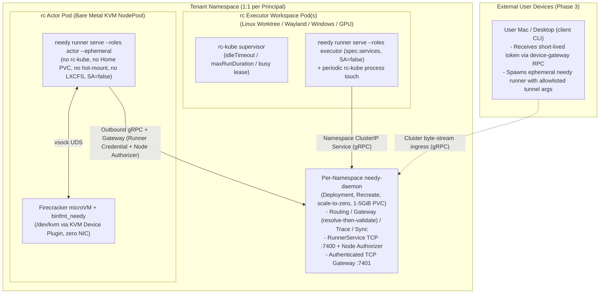

# Needy on Kubernetes with `rc` and Managed IaaS

Status: **design (settled via architecture grill and code review, not implemented)**, 2026-11-23.
This document records the settled cross-layer design for running Needy's
actor-executor model on Kubernetes alongside `rc` (a Kubernetes workspace
orchestrator), a managed IaaS control plane (IaC, quota, billing, bare-metal
provisioning), and an external device gateway for user-owned clients.

> **Revision notice (2026-11-26):** Parts of this design changed on
> 2026-11-25 and 2026-11-26; the text below is kept as written.
>
> - KVM nodes are not bare metal. They are nested-virtualization pools of
>   EC2 8th generation Intel families (c8i, m8i, r8i and their flex
>   variants) on the stock EKS AL2023 AMI, with `/dev/kvm` exposed by a
>   generic-device-plugin as a cluster-specific extended resource
>   (`lobe-iaas.lobehub.com/kvm` there), not `devices.kubevirt.io/kvm`
>   (section 5, item 6, and D6).
> - `rc`'s `Workspace` already has `hotMount`, `lxcfs`, `supplementalGroups`
>   and `podReplacementPolicy` in `v1alpha1`; `needyExecutor` and the
>   `Actor` resource do not exist yet (D3).
> - Image distribution follows
>   [One layered OCI base for VM and container actors](2026-11-25-layered-oci-base-spec.md):
>   standard OCI images built on `actor-base` and a layer registry of
>   ordinary images, not `needy image edit` pushes (D6).
> - A standalone actor runtime design (`runn`, drafted 2026-11-24) is
>   deferred. D1, D2, D4 and D5 stand; D5's fail-fast restart contract
>   matches the code at `ad4a146`.
> - The owner decided the division of work on 2026-11-26: `rc` owns needy
>   on Kubernetes (daemon, `Actor`, Workspace executors); `devices-api` only
>   creates `rc` resources; user-device executors (D7) are out of the MVP.
>   See the handoff [Integrating needy into `rc`](2026-11-26-rc-integration-guide.md).

Related notes:

- [Deployment topology and daemon responsibilities](2026-11-15-topology-and-daemon-responsibilities-design.md)
- [Drivers and extension points](2026-11-12-drivers-and-extension-points-design.md)
- [Container actor runtime](2026-11-10-container-actor-runtime-design.md)
- [Runners and runs](2026-11-10-runner-and-run-design.md)
- [needy through a Cloudflare Tunnel](2026-11-13-cloudflare-transport-evidence.md)

## 1. Goals and Layer Responsibilities

The design keeps Needy usable standalone on local developer machines with the
same profile YAML while integrating cleanly into a multi-tenant Kubernetes
stack without rewriting Needy's data plane in Go or tearing down `rc`'s
existing workspace features.

| Layer | Owns | Explicitly Does Not Own |
| --- | --- | --- |
| **Managed IaaS Control Plane** | VPC/EKS/Karpenter IaC (standard, gVisor, and bare-metal KVM node pools), tenant namespaces, quota, billing/usage events, warm capacity | Container-level routing, guest interception, Git worktree management |
| **`rc` (Kubernetes Orchestrator)** | Kubernetes control plane & CRD orchestration: heavy persistent **Executor `Workspace`** (Git `Repository`/`Worktree` CSI cloning, cache acceleration, Wayland GUI, Windows, GPU, `rc-kube`, `idleTimeout`/`maxRunDuration`), lightweight **pure `Actor` CRD** (timeout/anti-zombie lifecycle and quota observation), and lazy per-namespace `needy-daemon` reconciliation | Re-implementing Needy's command rules, gateway, chaos, or file sync in Go |
| **Needy (`needy-core` / `needy-daemon` / `needy` binary)** | Sandbox kernel (`linux-firecracker` + `binfmt_needy`, or container shims), per-namespace routing/gateway/relay/trace control plane, M:N actor-executor mesh, image layer definitions & `image edit`, and native executors on Linux/macOS/Windows | Kubernetes scheduling, tenant billing, CSI PVC cloning |
| **External Device Gateway + Client CLI (Phase 3)** | Control-plane pairing (`rpc_request`) to broker short-lived Needy runner credentials and structured tunnel parameters to online user devices (macOS/Desktop) | Carrying high-throughput raw gRPC/SSHFS streams through serverless HTTP workers |

## 2. Target Topology

Each tenant maps 1:1 to a Kubernetes Namespace. Multi-tenant isolation is
enforced at the Kubernetes Namespace + NetworkPolicy boundary, reinforced by
in-process SSRF and principal-scoping controls inside `needy-daemon`. A
`needy-daemon` instance is **never** shared across namespaces.

## 3. Settled Architecture Decisions

All decisions below were settled and stress-tested against the actual codebases.

### D1. Separate Per-Namespace `needy-daemon` and Independent Actor Pods
- **Decision**: Per-namespace `needy-daemon` runs as a lightweight Deployment
  (control plane, routing, gateway, trace, sync). Each Actor runs in its own
  dedicated Pod (scheduled on bare-metal KVM nodes for Firecracker, or
  standard/gVisor nodes for shim fallback) rather than spawning microVMs inside
  the daemon Pod.
- **Rationale**: Preserves 1-Pod = 1-Actor scheduling, Karpenter bin-packing,
  per-workload quota, and billing. Keeps each Actor Pod free of a heavy
  daemon/sidecar process.

### D2. Unified `kubelet`-Style `needy runner serve --roles actor --ephemeral` & Node Authorizer
- **Decision**: Do **not** introduce a separate `needy actor serve` process or
  a parallel `actor_token` credential type. Keep only **two** core runtime
  roles (`needy daemon serve` and `needy runner serve`) and **one** node
  credential family (`needy-runner.<name>.<64hex>`):
  - An Actor Pod runs `needy runner serve --roles actor --ephemeral` (no
    `state.db`, no `holder`), reporting `actor(linux-firecracker)` over
    `RunnerService.Control`.
  - When `CreateRun` schedules an actor onto that runner (`actor.runner`),
    `needy-daemon` dispatches `StartActor` over `RunnerService.Control`. The
    runner boots Firecracker and proxies local vsock ports (`7000`/`7001`/`7002`)
    plus console/lifecycle streams outbound to `needy-daemon` using its
    256-bit `Runner Credential` and `x-needy-run-id: <run_id>`.
  - **Node Authorizer**: `needy-daemon` authorizes actor-scoped requests
    (`GuestService/*`, `RunService/Decide`, `ProcessService/Exec`, TCP Gateway)
    only when `caller == Runner(name)`, the run is active (non-terminal),
    `run.actor_runner == Some(name)`, and the runner's active connection
    generation matches. The `Runner Credential` never enters the Firecracker
    guest VM.
  - Under `--ephemeral`, the runner exits cleanly once its assigned Actor Run
    finishes so Kubernetes transitions the Pod to `Completed`.
- **Rationale**: Halves process/token/API surface area, matches Kubernetes'
  `kubelet` + Node Authorizer model, and supports both K8s 1-Pod-1-Actor
  (`--ephemeral`) and bare-metal multi-VM hosts with the exact same binary and
  protocol.

### D3. `rc` Split: Pure `Actor` CRD (with Native Profile Passthrough) + Persistent Executor `Workspace` CRD
- **Decision**: Do **not** force Actors into the heavy `rc` `Workspace` Pod
  layout (which mandates a Home PVC, `rc-kube` as PID 1, `hot-mount`, and
  `WorkspaceExec` semantics). Instead, extend `rc` in a backward-compatible
  way (retaining `v1alpha1` to avoid CRD Conversion Webhook and TLS certificate
  overhead unless breaking schema changes later require `v1alpha2`):
  - Retain **`Workspace`** for heavy, persistent development machines and
    **Executors** (Worktree CSI cloning, cache acceleration, Wayland, Windows,
    GPU, `rc-kube`, `idleTimeout`/`maxRunDuration`), adding explicit optional
    fields for `hotMount`, `lxcfs`, `supplementalGroups`, and `needyExecutor`
    (`automountServiceAccountToken` already exists in `v1alpha1`).
  - Introduce a lightweight **`Actor` CRD** (provisional name) reconciled by
    `rc-controller` with:
    1. **Typed Kubernetes orchestration envelope** (`resources`/KVM,
       `nodeSelector`/`tolerations`, `idleTimeout`, `maxRunDuration`,
       `deleteAfterCompleted`, `env` with `secretKeyRef`);
    2. **Native Needy profile passthrough** (`spec.profile.{builtin | configMapRef | inline}`):
       passed verbatim to `needy-daemon` for schema validation, `extends`
       resolution, and rule compilation—no duplicate Go schema maintenance;
    3. **Independent per-Actor credential & retention lifecycle**: owned
       short-lived Runner credential Secret (TTL bounded by `maxRunDuration`,
       revoked on completion/deletion and garbage-collected via
       `OwnerReference`), pure Actor Pod (no `rc-kube`, no Home PVC, no
       `hot-mount`, no LXCFS, `automountServiceAccountToken: false`), and
       `rc`-style `idleTimeout`/`maxRunDuration`/`deleteAfterCompleted`
       reclamation.
- **Rationale**: Avoids `rc-kube → needy → firecracker → guest init` 4-layer
  supervision and double-PTY nesting, preserves `Workspace`'s Home PVC
  invariants, prevents LXCFS `/proc/cpuinfo` overrides from breaking Needy's
  KVM CPU feature probing, and keeps 100% compatibility with evolving Needy
  profile YAML.

### D4. M:N Mesh Owned by Per-Namespace `needy-daemon`
- **Decision**: `rc` resources remain single-machine abstractions (`Workspace`
  or `Actor`). Many-to-many routing (`M` actors × `N` executors, mixing
  in-cluster `rc` Executor Workspaces and external macOS/Windows machines) is
  handled by the namespace's `needy-daemon` using Needy's native runner
  registry and profile `runner:` selectors.

### D5. Lazy Per-Namespace `needy-daemon` with Small Persistent PVC (`Recreate`)
- **Decision**: `rc-controller` lazily creates a namespace's `needy-daemon`
  Deployment (with `strategy.type: Recreate` to prevent RWO Multi-Attach
  deadlocks), ClusterIP Service, internal credential Secrets, and a small PVC
  (1–5 GiB with explicit zone-matched `storageClassName` for `state.db`,
  `trace.db`, external runner enrollments, and agent `sync` stores) when the
  first Needy-enabled resource appears in that namespace, and scales the
  Deployment to 0 after a grace period once no active `Actor` or
  `needyExecutor` remains.
- **Daemon restart contract**: If `needy-daemon` restarts or is evicted while
  an Actor Pod is running, the Actor host bridge fails fast on control-plane
  auth/session loss so `rc` transitions the `Actor` cleanly instead of leaving
  orphaned VMs.

### D6. VM Base Images and `image edit` Layer Distribution
- **Decision**: Do not store gigabyte-scale VM base images or OCI layers in
  per-tenant PVCs. Distribute base VM images (`vmlinux`, `rootfs.ext4`) via
  node-level pre-pull / read-only host cache on bare-metal nodes (built on a
  dedicated bare-metal AMI without `lxcfs` or DMI-mask interference, isolated
  by a Node Taint), and push `needy image edit` custom layers to the tenant OCI
  Registry so Actor Pods schedule freely across bare-metal nodes and zones.

### D7. External Client Penetration via Control-Plane Brokering (Phase 3)
- **Decision**: Keep the external device gateway as a control-plane broker, not
  a raw gRPC/SSHFS data-plane relay.
  1. When a session targets an external device (e.g., local Mac) as an executor
     for a cloud Actor, the cloud server mints a short-lived, TTL-enforced
     Needy runner token from the tenant's `needy-daemon` and dispatches a
     structured `needy.attachExecutor` RPC through the device gateway.
  2. The RPC payload carries **structured allowlisted parameters only**
     (`host`, `port`, `routeToken`, `runnerToken`, `idleTtl`) — never an
     arbitrary shell command string — and returns the target `connectionId` so
     `needy.detachExecutor` routes back to the exact same client connection.
  3. The client CLI spawns an ephemeral `needy runner serve` child process
     connecting through a unified cluster-side byte-stream token-routing
     ingress into the tenant's `needy-daemon`, tearing it down on detach,
     disconnect, or `idleTtl` expiry.

### D8. Alignment with `kubernetes-sigs/agent-sandbox`
- **Decision**: Do not make `rc` depend on `kubernetes-sigs/agent-sandbox` CRDs
  or controller as a lower layer. Borrow its proven patterns (template security
  guardrails, unified token-routing ingress for external tunnels, and optional
  future warm pools); if ecosystem interoperability is later desired, add an
  optional watch/adapter controller in `rc` that translates
  `Sandbox`/`SandboxClaim` into `rc` resources.

## 4. Cross-Repository Vocabulary Mapping

Two terms are overloaded between `rc` and `needy` and must stay scoped by layer:

| Term | Meaning in `rc` | Meaning in `needy` | Convention in Integration |
| --- | --- | --- | --- |
| **Workspace** | Persistent K8s development machine (Pod + Home PVC) | Project working directory (e.g., `~/workspace`) | Top-level `Workspace` always means an `rc` machine; Needy's working directory stays inside `spec.needy` (native Needy profile schema). |
| **Runner** | Base execution container image (`Runner Image`) | Machine enrolled in a Needy control plane (`needy runner`) | Top-level `rc` docs/CRDs use **Executor** for the execution role; `needy` runner selectors stay scoped inside `spec.needy`. |
| **Actor** | Lightweight `rc` CRD for a pure sandbox Pod | Stateless sandbox running the driving program | Identical across both layers. |

## 5. Defense-in-Depth Security Requirements

1. **Zero Cross-Namespace Sharing**: Each tenant namespace runs its own
   `needy-daemon`. Needy has no multi-tenant RBAC, so namespace isolation is
   the hard tenant boundary.
2. **Node Authorizer & Strict `Caller::Actor` Method Allowlist**: Over shared
   TCP, a Runner's 256-bit credential (`needy-runner.<name>.<64hex>`) is
   authorized for actor-scoped requests (`GuestService/*` excluding `PushLayer`
   for normal runs, `RunService/Decide`, `ProcessService/Exec`,
   `HealthService/Check`, and TCP Gateway) **only** when `x-needy-run-id`
   names an active run scheduled on that exact runner (`run.actor_runner ==
   Some(name)`) with a matching active connection generation. The credential
   never enters the Firecracker guest VM, and every run/process endpoint
   enforces `known.run == caller.run`.
3. **Executor ServiceAccount Lockdown**: Any `rc` `Workspace` with
   `needyExecutor` enabled defaults to `automountServiceAccountToken: false`
   so it cannot use the namespace's default workspace Role to read
   `needy-daemon` Secrets or `pods/exec` into Actor or daemon Pods.
4. **Disable `host:` File Mappings in Managed Mode**: `needy-daemon` supports
   `--disable-host-files` (enabled by default in Kubernetes) so Actor profiles
   cannot read daemon state (`state.db`, Secrets, `/proc/self/environ`) via
   `copy-in` or overwrite daemon files via `mirror-out`.
5. **In-Process Gateway SSRF Defense + NetworkPolicies**:
   - Actor Pods carry an egress `NetworkPolicy` allowing traffic **only** to
     the namespace's `needy-daemon` Service port (Firecracker microVMs also
     have zero NICs).
   - `needy-daemon` carries an egress `NetworkPolicy` blocking foreign
     namespaces, cluster-private ranges (except same-namespace Executors), the
     Kubernetes API Server, and cloud metadata (`169.254.169.254`).
   - Because Kubernetes `NetworkPolicy` does **not** block Pod loopback
     (`127.0.0.1` / `::1`) or same-namespace Executor ports, Needy's gateway
     itself performs **resolve-then-validate** (single DNS lookup, rejecting
     loopback, link-local `169.254.0.0/16` & `fe80::/10`, ULA `fc00::/7`,
     IPv6 metadata `fd00:ec2::254`, IPv4-mapped IPv6, and configured private
     CIDRs, then dialing the validated `SocketAddr` directly) and parses IPv6
     authorities correctly.
6. **Bare-Metal KVM Access without `privileged: true`**: Expose `/dev/kvm` via
   a lightweight KVM Device Plugin (`devices.kubevirt.io/kvm: "1"`) with
   `supplementalGroups` or device permissions. Actor Pods require neither
   `privileged: true` nor `CAP_NET_ADMIN`.

## 6. Phased Implementation Specs

Detailed boundaries, user stories, implementation decisions, testing seams, and
explicit non-goals are split into three independently verifiable specs:

1. **Phase 1 — `needy` cross-network foundation (no Kubernetes dependency)**:
   [Remote Actor Host Transport and K8s-Friendly Runner Ergonomics](2026-11-23-remote-actor-host-and-runner-ergonomics-spec.md)
2. **Phase 2 — `rc` integration and bare-metal KVM IaaS loop**:
   [`rc` Needy Integration and Bare-Metal KVM IaaS Loop](2026-11-23-rc-v1alpha2-needy-integration-spec.md)
3. **Phase 3 — External client penetration and OCI layer distribution**:
   [External Client Penetration and Cloud OCI Image Layers](2026-11-23-external-client-penetration-and-oci-layers-spec.md)
