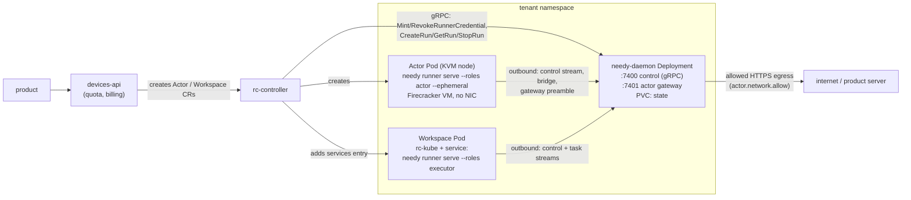
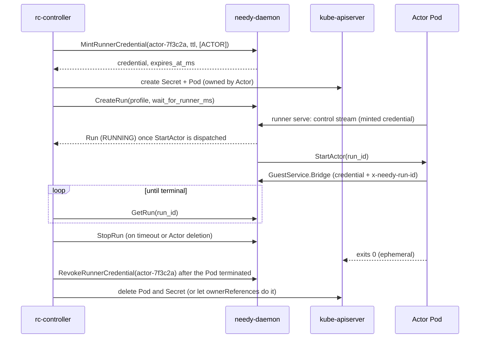

# Handoff: Integrating needy into `rc`

Status: **handoff**, 2026-11-26. Written for whoever implements needy
support in `rc` (the Kubernetes workspace orchestrator, Go and kubebuilder)
and in the managed IaaS `devices-api`. Every needy fact below was read from
needy's code at `ad4a146` (v0.0.17 plus B-1 #110 and B-2 #111) unless it is
marked otherwise; paths are relative to the needy repository unless they
name another one.

Evidence levels used here:

- **code**: read from the source at `ad4a146`; not exercised for this note.
- **probe**: a live probe on a Kubernetes cluster with KVM nodes, 2026-11-24
  and 2026-11-25: an EKS cluster's nested-virtualization pool and a
  self-managed cluster, both with binaries reporting `needy 0.0.16` (the
  self-managed cluster also ran builds of unreleased branches). A probe is
  not a support claim.
- **proposal**: a recommendation for `rc`; nothing in needy enforces it.

Related notes:

- [Needy on Kubernetes with `rc` and Managed IaaS](2026-11-23-kubernetes-rc-integration-design.md)
  (D1-D8; D1, D2, D4 and D5 stand, see its revision notice)
- [Remote actor host and runner ergonomics (Phase 1)](2026-11-23-remote-actor-host-and-runner-ergonomics-spec.md)
- [Image layers for remote actors](2026-11-25-remote-actor-images-spec.md)
- [One layered OCI base for VM and container actors](2026-11-25-layered-oci-base-spec.md)
- [Multi-machine guide](../../../guides/multi-machine.md)

## 1. Division of work and topology

Decided by the owner on 2026-11-26:

| Component | Owns | Does not own |
| --- | --- | --- |
| `rc` | needy on Kubernetes: one `needy-daemon` per tenant namespace (D5), an `Actor` resource whose reconciler mints a runner credential, runs one ephemeral actor runner Pod on a KVM node and calls `CreateRun` (D2, D3), and executor runners inside existing `Workspace`s through `spec.services` | needy's routing, gateway, traces or profile schema |
| `devices-api` (managed IaaS) | Creating `rc` resources (`Workspace`, and `Actor` once it exists), quota and billing | Talking to `needy-daemon` directly |
| The product | The product; talks to `devices-api` only | Kubernetes or needy |
| device-gateway | Unchanged for the MVP | |
| needy | The daemon, the runners, the actor VM, routing, gateway, traces | Kubernetes objects |

Out of the MVP: executors on users' own devices. They need a cluster
ingress that carries gRPC to the tenant's daemon (D7), and nobody owns one
yet.



Every connection is outbound from a runner to the daemon; runners never
listen (`crates/daemon/src/runner.rs`, module comment). The actor VM has no
network interface; its HTTP and HTTPS go through the runner's vsock proxy to
the daemon's gateway, which applies `actor.network`
(`crates/daemon/src/actor_runner.rs:1-12`, `crates/daemon/src/gateway_tcp.rs:1-19`).
The actor's egress therefore leaves from the **daemon's** Pod, not the actor
Pod.

## 2. The `needy-daemon` Deployment

### Flags (code)

`needy daemon serve` (`crates/cli/src/commands/daemon/mod.rs:51-86`):

| Flag | Use on Kubernetes |
| --- | --- |
| `--listen tcp://0.0.0.0:7400` | The control API for `rc` and runners. Repeatable. The private management socket always exists as well. |
| `--gateway-listen tcp://0.0.0.0:7401` | The shared, authenticated actor gateway for remote actor runners. Without it a remote actor has no network. |
| `--gateway-block-cidr CIDR` | Repeatable. Blocks gateway egress to these ranges in addition to the defaults (loopback, link-local including `169.254.169.254`, ULA including `fd00:ec2::254`, unspecified; `crates/core-actor/src/sidecar/gateway/egress.rs:112-144`). Pass the cluster's pod, service and VPC ranges. |
| `--runners-file PATH` | Static runner credentials, hot-reloaded (section 4). |
| `--disable-host-files` | Refuses every `host:` file mapping (copy-in, mirror-out, sync, host workspaces). Always set it: `host:` would be the daemon Pod's own filesystem. |
| `--host-files-root DIR` | Alternative to the above: confines `host:` to one tree. |
| `--heartbeat-interval DURATION` | Runner heartbeat interval; default 15 s (`crates/config/src/global.rs:99`). A runner is online while a heartbeat arrived within three intervals (`proto/needy/v1/runner.proto`, `RunnerStatus`). |
| `--layer-registry REPOSITORY` | Since #112 (B-3). Pulls and pushes built image steps as ordinary OCI images (`[http://]HOST[:PORT]/PATH`). |
| `--insecure-registry HOST[:PORT]` | Since #112 (B-3). Skips TLS verification for one registry host. |

There is no daemon flag for a control token (`--token-env` in
`docs/TERMS_AND_CONCEPTS.md` describes a flag that no longer exists; the
CLI passes `None` at `crates/cli/src/commands/daemon/mod.rs:228`). See
section 3.

### Directories (code)

needy uses XDG directories, each overridable by an environment variable
(`crates/cli/src/paths.rs:10-40`):

| Variable | Default | Holds | Recommendation |
| --- | --- | --- | --- |
| `NEEDY_STATE_DIR` | `$XDG_STATE_HOME/needy` | `state.db` (runner and client registries, runs, instances), `trace.db`, `runs/<id>/` (profile, console log, snapshot) (`crates/daemon/src/lib.rs:325-329`) | **PVC.** Losing it loses paired clients, minted runners and every run's history. |
| `NEEDY_DATA_DIR` | `$XDG_DATA_HOME/needy` | `images/linux-firecracker/base` (the base VM image), `guest/` (guest disks), `image-store/` commit layers (`crates/cli/src/paths.rs:84-103`, `crates/daemon/src/image/mod.rs:86-88`) | emptyDir is enough for the MVP; the base image is pulled again at start. |
| `NEEDY_CACHE_DIR` | `$XDG_CACHE_HOME/needy` | `image-store/`: built layers, snapshots, cache keys; remote actor runners fetch a run's layers from here (`GuestService.FetchLayer`) | PVC if runs use image definitions before #112; emptyDir once a layer registry refills it. |
| `NEEDY_RUNTIME_DIR` | `$XDG_RUNTIME_DIR/needy`, else the state directory | `daemon.sock` (management socket) | A `0700` subdirectory of an emptyDir (`medium: Memory`), so the socket is not on the PVC; the daemon refuses a directory others can read (`discovery.invalid_record: runtime directory must be private`, `crates/daemon/src/discovery.rs`), and an emptyDir itself is `0777`. |

Use `strategy.type: Recreate` and one replica: `state.db` is SQLite on a
ReadWriteOnce volume (D5).

### The base VM image on a daemon without KVM (code)

The daemon needs the base VM image's files even without `/dev/kvm` when a
remote run uses an image definition (`actor.image` with layers or
features): the plan's cache keys and the runner's root check name the
base's digest. Without it the create fails with
(`crates/daemon/src/image/build.rs:419-424`, added by #108):

> a remote actor's image is planned on this control daemon's base VM image;
> on a control host without KVM, get it with
> `needy image pull --driver linux-firecracker`

Profiles without `actor.image` do not need it. Run
`needy image pull --driver linux-firecracker` before `daemon serve` (an init
step or the container command) as the daemon's user; it downloads the
release asset of the binary's own version (`crates/cli/src/commands/image/pull.rs:43,79-82`),
about 81 MB for v0.0.17 (`gh release view v0.0.17`). `--file ARCHIVE`
imports a mirrored archive instead.

Also note (code): a daemon without KVM cannot build image steps for remote
actors; a step not in its layer store fails the create
(`crates/daemon/src/image/build.rs:398-409`, `TODO(remote-build)`). Without a
layer registry that leaves base-image profiles only, unless the layer store
already holds the steps; with a layer registry (#112) a builder on a KVM node
pushes the steps and the daemon pulls them.

### User, ports, readiness (code and probe)

- Run as uid 1000, non-root. Nothing in the daemon needs root or KVM.
- Ports: 7400 (control, gRPC over h2c) and 7401 (actor gateway). One
  ClusterIP Service with both.
- Readiness: `tcpSocket` on 7400. needy's health service is
  `needy.v1.HealthService/Check` (public, no token), not
  `grpc.health.v1.Health`, so Kubernetes' built-in gRPC probe does not fit.
- The listeners are plaintext TCP; there is no in-process TLS listener
  (`crates/config/src/global.rs:148-169`: a listener must be `tcp://`).
  Bearer tokens and runner credentials cross the pod network in the clear;
  NetworkPolicies (section 8) or a mesh's mTLS must protect them.
- With the management socket present, a TCP listener requires a credential
  on every call except `HealthService/Check`, `RunnerService/Join` and
  `ClientService/Pair` (`crates/api-server/src/server.rs:463-473`,
  `crates/api-server/src/middleware/authentication.rs:15-24,100-146`).

### What a daemon restart does to running actors (code)

Treat a daemon restart as failing every live run; nothing is resumed on
Kubernetes:

1. On the runner side, a broken bridge stream stops the VM and returns an
   error (`crates/daemon/src/actor_runner.rs`, the `bridge_stream.message()`
   arms of `run_actor`); an `--ephemeral` runner then exits
   (`crates/daemon/src/runner.rs:742-778`).
2. On the daemon side, the next start reconciles open runs. A run whose
   runtime holder cannot be adopted is marked `FAILED` with "the original
   runtime holder or actor was lost; continuity could not be verified"
   (`crates/daemon/src/reconcile.rs:145-215`). The holder is a child process
   in the daemon's container, so a container restart takes it too.
3. Executor runners keep a run's processes for 120 s after losing the
   daemon, then end them (`DISCONNECT_GRACE`, `crates/daemon/src/runner.rs:74`);
   when they reconnect, the daemon ends the processes of runs that are no
   longer live.

This matches D5's "fail fast" contract. `rc` should mark the `Actor` failed
when `GetRun` reports `FAILED` or the daemon's run is gone.

### Example (proposal)

```yaml
apiVersion: v1
kind: PersistentVolumeClaim
metadata: { name: needy-daemon-state, namespace: tenant-a }
spec:
  accessModes: [ReadWriteOnce]
  storageClassName: gp3          # zone-matched, per D5
  resources: { requests: { storage: 2Gi } }
---
apiVersion: apps/v1
kind: Deployment
metadata: { name: needy-daemon, namespace: tenant-a }
spec:
  replicas: 1
  strategy: { type: Recreate }
  selector: { matchLabels: { app: needy-daemon } }
  template:
    metadata: { labels: { app: needy-daemon } }
    spec:
      automountServiceAccountToken: false
      securityContext: { runAsUser: 1000, runAsGroup: 1000, runAsNonRoot: true, fsGroup: 1000 }
      containers:
      - name: daemon
        image: example.com/needy-runtime:0.0.18   # see section 5, "Delivering needy"
        command: [sh, -c]
        args:
        - |
          set -e
          # The runtime directory must be 0700 and owned by the daemon's uid
          # (crates/daemon/src/discovery.rs); an emptyDir is 0777, so use a
          # private subdirectory of it.
          mkdir -p -m 0700 "$NEEDY_RUNTIME_DIR"
          needy image pull --driver linux-firecracker -q   # only for image definitions
          exec needy daemon serve \
            --listen tcp://0.0.0.0:7400 \
            --gateway-listen tcp://0.0.0.0:7401 \
            --gateway-block-cidr 10.0.0.0/8 \
            --gateway-block-cidr 172.16.0.0/12 \
            --gateway-block-cidr 192.168.0.0/16 \
            --runners-file /etc/needy/runners/runners.yaml \
            --disable-host-files
        env:
        - { name: HOME, value: /home/needy }
        - { name: NEEDY_STATE_DIR, value: /var/lib/needy/state }
        - { name: NEEDY_CACHE_DIR, value: /var/lib/needy/cache }
        - { name: NEEDY_DATA_DIR, value: /home/needy/data }
        - { name: NEEDY_RUNTIME_DIR, value: /run/needy/private }
        ports:
        - { name: control, containerPort: 7400 }
        - { name: gateway, containerPort: 7401 }
        readinessProbe: { tcpSocket: { port: 7400 }, periodSeconds: 3 }
        securityContext: { allowPrivilegeEscalation: false, capabilities: { drop: [ALL] } }
        resources:
          requests: { cpu: 250m, memory: 512Mi }
          limits: { memory: 2Gi }
        volumeMounts:
        - { name: state, mountPath: /var/lib/needy }
        - { name: home, mountPath: /home/needy }
        - { name: runtime, mountPath: /run/needy }
        - { name: runners, mountPath: /etc/needy/runners, readOnly: true }
      volumes:
      - { name: state, persistentVolumeClaim: { claimName: needy-daemon-state } }
      - { name: home, emptyDir: {} }
      - { name: runtime, emptyDir: { medium: Memory } }
      # Mount the Secret as a directory, never with subPath: a subPath mount
      # does not receive updates, and the runners file is hot-reloaded.
      - { name: runners, secret: { secretName: needy-runners, defaultMode: 0440 } }
---
apiVersion: v1
kind: Service
metadata: { name: needy-daemon, namespace: tenant-a }
spec:
  selector: { app: needy-daemon }
  ports:
  - { name: control, port: 7400 }
  - { name: gateway, port: 7401 }
```

The probes ran the same flags in a bare Pod (probe). The Deployment, the
PVC split and the resource numbers are proposals; the probes' daemon asked
for 500m CPU and 1 GiB and was limited to 4 GiB.

## 3. How `rc` authenticates to the daemon

### What exists (code)

A request on the TCP listener is one of these callers
(`crates/api-server/src/middleware/authentication.rs:81-146`,
`crates/api-server/src/control.rs:22-39`):

| Credential | Caller | Reaches |
| --- | --- | --- |
| none, on the management Unix socket, same uid or root | `Operator` | everything |
| `needy-client.<id>.<64 hex>`, paired client token | `Client { access }` | `runs`: run and process calls; `admin`: also client and runner administration |
| `needy-runner.<name>.<64 hex>` | `Runner` | `Heartbeat`, `Control`, `Task` only |
| runner credential with `x-needy-run-id` | `Actor { run }` | the actor allowlist, for that run only (section 8) |

`MintRunnerCredential`, `RevokeRunnerCredential`, `CreateJoinToken`,
`RotateRunner` and `RemoveRunner` need an operator or an **admin** client
(`crates/api-server/src/protocol/grpc/v1/runner.rs:35-38,124-160`,
`crates/api-server/src/protocol/grpc/v1/mod.rs:67-81`). `CreateRun`,
`GetRun`, `StopRun` and the other run calls accept any paired client.

The only way to become a paired client is `ClientService.Pair` with a
pairing code, and the only way to make an **admin** pairing code is
`CreatePairingCode` from an operator or an existing admin client
(`crates/cli/src/commands/client.rs:111-141`). The operator exists only on
the management socket inside the daemon's Pod (`AuthLayer::owner`,
`crates/api-server/src/middleware/authentication.rs:226-244`). A client
token does not expire; it lives in `state.db` until revoked.

### What `rc` can do today (proposal, from code)

There is **no non-interactive way for a controller outside the daemon's Pod
to obtain an admin credential.** The workable bootstrap today is one exec
into the daemon's container, once per daemon (per PVC):

```sh
# as the daemon's user, inside its container (same NEEDY_* environment)
needy client invite --admin --name rc --ttl 5m -o json   # prints {"code": "needy-pair.…", …}
```

then, from `rc-controller`, `ClientService.Pair{code}` over TCP (no bearer
needed) returns `needy-client.<id>.<64 hex>`; store it in a Secret that only
`rc-controller` reads. This needs `pods/exec` on the daemon's Pods for
`rc-controller`, and must be repeated if the PVC is lost. Pairing again with
the same name replaces and revokes the earlier token
(`proto/needy/v1/client.proto`, `CreatePairingCodeRequest.name`).

### Static clients (`--clients-file`, G1)

**Gap G1** (a controller needs an admin credential it can provision before
the daemon starts) is closed by `needy daemon serve --clients-file PATH`
(needy-dev/needy#114, expected in v0.0.18; code, not yet released). The
file is hot-reloaded like the runners file, and unknown keys are errors at
every level:

```yaml
clients:
- name: rc                      # DNS label; the trace names it client:static-rc
  access: admin                 # admin | runs (default runs)
  token_hash: sha256:<64 hex>   # SHA-256 of the whole token; or `token:` in plain
```

The token is `needy-client.static-<name>.<64 hex>`: generate 32 random
bytes as hex, keep the full token in a Secret only `rc-controller` reads,
and put its hash in the daemon's Secret (mounted as a directory, never with
`subPath`). Removing or rotating an entry takes effect on the next request;
static clients are listed by `ListClients` and cannot be revoked through the
API. While the file holds a name, pairing that name is refused.

Until a release carries it, the interim workaround (probe, verified by the
`rc` session on a cluster) is: the management socket admits processes of
the daemon's own uid (peer credentials,
`crates/api-server/src/middleware/authentication.rs`), so a sidecar in the
daemon Pod that runs as the same uid and shares `NEEDY_RUNTIME_DIR` can run
`needy client invite --admin -o json` without `pods/exec`, and the
controller pairs with the code. `client invite` refuses a second invitation
for a name while one is open (`client.invitation_open`), so a failed `Pair`
blocks retries for the whole TTL: keep `--ttl` short (the `rc` session uses
`1m`).

### A Go client (proposal)

```go
type bearer string

func (b bearer) GetRequestMetadata(context.Context, ...string) (map[string]string, error) {
	return map[string]string{"authorization": "Bearer " + string(b)}, nil
}
func (bearer) RequireTransportSecurity() bool { return false } // h2c inside the cluster

conn, err := grpc.NewClient("dns:///needy-daemon.tenant-a.svc:7400",
	grpc.WithTransportCredentials(insecure.NewCredentials()),
	grpc.WithPerRPCCredentials(bearer(clientToken)))
runs := needyv1.NewRunServiceClient(conn)
runners := needyv1.NewRunnerServiceClient(conn)
```

Send exactly one `authorization: Bearer …` header; an empty or repeated one
is refused (`crates/api-server/src/middleware/authentication.rs:245-258`).

## 4. Runner credentials

A runner credential is `needy-runner.<name>.<64 hex>`: 32 random bytes after
a prefix naming the runner; the daemon stores only the SHA-256 of the whole
string (`crates/daemon/src/store/secret.rs:1-24,50-82`). A runner given
`--credential-file` or `--credential-env` takes its name from the
credential and never reads or writes `runner.json`
(`crates/cli/src/commands/daemon/runner.rs:56-75,206-222`). Names are DNS
labels, 1-63 characters (`crates/daemon/src/store/mod.rs:496-505`). Labels:
keys of 1-63 letters, digits, `.`, `_`, `-`, `/`; values of up to 63
letters, digits, `.`, `_`, `-` (`crates/daemon/src/store/mod.rs:512-523`).

### Static runners: `--runners-file` (code)

`crates/daemon/src/static_runners.rs`:

```yaml
# Either `runners: [...]` or a top-level list. Unknown keys inside an entry
# are errors; unknown keys next to `runners:` are ignored (untagged enum).
runners:
- name: ws-tenant-a-1
  # SHA-256 of the whole credential string, hex, optional "sha256:" prefix.
  # Or `credential: needy-runner.ws-tenant-a-1.<hex>` in plain text.
  credential_hash: "sha256:<64 hex>"
  roles: [executor]           # actor | executor; empty allows both
  labels: { rc.workspace: ws-tenant-a-1 }
```

- A plain `credential` must start with `needy-runner.<name>.`
  (`static_runners.rs:265-283`); exactly one of `credential` and
  `credential_hash`.
- Reloaded when the file's mtime, inode or size changes: every second by
  the maintenance task, and before each authentication and scheduling
  (`crates/daemon/src/runners.rs:27,36-68`; `static_runners.rs:96-191`). A
  Secret volume's atomic symlink swap changes the inode, so updates arrive
  after the kubelet syncs the volume (typically within a minute).
- Removing an entry or changing its credential closes that runner's control
  stream at the next reload. A file that fails to parse keeps the previous
  entries and logs a warning; a missing file removes them all.
- `MintRunnerCredential`, `RevokeRunnerCredential`, `RotateRunner` and
  `RemoveRunner` refuse static names (`crates/daemon/src/runners.rs:375-404`).

### Minted runners: `MintRunnerCredential` (code)

`proto/needy/v1/runner.proto`:

| Request field | Meaning |
| --- | --- |
| `name` | DNS label |
| `ttl_ms` | Required, positive; the credential expires `ttl_ms` after minting |
| `roles` | `RUNNER_ROLE_ACTOR`, `RUNNER_ROLE_EXECUTOR`; empty allows every role |
| `labels` | Applied to the runner |

The response has `runner`, `credential` (shown once), `expires_at_ms` and
`heartbeat_interval_ms`. `RevokeRunnerCredential{name}` revokes at once and
closes the runner's control stream. Admin only (section 3).

Semantics (`crates/daemon/src/store/mod.rs:275-309`,
`crates/daemon/src/runners.rs:74-96,375-404`):

- Minting a name that is held by a joined, unexpired runner fails
  (`RunnerExists`); a removed or expired one is replaced. Use a fresh name
  per `Actor` (for example `actor-<short uid>`).
- At expiry the daemon closes the runner's control stream and refuses the
  credential. The Node Authorizer only accepts an actor's calls while the
  runner's current control link is the one bound when the run started
  (`crates/daemon/src/run/mod.rs:1272-1283`), so an expiry mid-run cuts the
  actor off (derived from code; not exercised). **Set the TTL above the
  Actor's whole lifetime** (`activeDeadlineSeconds` plus start-up).

### Recommendation (proposal)

- **Actor Pods: minted credentials.** One per `Actor`, TTL bounded by
  `maxRunDuration` plus start-up, stored in a Secret owned by the `Actor`,
  revoked **after the actor Pod has terminated** (revoking earlier makes
  the ephemeral runner exit non-zero, `crates/daemon/src/runner.rs`, so a
  good run ends with a `Failed` Pod) or when the `Actor` is deleted.
- **Workspace executors: static entries.** Workspaces are long-lived; `rc`
  generates the credential itself (32 random bytes, hex, after
  `needy-runner.<name>.`), puts the plain value in the Workspace's Secret and
  its hash in the daemon's `needy-runners` Secret. No daemon round trip, and
  the entry survives a daemon restart or PVC loss.

## 5. The actor runner Pod

### Delivering needy (probe and gap)

needy is one static musl binary: `needy-x86_64-unknown-linux-musl.tar.gz`
(about 21 MB for v0.0.17) with a `.sha256` file holding the hex digest only
(`.github/workflows/release.yml:185-196`). Options:

1. An initContainer that downloads the release archive, checks the
   digest and unpacks it into an emptyDir (what the probes did, from GitHub
   or an in-cluster OCI artifact). This needs egress from the actor Pod at
   start, which conflicts with section 8's egress policy unless the source
   is in-cluster.
2. An image `rc` builds: a slim base (`debian:trixie-slim`), `ca-certificates`,
   the checked binary, and optionally the base VM image baked in (below).
3. A published needy image. None fits today: `needy-executor` (and
   `executor-base` from the next release) carries `/usr/local/bin/needy` but
   is a toolchain image of about 250 MB compressed for `linux/amd64`
   (`docker manifest inspect -v ghcr.io/needy-dev/needy-executor:v0.0.17`);
   `actor-base`'s `/.needy/needy` is an empty placeholder
   (`images/Dockerfile:136`).

**Gap G2: a slim needy runtime image** (`FROM scratch` or distroless plus
the static binary and CA roots, multi-arch, attested like `actor-base`)
would let `rc` reference a digest instead of building or downloading.

The base VM image (`vmlinux`, `rootfs.ext4`, `firecracker`; about 81 MB
compressed) comes from `needy image pull --driver linux-firecracker` into
`$NEEDY_DATA_DIR/images/linux-firecracker/base`. Firecracker attaches the
root file system read-only (`crates/core-actor/src/driver/linux_firecracker/config.rs:114-121`),
so it can also be baked into the runner image and named with
`--actor-image`, keeping `NEEDY_DATA_DIR` writable for guest disks (derived
from code; the probes pulled at start).

### Command (code)

```sh
needy runner serve \
  --address tcp://needy-daemon.tenant-a.svc:7400 \
  --credential-file /etc/needy/credential/credential \
  --roles actor \
  --ephemeral \
  --gateway tcp://needy-daemon.tenant-a.svc:7401 \
  --work-dir /home/needy/vm
```

`crates/cli/src/commands/runner.rs:131-176` (the flags; `crates/cli/src/commands/daemon/runner.rs` is the internal mirror) and
`crates/daemon/src/actor_runner.rs`:

- `--roles actor` with no usable KVM makes the runner exit with an error at
  start ("an explicitly requested runner role is unavailable on this
  machine"), a quick signal of a scheduling or permission problem.
- `--gateway` is the daemon's `--gateway-listen`. Without it the actor has
  no network.
- `--actor-image DIR` defaults to `$NEEDY_DATA_DIR/images/linux-firecracker/base`.
- `--work-dir DIR` holds `vm.json`, the vsock sockets and `console.log`; a
  temporary directory otherwise.
- Only `linux-firecracker` is accepted by a remote actor runner
  (`actor_runner.rs:70-72`).

### `--ephemeral` exit semantics (code)

`crates/daemon/src/runner.rs:741-800`:

- The runner takes the first `StartActor` and ignores later ones. When that
  actor ends, for any reason, the runner stops and exits.
- An `EndRun` before any actor was claimed also stops it.
- The exit code is **0 whether or not the actor succeeded**: `run_actor`'s
  error is logged, then the runner stops normally. A `Succeeded` Pod says
  nothing about the run; read `GetRun`.
- With no run ever scheduled, the runner waits forever. Set
  `activeDeadlineSeconds`.
- A refused credential (revoked, expired) ends the runner with an error, so
  the Pod fails.
- On `SIGTERM` (Pod deletion) the runner stops the VM gracefully and
  reports its exit before leaving (`actor_runner.rs`, the `stop.cancelled()`
  arm); prefer `StopRun`, which also runs mirror-out.

### KVM scheduling (probe)

- The KVM device is an extended resource whose name depends on the cluster:
  `example.com/kvm` on a managed IaaS's EKS `devices-kvm` pool (nodes
  labelled and tainted `example.com/kvm=true:NoSchedule`, 8th
  generation Intel families with nested virtualization, a
  generic-device-plugin DaemonSet), or `devic.es/kvm` with
  generic-device-plugin's default domain. `rc` should take the resource
  name, node selector and toleration from configuration, not hard-code them.
- The device plugin passes `/dev/kvm` with the node's owner and mode (the
  self-managed probe node had `0660 root:104`). A non-root container needs
  that gid in `supplementalGroups`. **The gid varies by node image**;
  discover it per pool with a one-shot Pod that holds the resource and runs
  `stat -c %g /dev/kvm`, and keep it in `rc`'s pool configuration. The
  probes added it at run time instead (`setpriv --groups 1000,$(stat -c %g /dev/kvm)`
  after a root setup step).
- No `privileged`, no added capabilities (probe: `privileged: false`).

### Resources (code and probe)

A VM without a recipe gets 2 vCPUs and 2048 MiB; a recipe sets its own
(`crates/core-actor/src/driver/mod.rs:401-403`). Size the Pod's memory
above the VM's plus the runner and Firecracker (the probes requested 4 GiB
and limited 6 GiB for the default VM) and its ephemeral storage for the
base image, guest disk and any image layers (the probes requested 10 GiB).

### Template (proposal)

```yaml
apiVersion: v1
kind: Secret
metadata:
  name: actor-7f3c2a-runner
  namespace: tenant-a
  ownerReferences: [{ apiVersion: rc.example.com/v1alpha1, kind: Actor, name: actor-7f3c2a, uid: "…", controller: true }]
type: Opaque
stringData: { credential: "needy-runner.actor-7f3c2a.<64 hex>" }   # from MintRunnerCredential
---
apiVersion: v1
kind: Pod
metadata:
  name: actor-7f3c2a
  namespace: tenant-a
  labels: { app.kubernetes.io/component: needy-actor }
  annotations: { karpenter.sh/do-not-disrupt: "true" }
  ownerReferences: [{ apiVersion: rc.example.com/v1alpha1, kind: Actor, name: actor-7f3c2a, uid: "…", controller: true }]
spec:
  restartPolicy: Never
  automountServiceAccountToken: false
  activeDeadlineSeconds: 7200            # maxRunDuration plus start-up
  terminationGracePeriodSeconds: 30
  nodeSelector: { example.com/kvm: "true" }          # from rc config
  tolerations:
  - { key: example.com/kvm, operator: Equal, value: "true", effect: NoSchedule }
  securityContext:
    runAsUser: 1000
    runAsGroup: 1000
    runAsNonRoot: true
    fsGroup: 1000
    supplementalGroups: [104]            # the gid owning /dev/kvm on this pool; see above
  containers:
  - name: runner
    image: example.com/needy-runtime:0.0.18      # same needy version as the daemon
    command: [sh, -c]
    args:
    - |
      set -e
      needy image pull --driver linux-firecracker -q    # or bake it in and pass --actor-image
      exec needy runner serve \
        --address tcp://needy-daemon.tenant-a.svc:7400 \
        --credential-file /etc/needy/credential/credential \
        --roles actor --ephemeral \
        --gateway tcp://needy-daemon.tenant-a.svc:7401 \
        --work-dir /home/needy/vm
    env:
    - { name: HOME, value: /home/needy }
    - { name: RUST_LOG, value: info }
    securityContext: { allowPrivilegeEscalation: false, capabilities: { drop: [ALL] } }
    resources:
      requests: { cpu: 1500m, memory: 4Gi, ephemeral-storage: 10Gi }
      limits: { example.com/kvm: "1", memory: 6Gi, ephemeral-storage: 20Gi }
    volumeMounts:
    - { name: home, mountPath: /home/needy }
    # Not under /var/run: on Debian-based images /var/run is /run, and a
    # read-only mount there makes /run/needy read-only for the runner.
    - { name: credential, mountPath: /etc/needy/credential, readOnly: true }
  volumes:
  - { name: home, emptyDir: {} }
  - name: credential
    secret: { secretName: actor-7f3c2a-runner, defaultMode: 0440, items: [{ key: credential, path: credential }] }
```

Differences from the probes, not verified on a cluster: running as uid 1000
from the first process (the probes set up as root, then `setpriv`), a
static `supplementalGroups`, and `capabilities: { drop: [ALL] }`.

## 6. Creating and following a run

### `CreateRunRequest` (code)

`proto/needy/v1/run.proto:45-106`:

| Field | Use from `rc` |
| --- | --- |
| `profile_yaml` | The profile, self-contained. The daemon resolves `extends: builtin:NAME` itself; a relative `extends` or `actor.recipe` path is resolved against nothing (`crates/daemon/src/run/mod.rs:1360-1373`). Send recipes as `recipe_yaml`. |
| `profile_name` | **Required.** The name in listings, traces and reports. |
| `name`, `group` | Free-form; names are not unique. Keep the returned `run_id`. |
| `actor_args` | Appended to `actor.command`. |
| `tty`, `wait_for_attach` | `tty` is a `WindowSize` (rows, cols) for a terminal `run attach` reaches; unset for headless agents (output goes to the console, `GetRunLogs`). |
| `wait_for_runner_ms` | How long the create waits for the named runners to connect. Use it so `CreateRun` can be sent as soon as the Pod exists. |
| `client_dir`, `client_execution` | Leave empty. |
| `image_commit`, `pinned_features` | From an image's lockfile, if `devices-api` keeps one. |

`CreateRun` returns after the daemon has placed everything, started the
executors, copied files in and **dispatched** `StartActor`
(`crates/daemon/src/run/mod.rs:629-683,784-940`); the run is `RUNNING`
before the VM boots. Give the call a deadline above `wait_for_runner_ms`
plus image preparation. A failed create is also kept as a `FAILED` run.
There is no idempotency key: a retried `CreateRun` makes a second run.

### The profile `rc` sends (code and proposal)

```yaml
extends: builtin:codex                 # optional; note that extends replaces lists, so
                                       # actor.network.allow below replaces codex's ["*"]
user: { name: agent, uid: 1000, gid: 1000 }
actor:
  driver: linux-firecracker
  runner: actor-7f3c2a                 # injected by rc: the minted runner's name
  network:
    allow: [api.example.com, "*.example.com"]   # the product server and model APIs
    services:
      product: { url: "http://product.product-ns.svc:8080" }   # in the actor: http://product.needy
  workspace:
    path: ~/workspace
    from: "executor:ws:~/project"
    writable: true
executors:
  ws: { runner: ws-tenant-a-1, driver: native }  # injected by rc
commands:
  - { match: "git **", to: ws }
  - { match: "{bash,sh} **", to: ws }
```

- **`rc` must own every `runner:` field.** A missing `actor.runner` or
  `executors.<name>.runner` places that part on the control host, which is
  the daemon's own Pod (`crates/daemon/src/schedule.rs:272-277`): an actor
  there fails without KVM, and a native executor there runs commands next
  to `state.db`. Reject profiles that leave one unset, or call
  `CheckProfile` first and refuse it when the actor `Placement` is unset, an
  executor is missing from `executors`, a `Placement`'s `runner` is empty,
  or any finding explains an unresolved selector (`proto/needy/v1/run.proto`,
  `CheckProfileResponse`).
- **Wait for the runner before `CheckProfile`.** A freshly minted runner
  that has never connected lists as `online` with empty capabilities for a
  few heartbeats, and `CheckProfile` then fails with `cannot host
  actor(linux-firecracker): it has none` (probe, observed by the `rc`
  session). Wait until `ListRunners` shows it `online` **and** its
  `capabilities.actor` contains `LINUX_FIRECRACKER`, then `CheckProfile`,
  then `CreateRun`. **Gap G7:** a minted runner should read offline until
  its first `Control` stream.
  **Gap G3:** the daemon has no switch that forbids control-host placement.
- `actor.network.allow` must name every host the agent reaches, including
  the product server it reports back to. HTTPS is tunnelled unmodified and
  resolved from the daemon's Pod, so `--gateway-block-cidr` also blocks
  in-cluster addresses named there.
- `actor.network.services` URLs bypass the gateway's egress policy
  (`crates/core-actor/src/sidecar/gateway/mod.rs:159-169`: `service_client`
  has no policy). Use them for in-cluster endpoints, and **never pass a
  user-supplied `services` map through**: it reaches anything the daemon's
  Pod can.
- `actor.workspace.from: executor:NAME:PATH` mounts the executor's
  directory over SFTP; see section 7.
- `actor.image` today: an image definition (layers, features) works for a
  remote actor when the daemon has or can obtain every step (section 2);
  or from a layer registry (#112). An OCI reference (`actor.image: REF`)
  is ignored for a remote actor (`crates/daemon/src/image/mod.rs:173-186`,
  `TODO(images)`); importing it is B-4.

### Following the run (code)

- `GetRun{run_id}` (an ID, an ID prefix or a name; `crates/daemon/src/run/mod.rs:436-475,596-624`)
  returns `Run`: `state`, `actor_state`
  (`STARTING`, `CONFIGURED`, `READY`, `EXITED`), `actor_exit` (the driving
  program's exit), `failure`, `last_activity_ms`.
- `RunState` (`proto/needy/v1/run.proto:166-175`): `CREATING`, `RUNNING`,
  `STOPPING`, then one of `FINISHED` (the driving program exited),
  `STOPPED`, `FAILED`.
- `last_activity_ms` advances on guest RPCs, gateway traffic, routing
  decisions and terminal or exec I/O; use it for an `Actor` `idleTimeout`.
- `StopRun{run_id, now, grace_ms}`: SIGTERM, then SIGKILL after the grace,
  then mirror-out; `now` skips both.
- `GetRunLogs{run_id, follow}` streams the console; `GetRunEvents{run_id}`
  streams the stored trace events (what `needy report` renders), for
  auditing or billing.

### Sequence (proposal)



## 7. Executor runners in a `Workspace`

`rc`'s `Workspace` already runs resident processes through `spec.services`:
exact argv, the Workspace's env plus `RC_KUBE_SOCKET`, restarted by
`rc-kube` with capped exponential backoff (rc at commit `2f4811a`:
`api/workspaces/v1alpha1/workspace_types.go:194-221,308`,
`internal/rckube/services.go:121-143`).

```yaml
services:
- name: needy-executor
  command:
  - needy
  - runner
  - serve
  - --address
  - tcp://needy-daemon.tenant-a.svc:7400
  - --credential-env
  - NEEDY_RUNNER_CREDENTIAL
  - --roles
  - executor
  - --labels
  - rc.workspace=ws-tenant-a-1
  - --activity-hook
  - rc-kube process touch
  env:
  - name: NEEDY_RUNNER_CREDENTIAL
    valueFrom: { secretKeyRef: { name: ws-tenant-a-1-needy, key: credential } }
automountServiceAccountToken: false
```

- `--activity-hook COMMAND` exists (`crates/cli/src/commands/daemon/runner.rs:40-43,97-106`;
  `crates/daemon/src/runner.rs:81-89,190-250`): `sh -c COMMAND`, fired
  asynchronously at most once per `--activity-hook-interval` (default 15 s)
  while exec streams carry traffic, which includes a workspace mount's SFTP
  stream. Failures are logged, never fatal. An idle mount or an agent that
  is thinking fires nothing, so a Workspace's `idleTimeout` can still
  suspend it under a live run; `rc` should also hold a Workspace busy while
  a run that routes to it is live (proposal).
- `rc-kube process touch` exists in `rc` (`internal/cli/rckube/cmd.go:288-306`)
  and postpones idle suspension.
- Native executors run commands as the runner's own user, which is the
  Workspace user; `~` in an executor path is that user's home (reported as
  `RunnerHost.home`).
- Workspace mounts (`from: executor:NAME:PATH`) start `sftp-server` on the
  executor at `/usr/lib/openssh/sftp-server` on Linux
  (`crates/core-executor/src/driver/mod.rs:168-175`): install
  `openssh-sftp-server` (Debian and Ubuntu) in Workspace images.
- `needy` must be on the Workspace image's `PATH`, at the daemon's version.

### 7a. Planned: one builder per namespace (proposal)

An `Actor`'s profile is the user's, so the Dev Container features above
`actor-base` are only known at run time. The daemon resolves them and
computes each step's cache key; a step neither in its layer store nor in the
layer registry must be built, and a control daemon without KVM cannot build
it (`TODO(remote-build)` in `crates/daemon/src/image/build.rs`).

Owner decision (2026-11-26): builds run in an **independently deployed
builder, one per namespace**, not in the actor runner and not through a
separate build system. Planned shape, to be specified with the slice that
implements it:

- A `needy-builder` Deployment on the KVM pool, 0..N replicas, running
  `needy runner serve --roles builder` (a new role) with a runner credential
  of the namespace's daemon. It builds steps in Firecracker sessions (same
  isolation and egress policy as actors) and pushes them to the namespace's
  layer registry.
- The daemon dispatches only the missing steps to a connected builder and
  waits for them, then pulls them from the layer registry; the first run of a
  new feature set waits for the build, so `rc` timeouts must allow for it.
- Credentials: the builder needs write access to the layer registry and read
  access to private feature registries; actor runners need read access only.
- `rc` owns the Deployment next to the daemon and may scale it to zero when
  idle (builds are rare once the cache is warm).

Until that slice lands, user-defined features work only when the layer
registry already holds every step (for example, built by CI or by a builder
run by hand with `needy image build` and `--layer-registry`).

## 8. Networking and security

### What the Node Authorizer guarantees (code)

- A runner credential alone reaches only `Heartbeat`, `Control` and `Task`
  (`authentication.rs:26-31,128`).
- With `x-needy-run-id`, it reaches only the actor allowlist (`GuestService`
  calls, `RunService/Decide`, `ProcessService/Exec`, `HealthService/Check`;
  `authentication.rs:37-53,281-283`), and only while that run is not
  terminal, is bound to this runner, and the runner's current control link
  is the one bound at start (`crates/daemon/src/run/mod.rs:1272-1283`).
- The TCP gateway authenticates the same pair from a
  `NEEDY-GATEWAY <credential> <run_id>` preamble (`gateway_tcp.rs:6-12,33-36`).
- The credential stays in the runner process; the VM reaches the daemon
  through host-side vsock proxies that add it (`actor_runner.rs:1-12,126-138`).
  A compromised guest cannot read it; a compromised actor Pod can act only
  as that one run's actor.

### Policies (proposal)

- Actor Pods: egress only to the daemon's 7400 and 7401 and to DNS. If needy
  or the base image is downloaded at start, that source must be allowed too,
  which is the reason to bake them in or serve them in-cluster (section 5).
  No ingress.
- Workspace Pods with an executor runner: egress to the daemon's 7400 (plus
  whatever the Workspace already needs).
- The daemon: ingress on 7400 from `rc-controller`, actor Pods and
  Workspace Pods; ingress on 7401 from actor Pods only. Egress to the
  internet for the gateway, to the layer registry (#112), to
  in-cluster services named in `actor.network.services`; deny the
  Kubernetes API, other namespaces and `169.254.169.254`. Pass the pod,
  service and VPC ranges as `--gateway-block-cidr` as well, because a
  NetworkPolicy does not stop the daemon from dialing its own loopback.
- `automountServiceAccountToken: false` on the daemon, actor and Workspace
  Pods; none of them talks to the Kubernetes API.
- Keep `--disable-host-files` on.
- Credentials cross the pod network in plaintext h2c (section 2).
  **Gap G4:** an in-process TLS listener, or document a mesh as required.

## 9. A Go client from needy's protos

needy's schemas are `proto/needy/v1/*.proto`, a Buf v2 module
(`proto/buf.yaml`); needy itself generates Rust (`proto/buf.gen.yaml`,
`make proto`). The files set no `go_package`, so use managed mode. This
template was generated and compiled (`go build ./...`, Go 1.27) against the
`v0.0.17` tag on 2026-11-26:

```yaml
# buf.gen.yaml in rc
version: v2
managed:
  enabled: true
  override:
    - file_option: go_package_prefix
      value: github.com/OWNER/rc/pkg/needy/gen   # rc's module path
inputs:
  - git_repo: https://github.com/needy-dev/needy.git
    tag: v0.0.17                                  # pin to the daemon's release
    subdir: proto
plugins:
  - remote: buf.build/protocolbuffers/go:v1.36.12
    out: pkg/needy/gen
    opt: paths=source_relative
  - remote: buf.build/grpc/go:v1.6.2
    out: pkg/needy/gen
    opt: paths=source_relative
```

Commit the generated code, as needy does, and regenerate when the daemon's
version changes. Every proto file starts with `EXPERIMENTAL / UNSTABLE`:
there is no wire compatibility promise in 0.0.x, so pin `rc`'s generated
client, the daemon image and the runner image to one needy release.
`proto/` did not change between `v0.0.17` and `ad4a146`.

## 10. Versions and known gaps

| Item | State |
| --- | --- |
| `--runners-file`, `--credential-file`/`--credential-env` | #92, in v0.0.15 |
| `MintRunnerCredential`, `--activity-hook`, `--wait-for-runner` | #93, in v0.0.15 |
| Image layers on remote actors (`FetchLayer`, root check) | #104, in v0.0.17 |
| Remote terminal wait, base-image hint | #108, in v0.0.17 |
| `actor-base`/`executor-base` published; root identity is the base's stack digest | B-1 #110, B-2 #111, merged after v0.0.17; first in the next release |
| Layer registry, standard registry auth and TLS | B-3 #112, merged |
| `actor.image: <OCI ref>` imported above the base | B-4, not started |
| `needy image build --push`, runners pulling from the import | B-5, not started |
| macOS drivers | Not relevant to the cluster |
| User-device executors | Need a cluster gRPC ingress (D7), unowned |

- **Same version for daemon and runners.** For image runs the runner
  refuses layers built on another base (`actor_runner.rs:355-369`), and B-2
  changed what the base's identity is. Pull the base image with the same
  needy version on both sides.
- Gaps found while writing this note (none implemented):
  - G1: no non-interactive admin credential for a controller (section 3);
    closed by `--clients-file` (#114, expected in v0.0.18).
  - G2: no slim needy runtime image (section 5).
  - G3: no switch to forbid control-host placement (section 6).
  - G7: a minted, never-connected runner lists as `online` with empty
    capabilities (section 6).
  - G6: routed commands map only the working directory between actor and
    executor paths; a literal actor path in arguments (for example
    `~/workspace/x`) is not translated (probe, observed by the `rc` session).
  - G4: no TLS on needy's listeners (sections 2 and 8).
  - G5: an `--ephemeral` runner exits 0 whatever the actor's outcome
    (section 5); an exit code reflecting the run would let Kubernetes
    status alone tell success from failure.
  - `docs/TERMS_AND_CONCEPTS.md` ("Control token") still describes
    `--token-env`, and `images/Dockerfile`'s `executor-base` `CMD` calls
    `needy daemon --mode executor`, which the CLI no longer parses; both are
    documentation or image follow-ups, not part of this handoff.

## 11. Checklists

### `rc`

- [ ] Configuration per KVM pool: resource name, node selector, toleration,
      `/dev/kvm` gid.
- [ ] Per namespace: `needy-daemon` Deployment (`Recreate`), PVC for
      `NEEDY_STATE_DIR`, Service (7400, 7401), `needy-runners` Secret mounted
      as a directory, NetworkPolicies.
- [ ] Bootstrap an admin client once per daemon (section 3) and keep its
      token in a controller-only Secret; switch to `--clients-file` when
      v0.0.18 is out.
- [ ] Upgrade the controller before anyone sets `Workspace` `spec.needy`:
      an older controller's typed `Update` drops the field.
- [ ] Generate a Go client from the pinned needy tag (section 9).
- [ ] `Actor` reconciler: validate and inject `runner:` fields → mint
      (TTL > lifetime) → Secret → Pod → `CreateRun` with
      `wait_for_runner_ms` → poll `GetRun` → `StopRun` on timeout or
      deletion → revoke → clean up. Status from `GetRun`, never from the
      Pod's exit code.
- [ ] Map daemon restarts to failed `Actor`s.
- [ ] `Workspace` executors: static runner entry (hash in the daemon's
      Secret, plain value in the Workspace's), a `services` entry,
      `openssh-sftp-server` and `needy` in the image, busy while a run uses
      it.
- [ ] Scale the daemon to zero only with no live run.

### `devices-api`

- [ ] Create `Actor` and `Workspace` resources only; never call the daemon.
- [ ] Keep profiles free of `runner:` fields and `actor.network.services`
      from users; let `rc` own them.
- [ ] Record quota and billing from the `Actor`'s status (and, if wanted,
      the run's trace through `rc`).
- [ ] Treat user-device executors as out of scope until an ingress exists.
